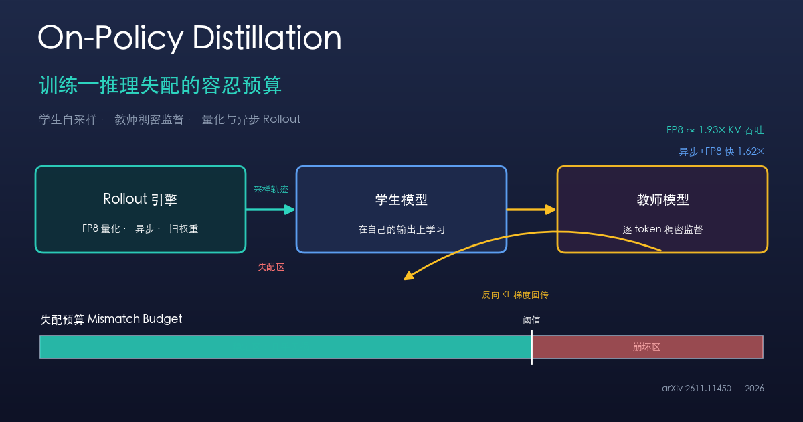

{: .center}

> 本文事实部分基于 arXiv 论文 *How Much Training-Inference Mismatch Can On-Policy Distillation Tolerate?*（arXiv:2611.11450，2026-11-08，代码见作者公开仓库）及公开的蒸馏/强化学习训练系统资料；带有「我的看法」「启示」字样的段落是我的分析与观点，请与事实区分阅读。

## 一、为什么现在值得关注 On-Policy 蒸馏

过去一年，大模型后训练（post-training）的路线逐渐收敛出三条主干：监督微调（SFT）、基于可验证奖励的强化学习（RLVR），以及介于两者之间的**On-Policy 蒸馏（On-Policy Distillation, OPD）**。

OPD 的核心直觉很简单：让**学生模型自己生成回答（on-policy rollout）**，再用一个固定的、更强的**教师模型**对学生生成的每一个 token 给出概率分布，学生据此最小化与教师分布的差异（通常是反向 KL）。它同时具备两个优点：

- 像 RL 一样，训练分布就是学生**自己会走到的分布**，避免了 SFT 「只学别人轨迹、自己一跑就崩」的分布漂移问题；
- 又像 SFT 一样，拿到的是**逐 token 的稠密监督信号**，而不是 RL 那种一条轨迹只有一个稀疏标量奖励。信号密度高，样本效率往往比 RL 高一个量级。

换句话说，OPD 想要「RL 的 on-policy 分布 + SFT 的稠密梯度」。这让它在推理蒸馏、小模型对齐、把大模型能力压缩进可部署规模等场景里越来越流行。

## 二、被忽视的成本：训练—推理失配

OPD 的瓶颈不在算梯度，而在**不停地让学生生成样本**。每一步都要跑一轮生成（rollout），这部分推理成本占了训练墙钟时间的大头。于是工程上自然会用两招来提速：

1. **量化推理**：rollout 用低精度（如 FP8、INT8）引擎跑，省显存、提吞吐；
2. **异步 rollout**：生成和参数更新解耦，生成引擎用的是「稍旧的权重」（weight staleness），这样 GPU 不必互相等待。

问题在于：这两招都会让**「负责生成样本的模型」和「正在被训练、算梯度的模型」不再是同一个分布**。生成引擎看到的是量化后的、或者过期的权重，而反向传播更新的是全精度的当前权重。这种差异就是**训练—推理失配（training-inference mismatch）**。

在强化学习里，这类失配是出了名的「定时炸弹」：它会让重要性采样比值失真，使 off-policy 修正失效，训练曲线突然崩塌。正因为如此，RL 系统往往对 rollout 引擎的精度和权重新鲜度要求极严。但 OPD 和 RL 的损失结构不同——它是**逐 token 对齐教师分布**，而不是用标量奖励做策略梯度。那么同样的失配，OPD 到底扛不扛得住？这正是这篇论文要回答的问题。

## 三、论文做了什么：把失配放到同一把尺子上量

这篇工作的方法论亮点，是**把所有失配来源折算到同一个标度上测量**，从而能横向比较「量化带来的失配」「权重过期带来的失配」「人为注入噪声带来的失配」各自有多大、各自伤害多少训练质量。

具体实验设置（事实）：

- 在**三组学生—教师组合**上测试量化带来的失配；
- 在其中一组上额外测试**权重过期（staleness）**与**人为注入权重噪声**；
- 观察训练质量随失配量变化的曲线，定位崩坏发生的位置与机理。

## 四、关键发现

### 1. 存在一条「失配预算」

最核心的结论：**OPD 能容忍相当可观的失配而几乎不掉点，但超过某个水平后质量就会明显退化。** 这意味着失配不是「有无」的二元问题，而是一个有上限的**预算（budget）**——预算之内近乎免费，越过阈值则迅速崩坏。

这和直觉里的「低精度一定掉点」不同：在阈值以内，FP8 rollout 的训练质量与 BF16 基本无差别。对工程团队来说，这条线的存在意味着「省钱」有明确的安全边界，而不是靠玄学调参。

### 2. 失配的代价与模型、甚至具体层都相关

论文发现，**失配造成的质量损失，以及量化引入的失配量，都是「模型相关」的**：不同的学生—教师组合，容忍度不一样；更细地看，**某些层对降精度格外敏感**。也就是说，均匀地把全网络压到 FP8 未必最优，真正的做法是识别出敏感层、给它们留更高精度。

### 3. OPD 比 RL 更「皮实」

在受控对比中，**一些会让 RL 方法崩溃的 rollout 配置，OPD 仍然保持稳定**。这为「OPD 比 RL 更适合激进的系统级提速」提供了直接证据：同样的异步/量化方案，RL 可能翻车，OPD 还能稳稳训练。

### 4. 权重噪声会「改变前缀」，这是逐 token 修正补不回来的

一个很有意思的机理发现：在权重噪声下，失配不仅扰动单个 token 的概率，还会**改变生成过程中实际走到的前缀（prefix）**。一旦生成轨迹本身被带偏到别的路径上，**逐 token 的修正（per-token correction）是补不回来的**——因为你修正的是「错误路径上的 token」，而不是把路径拉回正轨。这解释了为什么某些失配特别致命：它污染的是采样轨迹的走向，而非局部数值。

### 5. 把发现变成工具：轻量准入检查 + FP8 配方

论文没有停在观察，而是给了两样可直接用的东西（事实）：

- **轻量准入检查（admission check）**：针对校准好的失配预算，**筛查某个 rollout 配置是否越线**，而**不需要为每个候选配置都跑一次完整训练**。这把「要不要用这套加速方案」从昂贵的试错，变成一次便宜的前置体检。
- **模型专属 FP8 配方**：在保持训练质量的前提下，FP8 相比 BF16 可提供**约 1.93 倍的 KV-cache token 容量**；把 FP8 与异步 rollout 结合，达到同等训练质量的时间比同步 BF16 **快约 1.62 倍**。

## 五、和同类方案的对比（我的梳理）

| 维度 | SFT / 离线蒸馏 | On-Policy 蒸馏 (OPD) | RLVR / 策略梯度 |
|------|----------------|----------------------|------------------|
| 训练分布 | 教师/数据的分布（off-policy） | 学生自己的分布（on-policy） | 学生自己的分布（on-policy） |
| 监督信号 | 逐 token，稠密 | 逐 token，稠密（教师分布） | 轨迹级标量奖励，稀疏 |
| 样本效率 | 高，但有分布漂移 | 高，且无漂移 | 较低，需大量 rollout |
| 对失配的敏感度 | 基本无（不采样自身） | **中等，有可用预算** | **高，易崩** |
| 适合激进量化/异步 | 不涉及 | 较适合 | 风险大 |
| 依赖 | 需要教师 logits | 需要教师 logits | 只需奖励函数 |

> 我的看法：这张表揭示了 OPD 真正的生态位——它继承了 on-policy 的分布优势，又因为用的是稠密的分布对齐损失，而不是脆弱的重要性采样策略梯度，所以对系统级失配更宽容。这意味着「为了省钱而激进地量化/异步」这条路，在 OPD 上比在 RL 上好走得多。缺点也很明显：你必须拿得到教师的逐 token 分布（logits），这在只有 API、拿不到 logits 的闭源教师上行不通。

## 六、应用场景

- **推理能力蒸馏**：把大模型的长链思考能力压进小模型，OPD 的稠密信号比 RL 更省样本；
- **可部署规模的模型对齐**：在 7B/14B 这类要上线的模型上做后训练，OPD + FP8 能显著降本；
- **训练基础设施选型**：有了「失配预算 + 准入检查」，团队可以在开训前就决定用多激进的量化和多大的异步度；
- **显存受限环境**：FP8 带来近 2 倍的 KV-cache 容量，等价于更长的上下文或更大的并发 rollout。

## 七、优点与局限

**优点**

- 第一次把 OPD 的失配容忍度**定量化**，给出可操作的「预算」概念；
- 准入检查把「选配置」从跑完整训练的昂贵试错，降为一次便宜的前置检查；
- 明确了 FP8/异步的真实收益（1.93×、1.62×），对做基础设施的人极有参考价值；
- 揭示了「前缀漂移」这一逐 token 修正补不回的失败模式，有机理深度。

**局限（含我的判断）**

- 实验规模主要是三组学生—教师对、单组做深入消融；**更大模型、更多任务上的可迁移性仍待验证**；
- 「失配预算」是经验阈值，**换模型、换任务可能要重新校准**，准入检查的校准成本没有完全消失；
- 依赖能拿到教师 logits，**对闭源 API 教师不适用**；
- 主要围绕量化与异步两类失配，**其他来源（如不同 kernel、不同推理框架的数值差异）**覆盖程度有限。

## 八、给读者的可落地建议

如果你正在做蒸馏或后训练的训练系统，这篇论文给的启示可以直接转成行动清单：

1. **别把低精度当禁区**：OPD 下 FP8 rollout 在预算内几乎不掉点。先假设「可以用 FP8」，再去验证是否越线，而不是默认用 BF16。
2. **开训前先做准入检查**：用一次廉价的失配评估判断你的量化+异步组合在不在预算内，避免训到一半才发现崩了。
3. **量化要分层，不要一刀切**：找出对精度敏感的层，给它们保留更高精度，其余压到 FP8，收益最大。
4. **优先把「省钱预算」花在异步 + FP8 的组合上**：论文显示两者叠加能到 1.62× 提速，比单独一项更划算。
5. **警惕权重过期/噪声导致的前缀漂移**：如果发现 off-policy 修正怎么都救不回来，不要只在 token 级别找 bug，要怀疑是采样轨迹本身被带偏了——降低权重 staleness 或收紧异步度。
6. **如果你在做 RL 且被失配折磨**：评估一下任务能不能改用 OPD。只要能拿到教师 logits，OPD 往往对同样的系统级加速更宽容。

> 我的总体判断：这类工作代表了 2026 年 LLM 训练的一个重要转向——**从「堆算力」转向「量化地理解训练动力学，再据此压榨系统效率」**。「失配预算」是个很好的抽象：它把一个模糊的工程直觉（低精度大概还行吧）变成了可测量、可校准、可自动化检查的量。对大多数没有无限 GPU 的团队来说，这种「先画安全线、再在线内激进提速」的范式，比盲目追更大模型更有现实价值。

## 参考

- *How Much Training-Inference Mismatch Can On-Policy Distillation Tolerate?* arXiv:2611.11450（2026-11-08），作者公开了代码仓库。
- 相关背景：On-Policy 蒸馏作为介于 SFT 与 RLVR 之间的后训练范式，以及强化学习中训练—推理失配对稳定性的影响（公开训练系统资料）。

*（本文技术细节以上述论文为准；文中标注「我的看法/判断/启示」的内容为作者个人分析，不代表论文原文结论。）*

