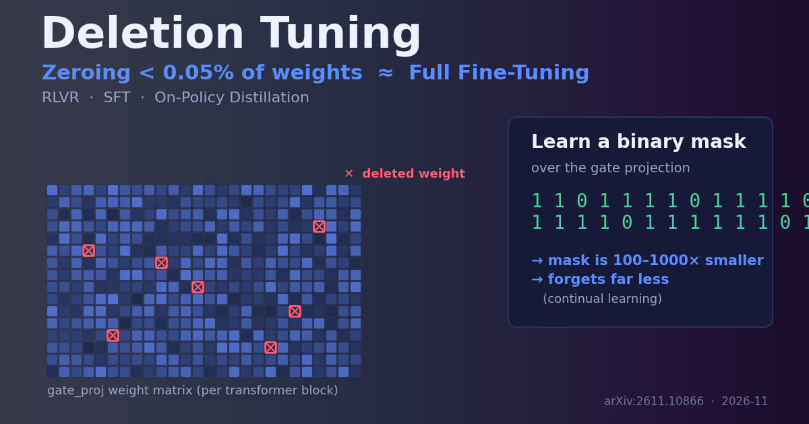

{: .center}

> 本文事实部分基于 arXiv 论文 *The Surprising Effectiveness of Deleting Weights in LLM Post-Training*（arXiv:2611.10866，2026-11-07，作者 Jack Lu、Zhenbang Yang、Mike Lasby、Tejas Pote、Yani Ioannou、Mengye Ren）及公开的参数高效微调（PEFT）资料。带「我的看法」「启示」字样的段落是我的分析与观点，请与事实区分阅读。

## 一、一个让人想反复确认的结论

后训练（post-training）这几年几乎是大模型能力增长的主战场：SFT 教格式与知识，RLVR（基于可验证奖励的强化学习）逼出推理，On-Policy 蒸馏（OPD）用教师分布压缩强模型的能力。它们的共同前提似乎是——**要让模型学会新东西，就得改动大量权重**。全量微调（Full Fine-Tuning, FFT）动全部参数，LoRA 退一步只训练低秩增量，但本质仍是「往权重里加东西」。

这篇论文把问题反过来问：**一个预训练模型到底要「改变多少」才能获得新能力？** 答案出人意料——只把**不到 0.05% 的权重置零（zeroing），不做任何其他修改**，就能在 RLVR、SFT、OPD 三种后训练设定下追平全量微调。

注意这里的关键词是「删」而不是「加」：方法不引入任何新参数、不改变被保留权重的数值，只是决定**哪些权重变成 0**。作者把它叫做 **Deletion Tuning（删除式微调）**。

**我的看法**：这个结论之所以值得停下来确认，是因为它同时冲击了两个流行直觉。其一，我们默认「学习＝增加信息」，而这里的学习是「减少连接」；其二，我们默认 PEFT 的省，是省在「训练的参数少」，而 Deletion Tuning 省在「最终产物几乎没有新信息要存」——它学到的是一张掩码，而不是一堆浮点增量。

## 二、方法：在 gate_proj 上学一张二值掩码

Deletion Tuning 的技术核心只有一句话：**在 Transformer 每个块的门控投影（gate projection, gate_proj）上，学习一张二值掩码（binary mask）**，被掩掉的权重置零，其余保持预训练值不变。

几个细节值得展开：

- **为什么是 gate_proj？** 现代 LLM 的前馈层普遍用 SwiGLU 这类门控结构，形式约为 `down_proj( SiLU(gate_proj(x)) * up_proj(x) )`。`gate_proj` 决定了「每个中间通道以多大强度被激活」，相当于一个逐通道的软开关。在这里做稀疏，等价于**有选择地关闭某些隐藏通道的门**，对网络表达力的调控很直接，却不破坏 `up_proj` 承载的内容。
- **学的是离散开关，不是数值。** 掩码是 0/1 的，训练时通常要用可微松弛或直通估计（straight-through）让梯度流过离散选择，推理时固化为硬掩码。产物因此是「哪些位置被删」的集合，而不是稠密的权重差。
- **稀疏度极低。** 「不到 0.05%」意味着一个百亿参数模型里，真正被动的也就几十万量级的权重，且集中在 gate_proj 这一类矩阵上。

**我的看法**：选中 gate_proj 是这套方法的「题眼」。它不是在随便一层做稀疏，而是落在了控制信息流的阀门上——这既解释了为什么极小的改动能撬动端到端能力，也暗示门控结构本身可能是后训练中最「可塑」的部位。

## 三、关键证据：三类后训练上追平 FFT，还更「不健忘」

论文最有分量的两个结论：

1）**效果追平全量微调。** 在 RLVR、SFT、OPD 三种差异很大的后训练目标下，只删不到 0.05% 的 gate_proj 权重，整体任务表现都能匹配 FFT。能同时横跨「强化学习式的稀疏奖励」「监督式的密集信号」「蒸馏式的分布匹配」，说明这不是某个任务上的巧合，而是后训练本身的某种普遍性质。

2）**遗忘（forgetting）大幅更轻。** 在强化学习设定下，Deletion Tuning 对**旧任务（prior-task）的准确率几乎保持在基座水平**，而 FFT、LoRA、以及随机稀疏微调（random sparse fine-tuning）最多会掉 **5.4 个百分点**。这正好打在持续学习（continual learning）的痛点上：学新不忘旧。

**我的看法**：第二点比第一点更有现实价值。工业界真正怕的往往不是「新任务涨不涨」，而是「上线一个新能力，顺手把老本行搞退化了」。如果一张极稀疏的掩码天然带有「少动少坏」的保护，那它在反复迭代的产品模型上，价值会被低估。

## 四、为什么「只删」就够？——几何视角

作者没有停在「它有效」，而是去量化**学到的权重变化长什么样**，用三把尺子对比 Deletion Tuning、LoRA、随机稀疏与 FFT：

- **稳定秩（stable rank）**：权重更新矩阵的「有效维度」。它刻画改动是集中在少数方向，还是铺得很开。
- **谱漂移（spectrum drift）**：微调前后奇异值谱的移动程度，衡量对权重「能量分布」的扰动。
- **主权重重叠（principal-weight overlap）**：改动是否落在原本就重要（主成分）的权重方向上。

结论是：在这三项几何指标上，**Deletion Tuning 都比 LoRA、随机稀疏更接近全量微调**。换句话说，删掉少数 gate_proj 权重所引发的整体权重几何变化，和 FFT「同形」，而低秩增量或随机稀疏则偏离更远。

**我的看法**：这组分析把「惊讶」变成了「可理解」。它暗示 FFT 真正起作用的那部分，本就可能是低自由度、且落在主方向上的；既然如此，用一组离散开关去逼近这块「有效子空间」，自然比强行规定低秩结构（LoRA）或乱撒点（随机稀疏）更贴近真相。这也和近年「微调更新内在低秩/稀疏」的一系列观察呼应。

## 五、与同类方案的对比

| 维度 | 全量微调 FFT | LoRA | 随机稀疏微调 | Deletion Tuning |
| --- | --- | --- | --- | --- |
| 改动形式 | 全部权重数值 | 加低秩增量 A·B | 随机位置训权重 | 学一张二值掩码（只置零） |
| 新增参数 | 无（原地改） | 有（低秩矩阵） | 无 | 无（只有 0/1 掩码） |
| 产物体积 | 等于一个完整 checkpoint | 小 | 中 | 极小（比 FFT 小百到千倍） |
| 旧任务遗忘 | 较重（RL 下最多 −5.4） | 较重 | 较重 | 几乎不掉 |
| 与 FFT 几何相似度 | — | 远 | 远 | 最近 |
| 是否改变保留权重 | 是 | 否（叠加） | 是 | 否 |

> 表中 FFT 的遗忘与各方法几何距离均来自论文在强化学习设定下的对比；体积「百到千倍更小」指掩码相对 FFT checkpoint 的数量级。

**我的看法**：和 LoRA 比，Deletion Tuning 有一个容易被忽略的工程差异——**它不改变任何被保留权重的数值**。LoRA 合并后会在全模型上叠加一层增量，而删除式微调给出的是「在原模型上关掉哪些开关」。这让多技能组合、回滚、审计都更干净：一个能力＝一组被删位置，理论上更可叠加、可解释。

## 六、应用场景

- **持续学习 / 多任务迭代**：需要不断加新能力又不能退化旧能力的线上模型，Deletion Tuning 的「少动少忘」是直接收益。
- **海量定制与分发**：每个客户/任务只需存一张极小掩码而非完整 checkpoint，存储与分发成本量级下降，适合「一基座、千变体」的产品形态。
- **模型可解释与安全研究**：被删位置本身是研究对象，可用于定位「某能力依赖哪些门控通道」，为能力定位、消融、甚至可控遗忘提供抓手。
- **资源受限的后训练**：产物极小意味着更易做版本管理、A/B 与热更新。

## 七、优缺点与开放问题

**优点**：产物极小、几乎不遗忘、与 FFT 几何最接近因而效果稳、不污染原权重、天然可组合。

**需要注意的边界**：

- **论文规模与任务范围的外推要谨慎。** 「不到 0.05% 追平 FFT」是在其评测设定下成立的结论，换到更大改动幅度的领域迁移（如注入全新语言或知识）是否仍然成立，需要各自验证。
- **训练离散掩码并不「免费」。** 训练期仍要前向/反向整模型并优化掩码，省的是**产物与遗忘**，不是**训练算力**。别把它当成比 LoRA 更省训练的方法来预期。
- **推理加速不等于自动兑现。** 置零不等于结构化剪枝；要把 0.05% 稀疏转成真实时延收益，需要配套的稀疏 kernel，否则只是「数值为 0」而非「算得更快」。
- **只作用在 gate_proj。** 对非 SwiGLU 结构、或注意力主导的任务，是否需要换挂载点，仍是开放问题。

## 八、给读者的可落地收获

1. **先把它当「抗遗忘的微调」来用**：如果你的痛点是持续学习中旧能力退化，优先试 Deletion Tuning，而不是一上来追求训练提速。
2. **产物管理思路要换**：把「一个能力」存成「一组被删权重的索引」，用掩码做版本与组合，别再默认每个变体都要一份完整权重。
3. **别误判它省在哪**：省的是存储与遗忘，训练算力并不少。预算评估时分清这两笔账。
4. **想要时延收益，配稀疏 kernel**：评估端侧/推理收益前，先确认推理栈能把稀疏真正算快。
5. **迁移前先做几何体检**：论文的稳定秩/谱漂移/主权重重叠是很好的诊断工具；换领域时用它判断你的更新是否仍「像 FFT」，能提前预警失效。
6. **把 gate_proj 当成后训练的高价值旋钮**：无论是否采用删除式微调，这项工作都提示门控投影是能力塑形的关键部位，值得在你自己的 PEFT 设计里重点关注。

## 参考

- Jack Lu, Zhenbang Yang, Mike Lasby, Tejas Pote, Yani Ioannou, Mengye Ren. *The Surprising Effectiveness of Deleting Weights in LLM Post-Training.* arXiv:2611.10866, 2026-11-07.
- 背景概念：SwiGLU 门控前馈、LoRA 低秩微调、RLVR、On-Policy 蒸馏、持续学习中的灾难性遗忘（公开资料）。

> 声明：本文对论文数值的转述以原文为准；文中「我的看法／启示」为作者个人分析，可能有误，欢迎指正。
