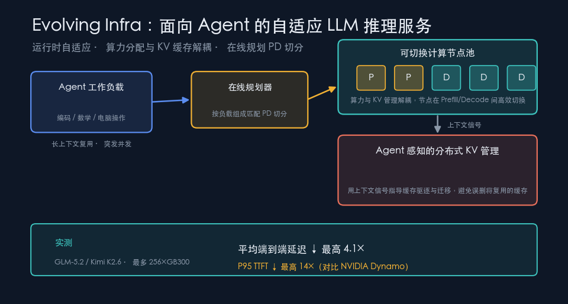

{: .center}

> 本文事实部分基于 arXiv 论文 *Evolving Infra: Agent-Adaptive LLM Serving at Scale*（arXiv:2611.12304，2026-11-09，作者 Hao Kang、Weili Xu、Ziyang Li、Zheng Du、Hanchen Li、Tian Xia、Song Bian、Tushar Krishna、Huizi Mao、Ion Stoica、Song Han 等）及公开的 LLM 推理服务（Prefill/Decode 分离、KV 缓存、PagedAttention、Dynamo 等）资料。带「我的看法」「启示」字样的段落是我的分析与观点，请与事实区分阅读。

## 一、问题换了，系统却没换

这两年谈大模型，大家的注意力多在训练和后训练：预训练配方、RLHF、蒸馏、各种参数高效微调。但真正把 GPU 账单推上去的，其实是**推理**，而且是一种新形态的推理——Agent。

一个编码 Agent 解决一个 issue，可能要读代码、跑测试、看报错、再改代码，循环十几甚至几十轮；一个「电脑操作」（computer-use）Agent 点一步看一步，上下文越滚越长。和传统的「一问一答」相比，Agent 负载有三个很不一样的特征：

- **轮次多、上下文长**：同一个会话里，前面生成的 KV 缓存后面还要反复用到，缓存的「复用价值」极高。
- **突发且不均衡**：有时集中在读入（长 prompt、工具返回的大段文本），有时集中在生成（长推理链），负载的「形状」一直在变。
- **异构任务混跑**：编码、数学、电脑操作同时在一个集群里，各自的 prefill/decode 比例完全不同。

论文的核心判断是：现有的 **Prefill/Decode 分离（PD disaggregation）**服务系统，是为相对稳定的负载设计的，面对 Agent 这种「活的」负载时**运行时适应能力不足**，于是出现两类顽疾——PD 节点之间负载失衡，以及把 Agent 马上要复用的 KV 缓存给驱逐掉了。

## 二、先补课：PD 分离与它的「死板」在哪

LLM 推理分两个阶段，特性截然不同：

- **Prefill（预填充）**：把整个输入 prompt 一次性过一遍，算出全部 token 的 KV 缓存。它是**计算密集**的，一次吃进很多 token，GPU 算力拉满。
- **Decode（解码）**：一个 token 一个 token 往外吐，每步都要读取之前所有 token 的 KV 缓存。它是**访存/显存密集**的，算力利用率低，但对延迟敏感。

把两者混在同一张卡上，会互相干扰：长 prefill 一来，正在解码的请求就被卡住，首 token 延迟（TTFT）飙升。于是业界主流做法是 **PD 分离**——拿一批节点专做 prefill，另一批专做 decode，prefill 算完把 KV 缓存传给 decode 节点。vLLM、SGLang、以及 NVIDIA 的生产级框架 **Dynamo** 都走这条路线。

问题在于，这套架构通常把「一个节点是 prefill 还是 decode」在部署时就大致定死，运行时即便能调，调整也偏粗：

1. **PD 切分比例难随负载走**。某一刻大量长 prompt 涌入，prefill 节点排长队，decode 节点却闲着；下一刻又反过来。固定或半固定的切分无法跟上这种摆动，于是**负载失衡**。
2. **KV 缓存管理用的是『粗信号』**。缓存显存不够时要驱逐，传统策略（如 LRU）只看「最近是否用过」，并不知道这段缓存属于哪个 Agent 会话、会不会马上被下一轮复用。结果**把高复用价值的缓存误删**，Agent 下一轮又得重算，既慢又浪费。

> 我的看法：这其实是「系统抽象」和「负载语义」之间的断层。推理系统看到的是 token 流和显存页，而 Agent 的真实结构是「会话—轮次—工具调用」。系统不知道上层语义，就只能用保守的、粗粒度的策略兜底。Evolving Infra 的价值，本质是把上层语义「喂」回底层系统。

## 三、Evolving Infra 做了什么

论文提出 **Evolving Infra**，一个「Agent 自适应」的服务框架，核心是三件事。

### 1）把算力分配与 KV 缓存管理解耦

这是整篇文章的地基。传统设计里，「这台节点是 prefill 还是 decode」往往和「它上面存着谁的 KV 缓存」绑死，所以想重新分配算力，就得连带搬迁缓存，代价高、不敢频繁做。

Evolving Infra 把这两件事拆开：**计算角色（做 prefill 还是 decode）可以独立切换，而不被它当前持有的 KV 缓存钉死**。于是节点能根据当下负载，在 prefill 和 decode 两种角色间**高效切换**，而不必每次都付出大规模缓存搬运的代价。这让「运行时重新分配算力」从一件奢侈的事变成可以经常做的事。

### 2）在线规划器：让 PD 切分跟着负载组成走

在解耦的基础上，一个**在线规划器（online planner）**持续观察当前的负载组成（有多少 prefill 需求、多少 decode 需求、任务类型如何），动态决定 PD 切分比例，把节点配置对齐到真实负载上。长 prompt 高峰来了就多拨些节点做 prefill，长生成高峰来了就反过来。

### 3）Agent 感知的分布式 KV 管理

另一半是一个**Agent 感知的分布式 KV 管理器**。它不再只用「最近用没用过」这种粗信号，而是**接收来自 Agent 上下文管理的信号**，据此指导缓存的驱逐与迁移——哪些缓存属于还在活跃的会话、下一轮大概率会复用，就尽量保留或提前搬到合适的位置；哪些确实可以丢，再丢。目标就是避免把「Agent 马上要用的缓存」误删。

把三者连起来看：解耦提供了「能频繁调」的能力，在线规划器负责「算力怎么调」，Agent 感知的 KV 管理负责「缓存怎么留」。前者治负载失衡，后者治缓存误删——正好对上第二节的两类顽疾。

## 四、实测效果

论文在三类代表性 Agent 任务上评测：**编码、数学、电脑操作（computer-use）**，模型用 **GLM-5.2** 和 **Kimi K2.6**，规模最大到 **256 张 GB300 GPU**。

对比对象是 NVIDIA 的生产级框架 **Dynamo**。结果是：Evolving Infra 把**平均端到端请求延迟**最多降低 **4.1×**，把 **P95 TTFT（95 分位首 token 延迟）**最多降低 **14×**。

> 怎么读这组数字（我的解读）：端到端延迟的 4.1× 体现的是整体吞吐与排队的改善，主要来自算力分配更贴合负载；而 P95 TTFT 的 14× 尤其值得注意——P95 和 TTFT 都是「最坏体验」和「首响应」的代理指标，这个量级的改善说明，长尾卡顿（往往就是 prefill 排队和缓存重算造成的）被压下去了。对交互式 Agent 来说，首 token 快、长尾稳，比平均值更决定体感。需要提醒：论文给的是「最多（up to）」，是特定负载下的上界，不等于所有场景都能拿到同样倍数。

## 五、和同类方案的对比

| 维度 | 混部（PD 不分离） | 传统 PD 分离（如 Dynamo 默认） | Evolving Infra |
| --- | --- | --- | --- |
| prefill/decode 干扰 | 严重，长 prefill 阻塞 decode | 基本消除 | 基本消除 |
| 运行时调整算力分配 | 无专门机制 | 可调但偏粗、偏慢 | 解耦后可高效频繁切换 |
| KV 缓存驱逐依据 | 通用策略（如 LRU） | 通用策略为主 | Agent 上下文信号指导 |
| 对 Agent 长上下文复用 | 常重算 | 易误删重算 | 尽量保留高复用缓存 |
| 面向负载 | 稳定、单轮为主 | 相对稳定的服务负载 | 动态、异构的 Agent 负载 |

一句话概括：**混部简单但抗不住干扰；传统 PD 分离解决了干扰，却没解决『随负载而动』和『懂 Agent 语义』；Evolving Infra 补的正是后两块。**

## 六、优点、代价与开放问题

**优点**

- 直击 Agent 负载的两个真实痛点（负载失衡、缓存误删），而不是泛泛提速。
- 解耦设计让「运行时重配」成本大降，是能长期复用的架构思路。
- 在大规模（256×GB300）和强基线（Dynamo）上验证，说服力较强。

**代价与风险（我的分析）**

- **复杂度上升**：在线规划器和分布式 KV 管理器本身是要维护、要调参、也会出故障的组件。规划器若决策抖动，可能带来频繁切换的开销。
- **依赖上层信号**：Agent 感知 KV 管理的效果，取决于上层能不能准确、及时地给出「哪些缓存会复用」的信号。若 Agent 框架与推理系统之间的接口不规范，这套信号的质量就难保证。
- **泛化性待观察**：评测集中在编码/数学/电脑操作三类任务与两个模型上，对检索增强、多模态、超长上下文等其他 Agent 形态的收益还需更多数据。
- **「最多 4.1×/14×」的解读要克制**：这是上界而非平均，落地时应以自己的负载重测。

**开放问题**：规划器的决策频率与稳定性如何权衡？缓存迁移的网络开销在更大集群上是否成为新瓶颈？上层 Agent 框架该暴露怎样的标准化「上下文信号」接口？这些都值得后续跟进。

## 七、给从业者的落地启示

就算你暂时用不上这套系统，它的思路也能指导今天的工程决策：

1. **按『Agent 负载』而非『单轮 QPS』做容量规划**。先测清楚你的真实负载里 prefill/decode 的比例及其波动，这决定了 PD 分离是否值得、切分该怎么定。
2. **把 KV 缓存复用当成一等公民**。会话级的前缀缓存（prefix caching）往往是 Agent 场景性价比最高的优化，优先确认你的推理栈（vLLM/SGLang/Dynamo 等）是否开启并命中良好。
3. **关注 P95/TTFT，而不只是平均吞吐**。交互式 Agent 的体感由长尾和首响应决定，监控要盯住分位数。
4. **让上层 Agent 框架把语义『说』给推理层**。哪怕只是简单地标注「这个会话还会继续」「这段上下文后续会复用」，也能帮底层做出更聪明的缓存决策——这正是 Evolving Infra 揭示的最大机会点。
5. **升级要用自己的负载回放来验证**，别直接套论文的倍数。先在影子流量上比对延迟分位数，再决定是否切换。
6. **留意架构解耦的通用价值**：把「算力角色」和「数据/缓存归属」解耦，是一条能迁移到很多系统设计里的原则，不限于 LLM 推理。

> 我的总体判断：训练侧的红利在边际递减，而**推理/服务侧仍是洼地**，尤其当负载从「对话」转向「Agent」之后，系统与负载语义之间的断层会不断暴露新的优化空间。Evolving Infra 不只是又快了几倍，它示范了一个方向——**让基础设施理解它正在服务的工作负载**。未来一两年，围绕「Agent 原生的推理系统」还会有一批工作，这是值得长期押注的赛道。

## 参考

- Hao Kang et al., *Evolving Infra: Agent-Adaptive LLM Serving at Scale*, arXiv:2611.12304, 2026-11-09. <https://arxiv.org/abs/2611.12304>
- 背景概念（Prefill/Decode 分离、KV 缓存、PagedAttention）：vLLM、SGLang 等开源推理框架公开文档；NVIDIA Dynamo 公开资料。

*（说明：本文题图为本地用 matplotlib 程序化绘制的示意图，非 AI 生成图片。本次自动化运行环境未配置 imagegen 所需的内置图像工具与 API Key，故采用程序化绘图并如实标注。）*
