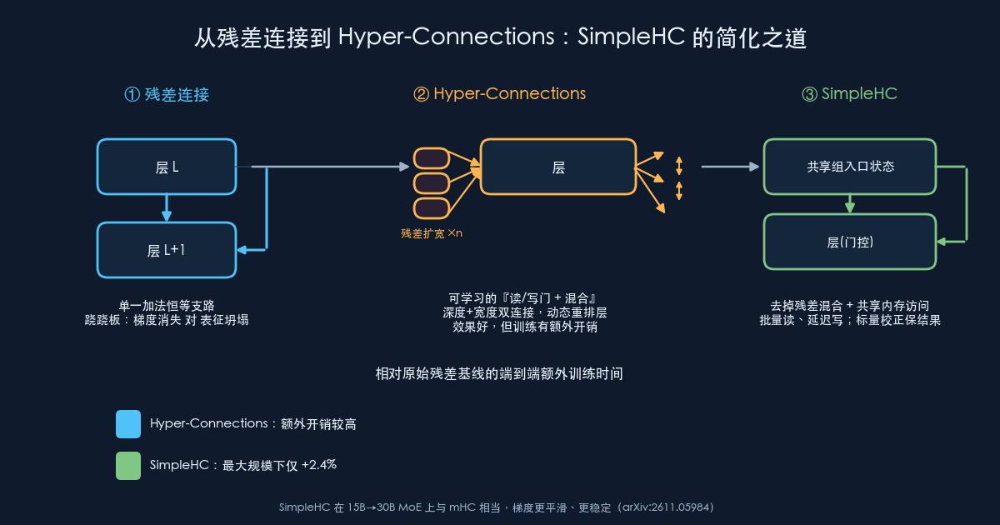

{: .center}

> 本文事实部分基于 arXiv 论文 *On the Design of Hyper-Connections: Simplification, Stability, and Scalability*（arXiv:2611.05984，2026-11-04，作者 Zhang Xiangdong、Qin Xiaohan、Cheng Yu、Yan Junchi 等）与原始论文 *Hyper-Connections*（arXiv:2409.19606，字节跳动 Seed）及公开的 Transformer / 残差网络资料。带「我的看法」「启示」字样的段落是我的分析与观点，请与事实区分阅读。

## 一、先从一条被我们默认的「地基」说起

今天几乎所有深度网络——从 ResNet 到每一个 Transformer——都建立在一条看似理所当然的设计上：**残差连接（residual connection）**。它的形式极简：

```
x_{L+1} = x_L + F(x_L)
```

即「把这一层算出来的东西，加回到输入上」。这条恒等支路（identity path）做了两件大事：**让梯度能顺着加法直通到浅层**，缓解深层网络的梯度消失；同时**让每一层只需要学习『增量』**，训练更容易。可以说，没有残差连接，就没有今天动辄上百层的大模型。

但残差连接不是没有代价。研究者很早就观察到一个「跷跷板」现象：

- 如果让残差支路权重偏大（接近恒等），梯度传播顺畅，但各层的输出容易变得越来越像，表征逐渐**坍塌（representation collapse）**，深层等于白堆；
- 如果压低残差、强化变换支路，表征更有区分度，但又回到**梯度消失/爆炸**、训练不稳的老问题。

过去人们用各种办法去调这个平衡：Pre-LN、各种初始化缩放、DeepNorm、ReZero、层缩放（LayerScale）等等。它们本质上都是在「残差 + 变换」这个固定的加法结构里拧一个标量或向量旋钮。

> 我的看法：残差连接的强大恰恰在于它「简单到无需解释」，但也正因为太固定，留给我们调节深浅层信息如何流动的自由度其实很少。真正的问题不是「加多少」，而是「谁和谁相加、以什么强度相加」能不能变成网络自己学出来的东西。

## 二、Hyper-Connections：把「一条残差」升级成「一张可学习的连接网」

2024 年字节跳动 Seed 提出的 **Hyper-Connections（HC，超连接）** 正是沿着这个思路走的。它的核心想法可以用三步理解：

1. **把残差「流」扩宽 n 倍**。原本每层之间只有一条隐藏状态在流动，HC 把它复制/扩展成 n 份并行的残差状态（expansion rate = n，常见 n=2、4）。你可以想象成从「单车道」变成「n 车道」的残差高速路。

2. **用可学习的连接替代固定的加法**。在扩宽后的状态上，HC 定义了两类可学习连接：
   - **深度连接（depth-connections）**：决定每一条残差「车道」如何喂给当前层、当前层的输出又如何写回各条车道——相当于把残差的强度从固定的 1 变成**可学习的权重**；
   - **宽度连接（width-connections）**：决定 n 条车道之间如何横向交换信息（即「混合 / mixing」）。

3. **让网络动态决定深度信息怎么走**。因为这些连接是学出来的（甚至可以依赖输入做动态预测，称为 dynamic HC），网络就能自行调整不同深度特征之间的连接强度，相当于**软性地重排层的顺序与作用**，从而同时缓解梯度消失与表征坍塌这对矛盾。

原始论文在稠密与稀疏（MoE）大模型预训练、以及视觉任务上都报告了相对残差连接的明显收益。此后，Hyper-Connections 被越来越多的前沿模型采纳，成为架构设计里一个真实在用、而非纸面上的改进。

> 我的看法：HC 真正聪明的地方，是把「残差强度」这件一直靠人手调的事，交还给了优化器。它没有推翻残差的直觉（信息要有直通路），而是把这条通路参数化、可学习化。这是典型的「把先验变成可学习结构」的套路，和注意力取代固定卷积核、MoE 取代固定 FFN 是同一种哲学。

## 三、问题来了：好用，但「贵」且「看不透」

Hyper-Connections 虽好，却带来两个现实障碍，这也是新论文（arXiv:2611.05984）的出发点：

- **训练开销不可忽略**。把残差扩宽成 n 份、再加上可学习的混合，意味着要反复读写一个「扩宽后的残差状态」。这些额外的内存访问和计算，在大规模训练里会实打实地拖慢速度。
- **组件没被讲清楚**。HC 把「读门 / 写门 / 深度连接 / 宽度混合」打包在一起，但到底哪一部分在真正起作用？是「可学习的门控」重要，还是「车道间的混合」重要？此前缺少系统的拆解，导致大家只能整包照搬。

新论文做的，就是把 HC 像拆积木一样拆开，逐个组件做消融，回答「到底什么在起作用、什么可以砍掉」。

## 四、SimpleHC：论文的核心发现与设计

论文系统研究后得到几个关键结论，并据此提出 **SimpleHC**。

**发现 1：两类交互各自单独就够好。** 作者发现，可以把 HC 的交互拆成两组：
- **「可学习读/写门 + 不做混合」**（有门控、车道之间不横向交换）；
- **「不受约束的混合 + 固定门」**（车道间自由混合，但门是固定的）。

有意思的是，**这两组里任意一组单独使用，性能就能和完整的 mHC（matrix/多维 Hyper-Connections）相当**。换句话说，HC 里「门控」和「混合」有相当程度的功能冗余，并不需要两者都上满配。

**发现 2：训练开销的主凶是「反复访问扩宽后的残差状态」。** 作者指出，即使不做混合，只要还在反复读写那个扩宽的残差状态，开销就降不下来。真正的瓶颈在**内存访问模式**，而不仅仅是混合这步运算本身。

**基于这两点，SimpleHC 做了两处简化：**

1. **去掉残差混合（removing residual mixing）**，只保留「可学习门控 + 加法结构」。这样结构退化成一个更干净的**加性结构（additive structure）**，并让各层共享门的输入（shared gate inputs）。
2. **共享内存访问（shared memory access）**。层特定的门共享一个「组入口状态（group-entry state）」，于是可以**批量读取（batched reads）、延迟写回（deferred writes）**，大幅减少对扩宽状态的重复访问；再用**标量校正（scalar corrections）**精确地保留前面子层输出的贡献，确保数学上不丢信息。

论文强调，它的分析同时支持「保留残差结构」和「共享内存访问」这两个设计——也就是说简化不是拍脑袋砍，而是有消融与分析背书。

**效果（论文报告）：**
- 在最大测试规模下，SimpleHC 相对普通残差基线，**端到端训练时间只多 2.4%**；
- 从 **15B 扩到 30B 的 MoE 模型**时，性能与 mHC 相当（即简化没有牺牲质量）；
- 标准训练中**梯度动态更平滑**，在压力测试下**更稳定**。

> 我的看法：这篇论文最大的价值不在于「又涨了几个点」，而在于**把一个被广泛采用却没讲透的模块做了可解释的瘦身**。「门控和混合有冗余」「开销主要来自内存访问而非算术」这两个结论，对任何想在自家训练栈里引入 HC 的团队都是直接可用的工程情报。2.4% 的额外开销，基本把「用不用 HC」从一道成本权衡题，变成了「几乎白送」的默认选项。

## 五、横向对比：残差 / Hyper-Connections / SimpleHC

| 维度 | 残差连接 | Hyper-Connections (mHC) | SimpleHC |
|---|---|---|---|
| 连接形式 | 固定加法恒等支路 | 扩宽 n 份 + 可学习深度连接 + 宽度混合 | 扩宽 + 可学习门控 + 加法（去混合） |
| 核心自由度 | 几乎没有（靠人手调标量） | 门控与混合都可学 | 只保留门控（发现二者冗余） |
| 训练开销 | 基线（最低） | 明显额外开销 | 最大规模下仅 +2.4% |
| 稳定性 | 跷跷板：梯度消失 vs 表征坍塌 | 缓解跷跷板 | 梯度更平滑、压力下更稳 |
| 可理解性 | 极高 | 组件耦合、较难解释 | 结构更干净、有消融支撑 |
| 适用规模 | 全部 | 大模型（含 MoE）验证 | 15B→30B MoE 验证可扩展 |

> 说明：上表中「训练开销」「稳定性」等为论文口径的定性/相对描述，具体数值随模型规模、实现与训练配置而变，落地前应以自家复现为准。

## 六、它能用在哪里

- **大模型预训练的底座选择**：在设计新一代稠密或 MoE 基座时，SimpleHC 可作为残差连接的近乎零成本替代，用来换取更平滑的训练与更好的深层利用率。
- **训练不稳定的「救火」**：对那些在加深、放大后容易出现 loss 尖峰、梯度爆炸的配方，HC 系方法提供的额外连接自由度可能帮助稳住训练。
- **架构搜索与消融研究**：论文把 HC 拆成「门控」「混合」两组可独立使用的交互，为想做架构简化/搜索的团队提供了清晰的切面。
- **迁移到视觉等其它模态**：原始 HC 已在视觉任务上验证过收益，SimpleHC 的简化思路理论上同样可迁移，但需各自验证。

## 七、优缺点与开放问题

**优点**
- 把「残差强度」从固定先验变成可学习结构，缓解梯度消失与表征坍塌的老矛盾；
- SimpleHC 以极小的训练开销（+2.4%）保住性能与稳定性，工程性价比高；
- 对 HC 做了可解释的消融，澄清了「门控 vs 混合」的冗余与开销来源。

**缺点与开放问题（部分是我的判断）**
- **仍需扩宽残差状态**：n 倍的残差状态会增加激活显存占用，SimpleHC 优化的是访问模式而非彻底消除它；
- **规模外推未知**：论文验证到 30B MoE，百亿到千亿级稠密/更大 MoE 上的表现仍待确认；
- **推理侧收益不明确**：收益主要体现在训练稳定性与开销，HC 对推理延迟/显存是否有净收益，论文着墨不多；
- **与其它稳定化技巧的叠加**：和 Pre-LN、QK-Norm、各类归一化/缩放方法如何组合，可能存在冗余或冲突，需要系统比较；
- **生态惯性**：残差连接的工具链（算子、并行、检查点）极成熟，任何替代都要跨过「能不能无痛接入现有训练栈」这道坎。

## 八、给读者的落地启示

1. **别把残差连接当成不可动的常量。** 它是一个设计选择，不是物理定律。当你的深层网络出现「加层不涨点」或训练不稳时，连接结构本身就是一个值得动的旋钮。
2. **要引入 HC，先只上「门控」这一半。** 论文显示门控与混合功能冗余，单独的「可学习读/写门 + 不混合」就能接近 mHC——这是最省、最容易接入的起点。
3. **优化训练开销时，先看内存访问而非算术。** 本文一个可迁移的工程教训是：扩宽状态的「反复读写」才是大头，批量读、延迟写、共享状态往往比省乘加更有效。
4. **把「标量校正保结果」记在工具箱里。** 做结构简化时，用一个精确的标量/恒等校正来保证「化简前后数学等价或贡献不丢」，是让激进简化仍然安全的常用手法。
5. **消融要拆到组件级再下结论。** 面对一个打包模块，先问「哪一部分真正起作用」，往往能砍掉一半复杂度而不掉点——这正是本文的方法论价值。
6. **落地前务必自测规模与训练栈兼容性。** 论文结论基于特定规模与实现，接入自家栈前应复现关键指标（收敛、稳定性、吞吐），再决定是否全量替换。

## 九、结语

Hyper-Connections 的故事，本质是把一条我们用了十年、几乎不再思考的「残差加法」重新问题化：信息在深层之间到底该怎么流动，能不能让网络自己学？而 SimpleHC 更进一步地提醒我们——**很多性能收益，其实可以用更简单、更省、更可解释的形式拿到**。在人人追逐更大、更复杂的当下，这种「做减法」的工作反而稀缺而珍贵。

> 我的总体判断：短期内残差连接不会「退休」，它仍是默认与兜底；但像 SimpleHC 这样「几乎零成本、可解释、可扩展」的替代，正在把 HC 从少数大厂的秘密武器，变成更多团队够得着的标准件。真正值得学的，不只是这个模块，而是它背后「拆开看清楚、再简化」的研究态度。

---

**参考**
- *On the Design of Hyper-Connections: Simplification, Stability, and Scalability*，arXiv:2611.05984（2026-11-04）。
- *Hyper-Connections*，arXiv:2409.19606（字节跳动 Seed）。
- 残差网络与 Transformer 归一化/稳定化（ResNet、Pre-LN、DeepNorm、ReZero、LayerScale 等）公开资料。

*（本文由我的 AI 博客自动化流程撰写：事实依据上述来源，分析与观点为个人判断，供学习交流，不构成任何投资或工程决策建议。）*
