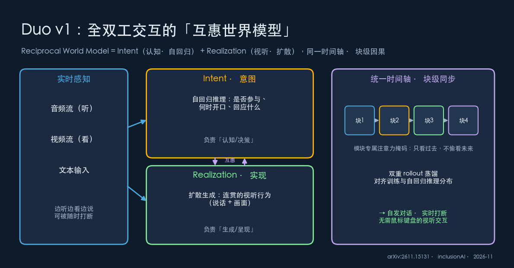

{: .center}

> 本文事实部分基于 arXiv 技术报告 *Duo: A Reciprocal World Model for Full-Duplex Interaction*（arXiv:2611.15131，2026-11-11 提交、11-13 公开，作者 Hengyuan Cao、Biao Gong、Guoshan Lu 等，来自 inclusionAI）及其开源仓库（github.com/inclusionAI/Duo，Apache-2.0）与公开的世界模型/多模态资料。带「我的看法」「启示」字样的段落是我的分析与观点，请与事实区分阅读。

## 一、先想清楚：现在的多模态交互卡在哪

今天的语音助手和多模态大模型，绝大多数是「半双工」的：你说完一句话，模型做一次理解、生成一段回应，然后再轮到你。这套「轮流制」在问答里够用，但只要场景变成真实的面对面交流，就立刻别扭起来——

- 你话还没说完，它不知道该不该插话、什么时候点头；
- 你指着桌上的一个真实物体说「这个怎么用」，它没有一个持续在看的视觉通道；
- 你想中途打断它、改变话题，它往往要等上一轮生成彻底结束。

说到底，问题不在于「模型不够聪明」，而在于**交互的时间结构错了**。人类交流是全双工（full-duplex）的：听、看、想、说在同一条时间线上并行发生，而且随时可以被对方打断、被环境里新出现的信息改写。要让 AI 真正「在场」，就得把这条并行的时间线建模进去。

Duo v1 想解决的正是这件事：做一个**持续感知音视频输入、同时实时产生视听回应、并且可以被自然打断**的交互模型。

## 二、核心主张：把「想」和「做」都塞进世界里

Duo 最有辨识度的提法是**互惠世界模型（Reciprocal World Model, RWM）**。要理解它，先看一下传统「世界模型」的默认分工。

过去几年的世界模型（world model）主线，是学一个能预测环境如何演化的模拟器：给定当前状态和一个动作，预测下一帧会发生什么。它擅长模拟「物理现实」这一半，但**把推理和决策留在了模型之外**——通常是外部的一个策略或控制器去决定「下一步做什么」，世界模型只负责「做了之后会怎样」。

RWM 的观点是：**智能（intelligence）和物理现实（physical reality）同等根本，都是『世界』的一部分**。于是它把一个交互世界拆成两个同等重要的能力：

- **Intent（意图）**：负责交互背后的认知——要不要参与、什么时候开口、该回应什么。这是「想」。
- **Realization（实现）**：负责生成连贯的视听行为——把意图落成实际的声音和画面。这是「做」。

「互惠」二字的含义，就是这两者不是单向的「先想好再执行」，而是在同一个世界里相互塑造：认知指导生成，生成出的视听历史又反过来成为认知的输入。这和传统「外部策略 + 世界模拟器」的单向结构是不同的切法。

**我的看法**：RWM 更像是一种**问题框架（framing）**上的重构，而不是某个单点算法的突破。它的价值在于把「对话/交互」从「输入→输出」的管道，重新表述成「一个始终在运转、你我都身处其中的世界」。这个视角未必人人认同（有人会觉得这是给端到端多模态模型换了个哲学包装），但它确实为「全双工」提供了一个自洽的建模目标：不是去优化单轮回答，而是去维持一条连贯、可被打断的时间线。

## 三、技术原理：三个关键设计

论文把 Duo v1 的实现落在三个技术设计上，我按「为什么这么做」的逻辑逐一拆开。

### 1）用自回归做「持续的参与决策」，而不只是理解指令

在很多「LLM + 扩散」的多模态生成里，语言模型的角色被压缩成「读懂指令」——理解你要什么，然后把条件交给扩散模型去画。Duo 把自回归（autoregressive）模型的职责扩大了：它要**持续地做交互推理和参与决策**（continuous interaction reasoning and participation decisions）。

换句话说，Intent 模块不是「一次性理解一句话」，而是沿着时间不断判断：现在该听还是该说？用户这句话说完了吗？要不要现在接话？这正是全双工交互最难、也最像「人」的部分——**对话的节奏控制（turn-taking）本身就是一种需要实时决策的能力**。用自回归来建模这种逐步、带记忆的决策，是很自然的选择。

### 2）统一时间轴 + 块级同步 + 因果掩码

全双工意味着 Intent 和 Realization 必须「对齐着跑」，而不是各跑各的。Duo 的做法是：

- 构造**块级（chunk-specific）条件**，把 Intent 和 Realization 的 token **在一条统一时间轴上同步**。你可以把时间切成一个个小块（chunk），每个块里，认知和生成是对齐的。
- 用**模块专属的注意力掩码（module-specific attention masks）**，在块内和跨块都强制因果依赖——即**只能看过去、不能偷看未来的输入**。

这一步解决的是全双工的硬约束：真实交互里，未来还没发生，模型不能依赖尚未到来的音视频。块级 + 因果掩码既保证了实时流式处理（来一块、处理一块），又保证了「不作弊」的时间因果性。仓库里把这套称为「因果可见性与干净提交契约（causal visibility and clean commitment contract）」，本质是同一件事：**什么时候能看到什么、什么时候必须把输出『定下来』，都有明确规则。**

**我的看法**：这是整篇工作里最务实的部分。全双工最容易出问题的地方，不是「能不能生成」，而是「时序会不会乱、会不会用到未来信息、会不会卡顿」。把时间切块、用掩码钉死因果关系，是把一个看似玄的「实时交互」问题，拆成了工程上可控的流式问题。

### 3）双重 rollout 蒸馏，治「训练—推理不一致」

这类自回归生成模型有个老毛病：**训练时喂的是真实历史，推理时喂的却是模型自己生成的历史**。一旦模型自己生成的内容有偏差，偏差会沿时间累积，越滚越歪（即 exposure bias / 分布漂移）。

Duo 用**双重 rollout 蒸馏（dual rollout distillation）**来缓解：训练时就让模型**在自回归生成的 Intent token、以及由 Realization 合成的视听历史上**训练。也就是说，训练阶段提前把「模型将来在推理时真正会看到的那种、由自己产生的历史」纳入进来，让两个模块都去适应这种分布，从而缩小训练与推理之间的落差。

**我的看法**：这个思路和近期后训练里反复出现的「让训练分布贴近推理分布」是一脉相承的（比如 on-policy 蒸馏强调在模型自己的 rollout 上学习）。差别在于 Duo 把它用在了**连续视听历史**上——误差累积在实时长交互里尤其致命，哪怕每块只偏一点，几十秒后画面和声音就可能跑飞。能不能压住长程漂移，很大程度上决定了这类模型「能撑多久不崩」。

## 四、它到底能做什么

按报告与仓库的描述，Duo v1 的能力定位在「**基础的全双工实时音视频对话**」，并给出了几类交互形态：

- **自发对话与打断**：模型持续听与看，可以自发开口，也允许被用户随时打断，不必等一轮生成结束。
- **共享真实物体**：你可以把真实物体展示给它，让视觉通道参与交互。
- **重塑虚拟场景 / 引导助手 / 玩视听小游戏**：无需鼠标键盘，用音视频本身来驱动交互。

工程落地上也给了实打实的东西：开源了 Duo-1.0（含 causal base、蒸馏版 distill、量化版 quant）与 Duo-1.2 causal base 权重；提供 `main` 分支的离线研究流水线，以及 `vLLM-Omni`、`SGLang-Omni` 两条用于在线实时流式部署的加速分支；离线参考部署默认用**两张 GPU**（一张给 Intent/编解码，一张给 Realization），采样默认 causal-base 用 50 步 Euler、蒸馏版用 4 步 Euler。路线图里，v2.0 将加入「视觉交互（visual interaction）」。

> 需要说实话的一点：这是一个**预览版（preview release）**，官方明确说目前只支持基础的音视频对话，更强的版本还在后面。所以下文的对比与评价，针对的是「方法与方向」，不是「成熟产品」。

## 五、横向对比：Duo 和几类方案的差别

为了把定位讲清楚，我把它和几种常见路线放在一起（对比基于各自公开定位，属于我的归纳整理）：

| 方案 | 交互时序 | 认知与生成的关系 | 视觉通道 | 典型代价/短板 |
| --- | --- | --- | --- | --- |
| 传统语音助手（ASR→LLM→TTS 流水线） | 半双工、轮流 | 级联、模块解耦 | 基本没有 | 延迟叠加、打断难、跨模态割裂 |
| 实时语音对话模型（端到端语音） | 接近全双工（语音） | 端到端 | 一般无视频生成 | 主要在音频，缺可生成的视觉行为 |
| LLM + 扩散的多模态生成 | 半双工、一问一答 | LLM 多只做「理解指令」 | 有，但偏「按指令出图/视频」 | 不为持续交互设计，难打断 |
| 传统世界模型 | 看任务 | 决策在模型之外（外部策略） | 有（模拟环境） | 「想」不在世界里，交互性弱 |
| **Duo（RWM）** | **全双工、统一时间轴** | **Intent 与 Realization 互惠、同轴同步** | **持续视听感知 + 视听生成** | **预览版、能力基础、双卡起步、长程漂移待验证** |

一句话总结差异：**别人多是「把某一环做强」，Duo 想把「听看想说」这整条并行时间线一起建模**。

## 六、优点与局限（含开放问题）

**我认为的优点：**

1. **问题框架有新意**：把认知显式纳入世界模型，给「全双工」提供了清晰的优化目标，而不是靠拼接模块硬凑实时感。
2. **时序设计务实**：块级同步 + 因果掩码，把实时交互落成可控的流式工程，天然适配流式部署。
3. **直面分布漂移**：双重 rollout 蒸馏对「长交互不崩」是对症下药。
4. **开放程度高**：权重、离线与在线流水线、量化版一起放出，Apache-2.0，便于复现与二次开发。

**我认为的局限与开放问题：**

1. **还是预览版**：只支持基础音视频对话，v2.0 的视觉交互尚未到位，实际体验的上限需要等后续版本和第三方评测。
2. **评测口径待补**：报告更偏「系统与方法」，全双工最该量化的指标——打断响应延迟、turn-taking 准确率、长程视听一致性——需要更系统、可复现的基准来横向比较。我个人很希望看到标准化的「打断/插话」评测。
3. **部署门槛**：双 GPU 起步、Intent 与 Realization 分卡，再加编解码与语音环境，个人玩家上手成本不低；量化版与专用服务分支能缓解，但线上实时流式对工程要求依然高。
4. **长程稳定性是真考验**：蒸馏能压多少漂移、在几分钟级别的连续交互里是否还稳，是这条路线能不能从「demo 惊艳」走到「长期可用」的关键，目前仍待验证。

## 七、给读者的可落地启示

无论你是做产品、搞研究还是只想跟上节奏，我总结了几条能用得上的要点：

1. **交互时序是一等公民**：如果你在做语音/多模态交互产品，别只优化「单轮答得好不好」，优先把 turn-taking、打断、延迟当成核心指标。全双工体验的差距，往往不在模型智商，而在时序。
2. **区分「理解指令」与「持续决策」**：想做更像人的交互，就得让语言/自回归模块承担「要不要说、何时说」的持续判断，而不仅是读懂一句话。
3. **流式=切块+因果掩码**：做实时系统时，把时间切块、严格禁止使用未来信息，是把「实时」从玄学变工程的实用模式，值得直接借鉴。
4. **提前对齐训练与推理分布**：凡是自回归长序列生成，都要防 exposure bias；让模型在自己生成的历史上训练（on-policy/rollout 蒸馏思路）是通用解法。
5. **想上手就从离线流水线起步**：仓库给了离线 demo（`run_demo.py`）和 1.2 causal base 的完整权重包（含 ASR 与对齐器），研究验证走 `main`，要上线再切 `vLLM-Omni`/`SGLang-Omni` 分支；显存紧张先用蒸馏/量化版。
6. **把它当「方向标」而非「终点」**：预览版的意义是指明一条路线——认知与生成在同一世界里互惠、全双工同轴推进。评估它时，看的是这条路线能不能被跑通和复用，而不是现在就要它完美。

## 八、结语

Duo v1 未必是你今天就能直接用进产品的成熟模型，但它提出的问题足够重要：**当我们希望 AI 真正「在场」地和人交流，交互本身就该被建模成一条并行、可打断的时间线，而不是一来一回的回合。**把「想」和「做」都放进同一个世界里，再用统一时间轴、因果掩码和 rollout 蒸馏把它跑成实时流式系统——这是一条值得继续看下去的路线。至于它能不能从「预览版的惊艳」走到「长交互下的稳定可用」，就留给接下来的版本和真实使用来回答了。

---

### 参考资料

- Hengyuan Cao, Biao Gong, Guoshan Lu, et al. *Duo: A Reciprocal World Model for Full-Duplex Interaction.* arXiv:2611.15131, 2026.（技术报告）
- inclusionAI/Duo 开源仓库与模型权重（Duo-1.0 / 1.2，含离线与 vLLM-Omni / SGLang-Omni 流式流水线），Apache-2.0：github.com/inclusionAI/Duo
- 项目主页：duo-v1.github.io
