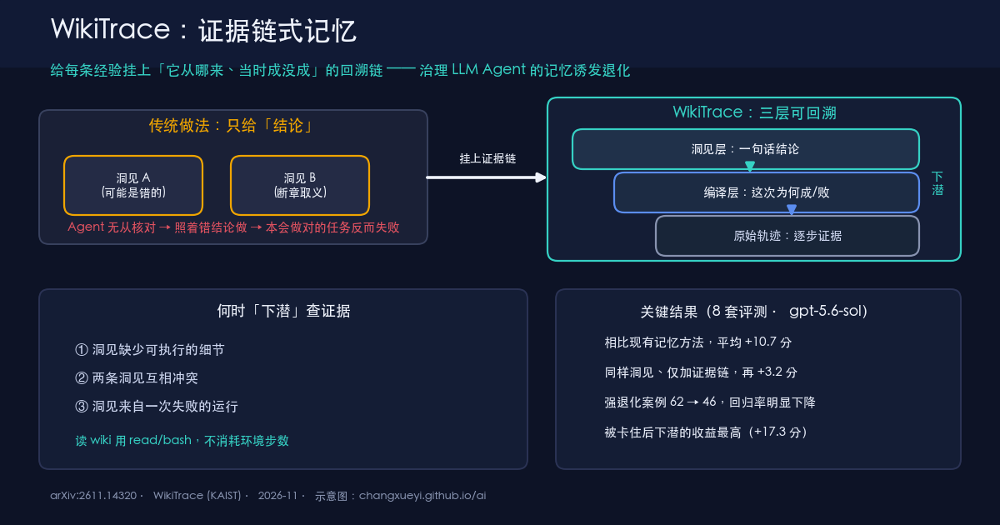

> 本文为 AI 前沿技术系列。事实部分基于论文 **WikiTrace: Evidence-Linked Memory Reduces Memory-Induced Degradation in LLM Agents**（arXiv:2611.14320，2026-11-10 提交，作者 Yukyeong Lee、Yumin Choi、Jinheon Baek、Sung Ju Hwang，代码见 github.com/yukyeongleee/wikitrace）。带「我的看法」标记的段落是作者本人的分析与判断，与论文结论区分开。

## 一、一个反直觉的现象：加了记忆，反而更差

过去一年，"自进化 Agent"是个很热的方向：不重新训练底座大模型，而是把一次次任务的执行轨迹（trajectory）提炼成一条条简短的"经验/教训"（lesson），存进外部记忆，下次遇到类似任务就取出来参考。思路很朴素——人不就是这么越做越熟的吗？

但 WikiTrace 这篇论文把一个常被忽略的现象摆到了台面上：**记忆并不总是帮忙，它还会造成"记忆诱发退化"（memory-induced degradation）**——Agent 在一个**没有记忆时本来能做对**的任务上，因为翻出了一条记忆，反而失败了。

退化的来源不难理解，论文归纳为三类：

1. **经验本身是错的**：从一次"看起来成功"的轨迹里提炼出来的规律，其实只在那个特例成立；
2. **误用了一条本来对的经验**：条件/适用范围没对上，硬套；
3. **读错了一条本来对的经验**：理解偏差。

根子出在一个工程惯例上：**经验是从只标了"成功/失败"的轨迹里推断出来的，但交给 Agent 用的时候，往往只给那句结论，不给产生它的原始轨迹**。于是 Agent 拿到一句"遇到台灯任务，点亮后把花瓶放在台灯处即可结束"这样的规则时，它没有任何办法去核对这句话到底对不对、适不适用——只能选择信，或者不信。

> **我的看法**：这个问题比它表面看起来更要紧。业界谈 Agent 记忆，关注点几乎都在"召回率"——怎么存得多、检得准。但 WikiTrace 提醒我们，记忆系统真正的风险指标应该是**净收益**：既要看它在多少任务上带来提升（Gain），也要看它在多少本来能做对的任务上造成回退（Regression）。一个只报告平均分提升的记忆系统，很可能在悄悄用"新任务涨的分"去补贴"老任务掉的分"，掩盖了退化。

## 二、WikiTrace 的核心主张：经验要可回溯，而不只是可召回

WikiTrace 的解法说起来朴素得近乎常识：**既然 Agent 没法核对一句孤零零的结论，那就把结论和它的证据重新连起来。** 具体做成一个三层、层层带链接的"wiki"：

- **洞见层（insight）**：一句话结论，比如"搜索某个小物件时，先查它专属的收纳处"。这是 Agent 默认看到的东西。
- **编译层（compilation）**：对那次运行的结构化摘要——这次任务为什么成功、或为什么失败，关键决策是什么。
- **原始轨迹层（raw trajectory）**：逐步的完整执行日志，证据的最终来源。

三层之间全部保留链接：每条洞见都指向它的编译摘要，再指向原始轨迹，并且**标注了它来自的那次运行到底是成功还是失败**。

关键设计有几条值得拎出来：

- **洞见是不可变的**：一次运行独立生成至多 3 条候选洞见，写下后既不合并、也不过滤、不再更新或删除。这样每条洞见都有清晰、唯一的出处。（这跟很多"记忆去重/合并/反思改写"的方案是反着来的。）
- **所有洞见放在第一条消息里**：Agent 一上来就能看到全部洞见，不依赖"先检索再使用"那种可能漏召回的流程。
- **查证据不花预算**：读 wiki 用 `read` / `bash` 这类终端工具完成，**不消耗环境的行动步数**（game steps）。这点很重要——它把"核对"的成本降到几乎为零，Agent 才有动机去查。

## 三、什么时候"下潜"去查证据

Agent 不会对每条洞见都翻底账——那样太慢。WikiTrace 定义了三个触发"下潜"（descent）的条件，Agent 命中任一条就顺着链接去核对原始运行：

1. **洞见缺少可执行的细节**：结论太笼统，没法直接照着做；
2. **两条洞见互相冲突**：谁对谁错，去证据里裁决；
3. **洞见来自一次失败的运行**：天然可疑，先查再用。

下潜之后，Agent 可能做三件事：**修订洞见**（revise，约占 24%）、**补上洞见遗漏的细节**（refine，约 14%）、或**补充洞见完全没覆盖的新事实**（new fact，约 4%）。

论文里有个很有说服力的细粒度发现：**不同触发原因的价值差别很大。** 当 Agent 是因为"某次尝试被卡住了（setback/blocked attempt）"才去下潜时，收益最高——相对只给结论的基线能领先约 17.3 分；而那些例行的、没有明确疑问的"顺手查一下"，领先幅度就小得多（约 3.4 分）。换句话说，**遇到阻碍时的查证，是记忆回溯最该花力气的地方。**

> **我的看法**：这三个触发条件其实是一套很朴素的"认识论纪律"——对笼统的要求细节，对矛盾的要求裁决，对来路不正的（失败运行）要求复核。它可以被直接搬到任何 RAG / 记忆系统里，而不必非得用 WikiTrace 这套完整实现。更深一层的启示是：**让模型"能查"还不够，要给它明确的"何时必须查"的信号**，否则它要么懒得查、要么到处乱查。

## 四、关键数据：证据链到底值多少分

WikiTrace 在 **5 个 Agent 评测、共 8 套测试**上验证：ALFWorld（家务文字世界）、ScienceWorld（科学实验文字世界）、PlanCraft（合成/制造）、τ3-bench（工具调用/客服对话）、AppWorld（真实 App API 操作）。Agent 与裁判都用 gpt-5.6-sol（中/高推理档），对话类任务里"用户"由 gpt-4.1 扮演。

几个核心结果：

- **相比现有各类记忆方法，平均高出约 10.7 分**，在 8 套里的 7 套上领先。
- 最能说明问题的是对照组 **Insights Only**：它拿到的洞见和 WikiTrace **一模一样**，唯一区别是**不挂证据链、不能下潜查原始运行**。结果 WikiTrace 仍比它**平均高出 3.2 分**。也就是说，这 3.2 分纯粹来自"能回溯证据"这件事本身，而不是洞见质量更高。
- **退化被压下去了**：论文用裁判统计"强退化"案例，Insights Only 有 62 例，WikiTrace 降到 46 例；在回归率最高的 ScienceWorld 上，Insights Only 的回归率约 9.4%，同样的洞见喂给 WikiTrace 后降到约 7.1%。
- 在需要"重做一遍"的对照里，WikiTrace 对相应基线的领先可达约 35 个百分点。

> **我的看法**：Insights Only 这个对照组是这篇论文最漂亮的地方。它把"记忆内容好不好"和"记忆能不能被核对"这两件事干净地切开了——同样的结论，仅仅因为允许回溯证据，表现就不一样。这说明 **Agent 记忆的瓶颈，正在从"提炼出好经验"转向"让 Agent 有办法信任/质疑已有经验"**。前者是内容问题，后者是结构（可追溯性）问题，而后者长期被低估了。

## 五、和同类方案的对比

| 维度 | 无记忆（No Memory） | 只给结论（Insights Only / 多数自进化 Agent） | 反思/改写式记忆（如 ExpeL、ReMe 等） | WikiTrace（证据链式） |
|---|---|---|---|---|
| 给 Agent 的东西 | 什么都不给 | 一条条孤立结论 | 经过合并/更新/筛选后的结论 | 结论 + 编译摘要 + 原始轨迹，层层带链接 |
| Agent 能否核对经验 | 无经验可核对 | **不能** | 通常不能（改写后更难追溯源头） | **能，按需下潜查证据** |
| 对错误经验的处理 | 不适用 | 照单全收，易翻车 | 靠后续效用去更新/删除，滞后 | 用的时候当场核对、修订或弃用 |
| 记忆是否可变 | — | 多为静态 | 动态改写，可能丢失出处 | **不可变 + 保留出处**，可审计 |
| 退化风险 | 基准 | 高（本文重点揭示） | 中（改写也可能引入新错误） | 显著更低 |
| 额外成本 | 低 | 低 | 中 | 查证据不耗环境步数；但要存全量轨迹、prompt 更长 |

从这张表能看出 WikiTrace 的定位：它不追求"把记忆压缩/提炼得更精"，而是走了相反的路——**宁可多存、保留出处、让经验可被审计**。这是一种"透明优先"而非"精炼优先"的记忆哲学。

## 六、优缺点与开放问题

**优点**

- 直击一个被低估的真问题（记忆诱发退化），并用干净的对照实验证明"可回溯性"本身就有价值。
- 工程上温和、可嫁接：三层 wiki + 三个下潜触发条件，可以增量加到现有 ReAct/记忆框架上。
- 洞见不可变 + 保留出处，天然带来**可审计性**，这对生产环境排错很友好。

**缺点与开放问题（部分是我的判断）**

- **存储与上下文成本**：保留全量原始轨迹，长期看是不小的存储负担；把所有洞见放进第一条消息，也会让上下文越堆越长，随着记忆库增长，可扩展性存疑。
- **依赖强模型的"自省"能力**：下潜、核对、修订都要求 Agent 有较强的判断力。实验用的是 gpt-5.6-sol 这类强模型，换成较弱的模型，它还能不能准确判断"该下潜"、并从证据里得出正确修订，是个未知数。
- **评测仍以文字世界/受控环境为主**：ALFWorld、ScienceWorld 这类偏模拟，真实、开放、长程、多人协作场景下的表现仍待验证。
- **洞见"只增不删"的代价**：不合并、不删除保证了可追溯，但记忆库会单调膨胀，长期检索与冲突会越来越多；如何在"保留出处"和"控制规模"间取得平衡，是后续要解决的。
- **证据本身也可能误导**：原始轨迹里的"成功"可能是侥幸，下潜核对未必总能识破——证据链降低了风险，但没有消灭它。

## 七、给工程实践的 6 条可落地建议

如果你正在给自己的 Agent 或 RAG 系统做记忆/经验复用，这篇论文有几条可以直接拿去用的启示：

1. **记忆评估加一个"回归率"指标**。别只看"用了记忆涨了多少分"，务必同时统计"本来能做对、用了记忆反而做错"的任务比例（Regression）。净收益为正才算真有用。
2. **存经验时顺手存出处**。哪怕不做完整三层 wiki，至少给每条经验记上：来自哪次运行、那次是成功还是失败、原始日志在哪。可追溯是低成本、高回报的投资。
3. **给模型明确的"何时该复核"触发条件**。笼统的结论要细节、冲突的结论要裁决、来自失败的经验要先查——把这三条写进系统提示，比单纯"你可以查资料"有效得多。
4. **把"查证据"的成本降到最低**。WikiTrace 让读 wiki 不占行动预算，Agent 才愿意查。工程上对应的是：核对/检索操作要快、要廉价、不要和主任务抢步数或 token 预算。
5. **对失败运行的经验要特别小心**。从失败里也能学到东西，但"失败教训"是退化的高发区，默认把它标记为"需复核"而非"可直接采纳"。
6. **慎用激进的记忆改写/合并**。合并、去重、反思改写会让经验"看起来更干净"，但常常切断了出处、引入新的错误。在可审计性和精炼度之间，生产系统往往更需要前者。

## 八、结语

WikiTrace 真正有价值的，不是又刷高了几个 benchmark，而是把一个被忽视的假设摆了出来：**我们默认"给 Agent 喂经验一定有益"，但经验同样会把它带沟里。** 它给出的答案也很克制——不是让记忆更聪明，而是让记忆更**透明、可核对**。

放到更大的背景看，这和我这段时间观察到的一条主线是一致的：随着底座模型越来越强，Agent 的竞争力正从"模型本身"逐渐转移到**它周围的上下文与记忆基础设施**上。谁能让模型可靠地信任、质疑、修正自己积累的经验，谁就能把"自进化"从一句口号变成真正稳定的能力。记忆的下一仗，拼的不是记得多，而是记得**可被追责**。

---

### 参考资料

- Yukyeong Lee, Yumin Choi, Jinheon Baek, Sung Ju Hwang. *Don't Just Trust Your Memory: Evidence-Linked Memory Reduces Memory-Induced Degradation in LLM Agents (WikiTrace)*. arXiv:2611.14320, 2026-11-10. 代码：github.com/yukyeongleee/wikitrace
- 评测环境：ALFWorld、ScienceWorld、PlanCraft、τ3-bench、AppWorld（见论文 Table 3/4）
- 本文配图为作者用 matplotlib 程序化绘制的结构示意图（因当前自动化环境无可用的图像生成后端），非论文原图。
