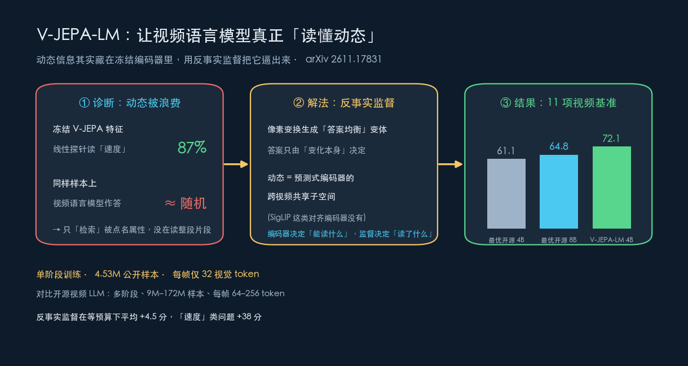

> 本文为 AI 前沿技术系列。事实部分基于论文 **V-JEPA-LM: Video-Language Models That Read Dynamics Beyond Static, Text-Aligned Representations**（arXiv:2611.17831，2026-11-13 提交，作者 Keuntae Kim、Dongjun Kim、Yong Suk Choi）。带「我的看法」标记的段落是作者本人的分析与判断，与论文结论区分开。

## 一、一个扎心的现象：信息都在，模型却没在读

先说一个让人有点难受的实验结果。

拿一批视频片段，问模型一个关于「动态」的问题，比如「画面里的物体是在加速还是减速」「两个动作谁先发生」。研究者做了两件事对照：

- 用一个**线性探针（linear probe）**去读冻结的 V-JEPA 视频特征——也就是只在编码器输出上接一个最简单的线性分类层，别的什么都不训练。这个探针读「速度」能达到 **87% 的准确率**。
- 换成标准做法：把同一个冻结编码器接上语言模型，训练成一个视频语言模型（Video-LLM），再问同样的问题。结果模型的回答**几乎等于随机瞎猜**。

同一批片段、同一个编码器，信息明明就在特征里（线性探针都能读出来），可一旦走「视频语言模型问答」这条链路，答案质量就塌了。这说明问题不在编码器"看没看见"，而在后面那套"怎么用"的流程把信息漏掉了。

**为什么会这样？** 论文给的解释很直接：训练视频语言模型用的监督信号——字幕（caption）和问答对（QA）——每一条**只点名了片段的少数几个属性**。「一个人把杯子从桌子左边挪到右边」这样的字幕，告诉模型的是"有人、有杯子、从左到右"这些可以被名词和介词点到的东西。于是模型学到的是一种**检索式的捷径**：把问题里提到的词，对应到画面里能直接命中的静态属性上，拼出一个听起来合理的答案。至于"挪得多快""和另一个动作谁先谁后"这种需要真正沿时间轴去读整段片段才能得到的信息，字幕根本没逼它去用，它也就不用了。

> **我的看法**：这个现象的意义，比"又一个视频模型刷了榜"大得多。它其实是在说：**我们一直用"会不会描述画面"来当作"看懂没看懂"的代理指标，但这两件事可以严重脱节。** 一个视频语言模型在很多基准上分数很高，可能只是因为那些基准的问题大多能靠静态线索（物体、场景、字幕里出现过的词）蒙对，而不是因为它真的理解了"发生了什么、怎么发生的"。换句话说，视频理解这个领域的很多"进步"，可能被"图像理解 + 字幕检索"这套捷径给虚高了。

## 二、动态到底藏在哪：编码器类型决定了上限

既然线性探针能读到 87%，那"动态"这份信息，在冻结编码器里到底以什么形式存在？这是论文第二个有价值的发现。

它比较了两类编码器：

- **预测式（predictive）编码器**，代表就是 V-JEPA。这类模型是靠"预测视频里被遮住的部分会怎么变化"来训练的，本质上是在学一个关于世界如何演变的"世界模型"。研究发现，在这类编码器里，**"动态"存在于一个跨视频共享的子空间（subspace）里**——也就是说，不管具体内容是什么，"速度、方向、顺序、状态变化"这些动态属性被编码到了一组相对一致、可被线性读取的方向上。
- **逐帧、文本对齐（frame-wise, text-aligned）编码器**，代表是 SigLIP 这类图文对比学习出来的模型。它们擅长把单帧画面和文本对齐，但"动态"**并不是**作为一个跨视频共享的成分存在——因为它们压根不是靠预测时间演变训练出来的，时间维度上的结构信息没有被系统性地编码进去。

这个对比点出一个关键结论：**编码器的训练目标，决定了下游"最多能读出什么"。** 你用一个只会对齐单帧和文字的编码器，后面接再强的语言模型、喂再多数据，也很难凭空读出它根本没编码进去的动态结构；而预测式的世界模型编码器，把动态好好地留在了特征里，等着被用。

> **我的看法**：这其实是对 Yann LeCun 一系列"JEPA / 世界模型优于纯生成或纯对比"观点的一个很具体的经验支撑。过去这类论证常停留在"理念上更对"的层面，而这篇论文给出了一个可测量的落点：动态信息在预测式编码器里是"线性可读、跨视频共享"的，这是一个能用探针量化、能复现的性质，而不只是哲学偏好。对做多模态基座选型的人来说，这是个很实际的信号——**如果你的下游任务重度依赖时间/动态推理，编码器该往"预测式/世界模型"这一侧选，而不是默认拿图文对齐模型凑。**

## 三、解法：用「反事实监督」逼模型去读片段

诊断清楚了——信息在，但常规字幕/问答监督没逼模型去用。那怎么逼？

论文的做法叫**反事实监督（counterfactual supervision）**，核心思路可以用一句话概括：**造一批"除了那个变化，其他都一样"的视频对，让答案只能由那个变化本身决定。**

具体怎么造：

1. 拿公开视频，施加**像素级变换（pixel transformations）**，例如改变播放速度、调整时序顺序、翻转运动方向等等。
2. 这些变换会生成**答案均衡（answer-balanced）的变体**：对于同一类问题，不同变体的正确答案被设计成均匀分布——比如"变快了"和"变慢了"各占一半。
3. 关键在于，这些变体之间**唯一实质性的差异就是被施加的那个变化**。画面里的物体、场景、能被字幕点名的静态属性全都一样。

这样一来，模型就没法靠"检索静态属性"来蒙答案了：因为所有静态线索在正例和反例里完全相同，唯一能区分答案的信息，就是那段动态本身。要答对，它**只能**去读编码器里携带的动态子空间。监督信号第一次和"必须读片段"这件事对齐了。

论文把这件事总结成一句我很喜欢的话——**编码器决定「能读什么」（what can be read），监督决定「读了什么」（what is read）**。前者是上限（第二节的发现），后者是能不能把上限兑现（这一节的发现）。两者缺一不可：编码器没编码进去，再好的监督也造不出信息；编码器编进去了，监督不对，信息照样睡大觉。

为了把这两者拆开验证，论文做了一个**受控的「编码器 × 监督」交叉实验**：在相同的数据预算下，把"用反事实监督"和"不用"对比。结果是——反事实监督**平均带来 +4.5 分**的提升，而在那些真正考动态的**「速度」类问题上，提升高达 +38 分**。这个 +38 分非常说明问题：它恰好打在常规监督最漏的地方。

## 四、效率才是最意外的部分：少花钱办成了事

如果只是"效果好"，还不够稀奇。真正让我觉得这篇值得写的是它的**数据与计算效率**。

对比一下开源视频大模型的典型配置：

- 它们通常要**多阶段训练**（对齐、预训练、指令微调等好几段），样本量从 **9M 到 172M** 不等，每帧用 **64 到 256 个视觉 token**。
- V-JEPA-LM 则是**单阶段训练**，只用 **4.53M 公开样本**，每帧仅 **32 个视觉 token**。

就是在这种"又少又省"的配置下，V-JEPA-LM 做出了 1B 到 8B 的一系列模型（语言侧用 Qwen3 和 Llama），**在 11 项视频基准上，每个参数量级都拿到了平均分第一**。其中最亮眼的一组数字：

- **V-JEPA-LM 4B：平均 72.1 分**
- 同量级最强开源 4B：61.1 分
- 甚至更大的最强开源 8B：64.8 分

也就是说，它的 **4B 模型越级打败了别人家的 8B 模型**，还是在训练样本和每帧 token 都少得多的前提下。

> **我的看法**：这组效率数字，比那个 72.1 的绝对分数更重要。它传递的信号是：**视频理解近几年的"堆数据、堆 token、堆阶段"路线，很可能把大量算力花在了补救"编码器选错 + 监督不对"上。** 当你用一个本就不擅长编码动态的图文对齐编码器，又用一堆只点名静态属性的字幕去训练，模型自然要靠海量样本去"死记硬背"各种时间线索的表面相关性——这当然贵。V-JEPA-LM 等于反过来证明：**把编码器选对（预测式）、把监督设计对（反事实），省下来的数据和算力是数量级级别的。** 对预算有限的团队，这是比"再多标 1 亿样本"更划算的方向。

## 五、横向对比：它和同类思路差在哪

把这篇和相邻的几条技术路线摆在一起，更能看清它的位置。

| 方案 | 编码器 | 主要监督 | 典型代价 | 对"动态"的利用 |
| --- | --- | --- | --- | --- |
| 图文对齐式 Video-LLM（SigLIP 系 + LM） | 逐帧、文本对齐 | 海量字幕 + QA | 多阶段、样本/帧 token 都大 | 弱：动态未系统编码，易走静态捷径 |
| 预测式编码器 + 常规字幕监督 | V-JEPA 等预测式 | 字幕 + QA | 中 | 被浪费：信息在特征里，但没被逼着读 |
| V-JEPA-LM（本文） | V-JEPA 预测式 | 反事实监督（像素变换 + 答案均衡） | 单阶段、4.53M 样本、32 token/帧 | 强：监督与"必须读片段"对齐 |

一句话总结这张表：**换编码器解决"能不能读"，换监督解决"读不读"，两刀都要砍。** 只换编码器（第二行）会浪费，只有监督没有好编码器（第一行）会撞上限。

## 六、优点、局限与开放问题

**优点（基于论文）**

- **把一个模糊直觉变成可测量的性质**：用线性探针 87% vs 问答近随机的对比，把"视频模型没在读视频"这件事钉成了硬数据。
- **机制清晰、可复现**：动态存在于预测式编码器的"跨视频共享子空间"，这是能探针量化的结论，不是定性描述。
- **解法干净**：反事实监督靠纯像素变换 + 答案均衡构造，不需要额外人工标注动态标签。
- **效率惊人**：单阶段、少样本、少 token 还能越级，工程上非常有吸引力。

**局限与需要谨慎的地方（我的判断）**

- **像素变换覆盖的是"可程序化合成"的动态**：速度、顺序、方向、状态翻转这类能用变换造出来的变化很合适，但真实世界里大量动态是语义性的（"他犹豫了一下才伸手""液体快溢出来了"），未必都能用像素变换造出答案均衡的反事实对。这类长尾动态能提升多少，还需要更多证据。
- **"答案均衡"可能引入自身的分布偏置**：合成变体的世界和自然视频分布有差距，模型会不会学到"变换痕迹"而非"真实动态"，是个要盯的风险（论文在自然基准上有提升，是个好信号，但值得独立复现）。
- **依赖一个好的预测式编码器**：方法的上限被编码器锁死。如果你手头没有质量过关的 V-JEPA 级世界模型编码器，这套打法难以直接照搬。
- **11 项基准的"动态占比"**：平均 +4.5、速度 +38 说明收益高度集中在真·动态问题上。对以静态识别为主的任务，这套方法的边际收益可能有限——要按任务结构判断值不值得上。

**开放问题**

- 反事实监督能不能扩展到**语义级动态**（意图、因果、物理合理性），而不只是低层运动属性？
- 这个"跨视频共享子空间"在**更大规模、更多模态**（加音频、加文本时间戳）下还稳不稳定？
- 把这套诊断范式（探针上限 vs 实际问答）作为**通用评估协议**，是否能揭示其他多模态任务里类似的"信息在但没被读"？

## 七、给读者的可落地收获

如果你在做多模态/视频相关的工作，这篇至少能给你几条能直接用的判断：

1. **先探针，再训练**：想知道"模型答不对，是信息没编进去还是没被读出来"，最便宜的诊断就是在冻结特征上接线性探针。探针能读、下游读不出，问题多半在监督/数据，而不是编码器——别急着换骨干。
2. **按任务选编码器**：动态/时间推理重的任务，优先选预测式（世界模型类）编码器；纯静态识别，图文对齐编码器够用且更省。先想清楚任务里"动态占比"有多高。
3. **监督要和"你希望模型用的信息"对齐**：如果你希望模型用某种信息，就去造"只有这种信息变、其他都不变"的对照样本——反事实/对照数据往往比单纯加量更有效。
4. **用"答案均衡"消除捷径**：无论什么任务，当正确答案能被某个无关的表面线索预测时，模型就会抄近路。刻意把答案在各类里均衡，并让无关线索保持一致，是逼模型学真本事的通用技巧。
5. **别被平均分骗了**：评估时把"考动态/时间"的子集单独拎出来看。一个在综合榜上领先的视频模型，很可能在真正的动态推理上接近随机——分项指标比总分诚实得多。
6. **效率优先于蛮力**：在补更多数据之前，先问一句"我是不是在用海量样本补救编码器/监督的错配？"。很多时候把这两件事修对，省下的是数量级的成本。

## 八、结语

V-JEPA-LM 最打动我的，不是 72.1 这个分数，而是它把"视频模型到底有没有在看视频"这个一直被含糊带过的问题，拆成了两个可以分别验证的子问题：**信息编进去了吗（编码器），信息被读出来了吗（监督）。** 答案是——很多时候信息一直都在，只是我们用错了监督，把它白白浪费掉了。

这给整个多模态领域提了个醒：**下一波提升未必来自"更大、更多、更久"，而可能来自"诊断得更准、监督得更对"。** 当一个 4B 模型用零头的数据就能越级，说明过去的很多算力，花在了补救本可以避免的错配上。把力气用在刀刃上，这才是真正的"前沿"。

---

## 参考资料

- Keuntae Kim, Dongjun Kim, Yong Suk Choi. *V-JEPA-LM: Video-Language Models That Read Dynamics Beyond Static, Text-Aligned Representations.* arXiv:2611.17831, 2026-11-13. https://arxiv.org/abs/2611.17831
- V-JEPA（预测式视频世界模型编码器，Meta AI）相关工作，作为本文"预测式编码器"背景参考。
- SigLIP（图文对齐编码器）相关工作，作为本文"逐帧文本对齐编码器"对照参考。

> 说明：本文配图由脚本（matplotlib）程序化绘制，用于示意 V-JEPA-LM 的"诊断—解法—结果"三段逻辑；非论文原图。本次自动化运行环境中 imagegen 内置图像生成工具不可用（无可用后台工具且未设置 OPENAI_API_KEY），故采用程序化绘图并在此如实说明。文中带「我的看法」的段落为作者分析观点，与论文结论区分。
