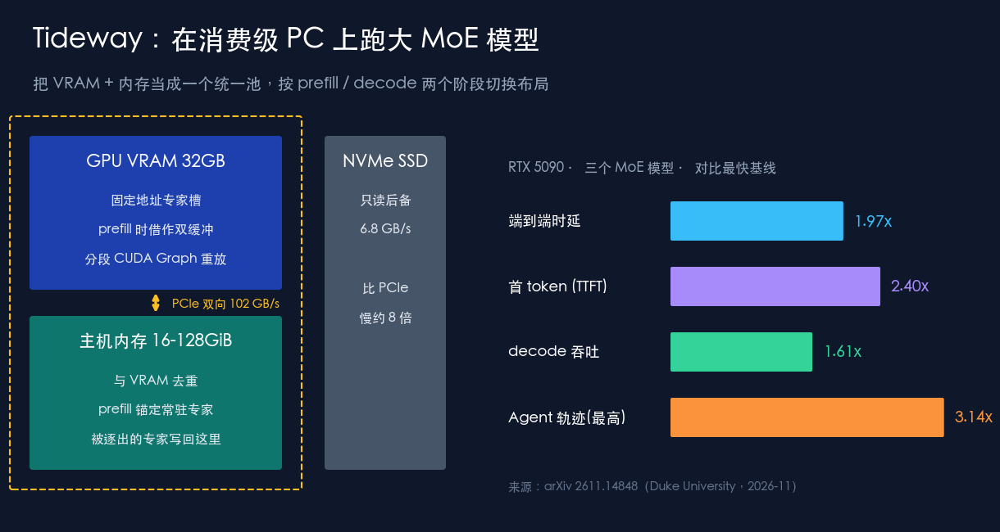

> 本文为 AI 前沿技术系列。事实部分基于论文 **Tideway: Phase-Aware Tiered Memory Management for MoE Inference on Consumer Devices**（arXiv:2611.14848，2026-11-10 提交；作者 Yifei Wang、Tsun-yu Yang、Danyang Zhuo、Yiran Chen 等，Duke University；Hugging Face Daily Papers 2026-11-19 列表）。代码开源于 [github.com/Afterglow231/Tideway](https://github.com/Afterglow231/Tideway)。论文目前是预印本、处于审稿中。标注「我的看法」的段落是我个人的分析，与论文结论分开。

## 一、背景：本地 Agent 想用大 MoE，卡在内存上

过去一年，开源 MoE（Mixture-of-Experts，混合专家）模型在推理和写代码上进步很快。MoE 的特点是总参数很大，但每个 token 只激活少数几个专家，例如论文评测用的 Qwen3.6-35B-A3B（总 35B，激活约 3B）、Gemma4-26B-A4B，以及 DeepSeek-V4-Flash（FP4 权重约 155GiB）。

激活参数少意味着算力需求不高，一张消费级显卡就能算得动。于是越来越多人想把编码 Agent 这类长任务放到本地跑，理由很实际：

- **隐私**：代码、文档不出本机；
- **成本**：Agent 一跑就是几十轮、上百万 token，API 账单很可观；
- **可定制**：可以针对自己的领域做适配。

问题在于**存**。论文统计了 2026 年的四组硬件数据（整机报价、3DMark 提交、BOINC 主机、Steam 硬件调查），结论一致：配 RTX 5090 的机器里 64–84% 只有 16–64GiB 内存，超过 128GiB 的最多占 11%；Steam 用户中 99% 在 16–64GiB 区间。而整机价格在 128GiB 之后陡增，256GiB 约 2.6 万美元，512GiB 约 4.1 万美元。再加上 AI 需求推高 DRAM 价格，「加内存」不是普通用户的现实选项。

结果就是：32GB 显存放不下，几十 GiB 内存也放不下，权重必然溢出到 NVMe SSD。而 MoE 激活哪个专家要到运行时路由后才知道，**跨层级的权重搬运直接落在每次前向计算的关键路径上**。

## 二、现有系统为什么慢：两个阶段，两种病

论文把问题拆成 prefill（处理输入）和 decode（逐 token 生成）两个阶段，二者的访问模式完全不同。

### 1. Prefill：循环扫描把 LRU 打穿

长 prompt 按 8K token 分块处理时，**每一块几乎会激活每一层的全部专家**。也就是说，每处理一块，整个模型的专家都要流过 GPU 一遍。

现有系统大多把内存当作显存的后备缓存，用类似 LRU 的按需换页。面对「从第 1 层扫到最后一层、再从第 1 层开始」的循环扫描，LRU 是最差的策略：加载后面层的专家时把前面层的挤掉，下一块开始时前面层又得从 SSD 读回来。

论文的测量（DeepSeek-V4-Flash，64GiB 内存，32K prompt）：64GiB 内存明明能装下 44% 的专家池，基线系统 prefill 阶段却有 **86–99%** 的专家流量来自 SSD。Tideway 把这个比例降到 52%。

### 2. Decode：CUDA Graph 用不上，CPU 调度成为瓶颈

Decode 每步只碰少数专家，权重 I/O 不大，但出现了另一个问题。CUDA Graph 通过重放一段预先录制的固定 kernel 序列来消除逐个 launch 的开销，可专家换页需要 CPU 读回路由结果、查专家位置、发起拷贝，这些依赖数据的主机操作没法录进图里。于是现有系统在换页路径上退回 eager 模式，每层发一长串单独的 kernel，CPU 编排开销和 GPU 空等占了 decode 时间的大头。llama.cpp 是另一个极端：launch 开销小，但 92% 的 decode 时间花在用 CPU 计算专家上。

### 3. 内存一缩，性能断崖

在 TraceLab 的真实编码 Agent 轨迹上，内存从 128GiB 降到 32GiB 时，基线的 TTFT 恶化约 1.1–6.4 倍，TPOT（每 token 时间）恶化约 1.3–7.0 倍。一旦溢出 SSD，无论内存多大，基线都要从 SSD 读走 155GiB 模型的大部分。

几个代表性基线的具体问题：

| 系统 | 做法 | 在内存不足时的问题 |
|---|---|---|
| FreeToken | prefill/decode 分别优化，VRAM 缓存内存里已有的专家副本 | 假设专家池全部在内存，放不下就没有退路 |
| llama.cpp | 内存映射文件 + CPU/GPU 混合计算 | 交给操作系统按页换页，粒度是页而非专家，溢出 SSD 后抖动 |
| FlashMoE | 支持 SSD，学习型替换策略 | 面对整模型 prefill 扫描仍然抖动 |
| SSD-LLaMA | 压缩 + 异步传输 + 跨层缓存 | 两阶段共用一个固定布局，内存利用不足 |

论文的总结是：这些系统都没有把有限的显存和内存当成**一个统一的池**来用。

## 三、Tideway 的核心设计

Tideway 由两个协同的组件构成：**跨层内存管理器**（决定专家放在哪、内存怎么划分）和**换页感知执行引擎**（决定 kernel 怎么跑、搬运怎么藏起来）。

### 1. 统一内存池：显存和内存不再各管各

关键观察是消费级 PC 上跨层成本极不对称。论文实测平台的数据：PCIe 5.0 固定内存带宽 H2D 57.6 GB/s、D2H 57.3 GB/s、双向合计 102.1 GB/s，而 NVMe SSD 读只有 6.8 GB/s。从内存给 GPU 补一个专家，比从 SSD 读快好几倍。

由此得出两条推论：

- **内存里的副本很值钱**，即使显存里也有一份，它也是下次快速补货的来源；
- **显存逐出的专家不该直接丢**，如果它在内存里没有副本，就沿几乎空闲的 D2H 链路写回内存，避免下次从 SSD 重读。

Tideway 在预留模型常驻状态和 KV cache 之后，把剩余显存和内存切成统一大小的「专家槽」，用一张 **Residency Table（驻留表）** 记录每个专家在哪个层级、哪个槽，并区分「跨层冗余副本」和「池中最后一份」。池的组织方式随容量变化：内存能装下全部专家时，内存放完整工作副本，显存缓存热点；只有显存加内存才装得下时，跨层去重扩大有效容量；两者加起来都不够时，从 SSD 按需换页，重点转为避免不必要的出池。

### 2. 阶段感知布局：prefill 和 decode 用两套内存布局

Agent 工作流不断在 prefill 和 decode 之间切换：每轮工具调用返回后，新内容要 prefill，然后 decode 生成下一步动作。Tideway 为两个阶段各维护一套布局，在阶段边界切换：

- **Prefill 布局**：从 decode 的专家缓存里「借」出显存，划出激活工作区和双缓冲权重暂存区；在内存里用 **锚点（anchor）** 钉住已常驻的专家，防止被扫描冲掉，只留一个小的 **流式窗口（Streaming Window）** 让 SSD 读上来的权重循环通过。
- **Decode 布局**：释放锚点，把借出的显存收回为固定地址的专家槽，内存按 LRU 管理。

我认为这是全文最值得借鉴的一点：它承认同一块内存在两个阶段的最优用法不同。Prefill 是一次性的顺序扫描，适合流式处理，不适合缓存；decode 是稀疏随机访问，适合缓存。数据库里早有类似思路（顺序扫描不污染 buffer pool），Tideway 把它用到了 MoE 专家调度上。

### 3. 副本感知替换：别把最后一份删掉

逐层独立 LRU 有两个浪费：专家从 SSD 经内存提升到显存后，两层各存一份；各层独立淘汰时看不到跨层冗余，可能删掉某个专家在池中的唯一副本。Tideway 用两条规则替代：

- **惰性去重回收**：专家提升到显存后保留内存副本，但标记为「可替换」。内存要分配时先用空槽，再回收可替换副本，最后才对其他常驻专家做 LRU。少量热门专家豁免去重，允许双份常驻，以减少反复的 PCIe 传输。
- **选择性写回**：显存逐出前先检查内存里有没有有效副本。有就直接释放；没有且内存有空槽或可替换槽，就写回内存；都没有才让它出池，且不会为此挤掉内存里的独占专家。

论文给了一个 10 槽的小例子：同样一次 prefill 加 decode，默认 LRU 池中只剩 7 个不同专家，Tideway 保持 9 个且没有出池；下一次 prefill 之后，默认策略要为 decode 从 SSD 重读两个专家，Tideway 直接从内存命中。

### 4. 流式 prefill 流水线

Prefill 逐层处理，用双缓冲重叠「第 l 层计算」和「第 l+1 层权重组装」。每层权重可能来自显存（GPU 内拷贝）、内存（PCIe）或 SSD（经流式窗口）。8K 的大分块让每层计算足够重，能盖住后面的传输。两个 CUDA event（release 和 ready）协调拷贝流和计算流，防止缓冲区被提前复用。

### 5. 分段 CUDA Graph：换页时也能重放

这是解决 decode 瓶颈的部分。Tideway 不再整层录图，而是把每层切成三段：

1. **注意力前段**：投影、归一化、RoPE 等（稀疏注意力因宽度可变保持 eager）；
2. **FFN 前段**：路由权重、专家 ID、共享专家，在主机需要读取路由结果处截断；
3. **FFN 后段**：按「槽 ID」而非专家 ID 计算被路由的专家。

三段在 warmup 时为每层各录一次，输入输出绑定到固定地址的持久缓冲区。之后每个 token 只更新缓冲区内容并按层重放。两段之间由主机处理换页：读回专家 ID，驻留表分配显存槽，必要时发起 D2H 写回和 SSD 读，再把槽 ID 上传，并把专家图排在同一 CUDA stream 的传输之后。专家全命中的层只付出查表和上传的代价；缺页只是让中间的处理程序变长，执行路径不变，也**不需要因为缺页重新录图**。

关键技巧在于第 3 段按「槽」寻址。专家换到哪个槽是运行时决定的，但图里的 kernel 只认固定地址的槽，所以一张图可以服务任意专家组合。

## 四、实验数据

**平台**：32 核 AMD CPU、RTX 5090（32GB，PCIe 5.0）、WD_BLACK SN850X 8TB NVMe，CUDA 13.0、PyTorch 2.11、Triton 3.6。实现约 1.18 万行（Python + C，kernel 用 Triton 和 CuTe DSL）。每个模型把内存上限分别设在 16–128GiB 之间。

**模型**：Gemma4-26B-A4B（BF16）、Qwen3.6-35B-A3B（BF16）、DeepSeek-V4-Flash（原生 FP4）。

**负载**：270 组固定形状配置（输入 4K–128K，输出 128–2K），以及 TraceLab 里 8 个多轮编码 Agent 会话的回放。

**基线**：FreeToken v0.1.2（扩展了 SSD 按需换页）、llama.cpp，以及在 FreeToken 后端上复现的 SSD-LLaMA 和 FlashMoE（二者未开源）。

| 指标（对比最快基线） | 平均 | 范围 |
|---|---|---|
| 端到端时延（固定形状） | 1.97x | 1.13x–3.18x |
| 端到端时延（TraceLab Agent 轨迹） | — | 1.20x–3.14x |
| TTFT（首 token 时间） | 2.40x | 1.15x–9.04x |
| Decode 吞吐 | 1.61x | 1.20x–2.28x |

几个值得注意的细节：

- **内存足够时也有收益**。在最高内存预算下，专家全部装得进统一池，Tideway 仍有 1.13–1.58 倍提速，来自去掉逐专家的 CPU 调度和重叠 PCIe 传输。
- **内存越紧，优势越大**。溢出到 SSD 的配置下，固定形状提速 1.95–3.18 倍，TraceLab 提速 1.47–3.14 倍。
- **Prefill 分块越大越占优**。32K prompt 下，分块从 1K 增到 8K，所有系统 TTFT 都下降（扫描次数变少），Tideway 的相对优势随之扩大，因为每层计算更重，更能藏住传输。
- **阶段切换后恢复更快**。Decode 每步时延在每轮 prefill 之后，Tideway 起点更低、收敛更快；即使 128GiB 能装下模型，部分基线仍有明显的冷启动尖峰。

**消融**（DeepSeek-V4-Flash，32K 输入，1K 输出）：

| 逐步加入的机制 | 端到端累计 | TTFT 累计 | TPOT 累计 |
|---|---|---|---|
| 基础版（逐层 LRU + 同步加载 + eager） | 1.00x | 1.00x | 1.00x |
| + 跨层内存管理器 | 1.23x | 1.55x | 1.11x |
| + 异步传输与 prefill 流水线 | 约 1.67x | 2.94x | 1.37x |
| + 分段 decode 图 | 2.28x | 2.94x | 2.04x |

消融说明分工很清楚：内存管理和流水线主要救 prefill，分段 CUDA Graph 主要救 decode。三者缺一不可，没有一个「银弹」。

**开销**：图录制和校验只在 warmup 时做一次，几秒完成；持久缓冲区和驻留表占不到 32GB 显存的 3%。所有写回都发生在显存和内存之间，SSD 只读，不会增加消费级 SSD 的写入磨损，反而因为读得少减轻了 I/O 压力。

## 五、与同类方案对比

| 方案 | 专家放在哪里算 | 内存不够时 | 适合场景 |
|---|---|---|---|
| CPU 算冷专家（Fiddler、KTransformers） | 冷专家在 CPU 上算 | 受限于 CPU 算力 | 内存大、CPU 强的工作站 |
| GPU 预取（MoE-Infinity、SwapMoE） | 全在 GPU 上算，提前预取 | 假设内存充足 | 内存够大的服务器 |
| 操作系统换页（llama.cpp mmap、CUDA Unified Memory） | 页粒度按需调入 | 页粒度抖动 | 简单易用，性能一般 |
| 压缩与学习型替换（SSD-LLaMA、FlashMoE） | GPU 算，SSD 做后备 | 布局固定或仍被扫描冲掉 | 有 SSD 后备的单机 |
| **Tideway** | GPU 算，显存加内存统一池，SSD 只读后备 | 阶段感知布局 + 副本感知替换 | 显存和内存都紧张的消费级 PC |

论文也说明 Tideway 与量化、投机解码、前瞻预取正交：已经支持 BF16 和 FP4；SSD 慢于 PCIe 时可以叠加无损压缩；投机解码的多 token 验证可以通过加宽录制段的 token 维度接入，不用因缺页重新录图。

（注：消融表第三行的「约 1.67x」是我按论文给出的 1.23x 与 1.36x 连乘算出的，论文原文只给出了每步的增量和最终的 2.28x。）

## 六、优点、局限与开放问题

**优点**

- **问题选得准**。消费级硬件的真实瓶颈是内存容量和 PCIe/SSD 带宽，不是算力。论文用硬件普查数据而不是假设来论证这一点，说服力强。
- **系统级协同而非单点技巧**。替换策略、布局切换、流水线和图重放是一起设计的，消融显示每部分都贡献显著。
- **面向 Agent 负载评测**。用多轮编码 Agent 轨迹回放，覆盖了反复的 prefill/decode 切换和不断增长的上下文，比单次问答更接近本地 Agent 的实际用法。
- **开源、不改模型**。无损，不需要重训或额外的预测器。

**局限（部分来自论文自述，部分是我的看法）**

- **KV cache 与专家争内存**。Tideway 先预留 KV 再分专家槽，上下文越长，留给专家的空间越少。论文把 KV 与专家联合管理列为未来工作。编码 Agent 的上下文动辄几十 K，这个问题在实际使用中会很突出。
- **单会话、单 GPU**。论文评测的是一个模型服务一个会话。如果本地同时跑多个子 Agent（论文也提到 Codex CLI、OpenCode 会派生子 Agent），专家工作集会叠加，需要额外的调度和准入控制。
- **硬件条件偏高端**（我的看法）。实验用的是 RTX 5090 + PCIe 5.0 + 高速 NVMe。在 PCIe 4.0、显存 16–24GB、SSD 更慢的机器上，绝对速度会低很多，「SSD 比 PCIe 慢约 8 倍」这个比值也会变化，策略收益是否保持需要自己测。
- **论文只给相对提速**（我的看法）。正文主要报告相对最快基线的倍数，读者很难判断在 64GiB 内存下跑 DeepSeek-V4-Flash 的绝对 tokens/s 是否达到「能用」的程度。建议看代码仓库或自己测。
- **基线有复现成分**。SSD-LLaMA 和 FlashMoE 是作者在 FreeToken 后端上复现的，复现质量会影响对比结论。
- **预印本**。结果尚未经同行评审。

## 七、我的看法

1. **本地大模型的竞争点正在从「能不能装下」转向「怎么在溢出时保持速度」**。量化把权重压小一个台阶，但前沿 MoE 的体量增长更快，溢出到 SSD 会是常态。专家粒度的分层存储管理会和量化一样，成为本地推理引擎的标配能力。
2. **MoE 的稀疏性是一把双刃剑**。Decode 时稀疏让换页可行，prefill 时却几乎全激活。任何只看 decode 稀疏性的卸载方案，在 Agent 这种长输入、多轮 prefill 的负载下都会吃亏。Tideway 的价值正在于把 prefill 当一等公民处理。
3. **「按槽寻址」是一个可迁移的思路**。把动态的数据位置变成固定地址上的内容更新，让静态执行图能处理动态数据。这个技巧适用于其他想在动态负载下保留 CUDA Graph 的场景，比如 LoRA 适配器热切换、动态 KV 块。
4. **对普通用户而言，加内存仍然是最划算的升级**。论文数据显示内存越紧张，所有系统越慢；Tideway 缩小了差距，但没有消除差距。从 32GiB 升到 64GiB 的花费远小于换显卡。

## 八、落地建议

如果你想在自己的 PC 上用本地 MoE 跑 Agent：

1. **先算账**：模型权重大小（含量化格式）与显存加内存之和对比。能全部放进内存时，用 llama.cpp 或 FreeToken 这类成熟引擎就够了；放不下、要溢出到 SSD 时，才是 Tideway 这类系统的主场。
2. **SSD 选高速 NVMe 并放在 CPU 直连通道上**。溢出后 SSD 读带宽直接决定 TTFT 下限。
3. **Prefill 分块尽量调大**（在显存允许的范围内）。论文显示从 1K 到 8K，所有系统 TTFT 都在下降，因为每块都要扫一遍全部专家。
4. **控制 Agent 的上下文长度**。KV cache 会挤占专家空间；做上下文压缩、裁剪工具输出，不光省 token，也直接提升本地推理速度。
5. **评估本地引擎时用 Agent 轨迹测**，不要只测单次短问答。多轮 prefill/decode 切换才会暴露缓存被冲掉、冷启动尖峰这些问题。
6. **给推理引擎开发者**：检查你的缓存策略在「循环顺序扫描」下的表现；考虑把显存逐出的数据写回内存而不是直接丢弃；在动态换页路径上尝试分段录图加槽寻址，而不是整体退回 eager。

## 九、结语

Tideway 处理的是一个很具体的工程问题：在显存和内存都不够的普通 PC 上，让大 MoE 模型跑得不那么慢。它的办法也不神秘：统一池、分阶段布局、别删最后一份副本、换页时保住 CUDA Graph。这些机制组合起来，在 RTX 5090 上带来平均约 2 倍的端到端提速。本地 Agent 想要普及，这类「把每一 GB 内存和每一 GB/s 带宽用到位」的系统工作必不可少。

## 参考

- Yifei Wang et al. *Tideway: Phase-Aware Tiered Memory Management for MoE Inference on Consumer Devices*. arXiv:2611.14848, 2026. [arxiv.org/abs/2611.14848](https://arxiv.org/abs/2611.14848)
- 代码：[github.com/Afterglow231/Tideway](https://github.com/Afterglow231/Tideway)
- Hugging Face Papers 页面：[huggingface.co/papers/2611.14848](https://huggingface.co/papers/2611.14848)
- 相关阅读（本博客）：[投机解码](/ai/)、[Agent 推理服务基础设施](/ai/)
