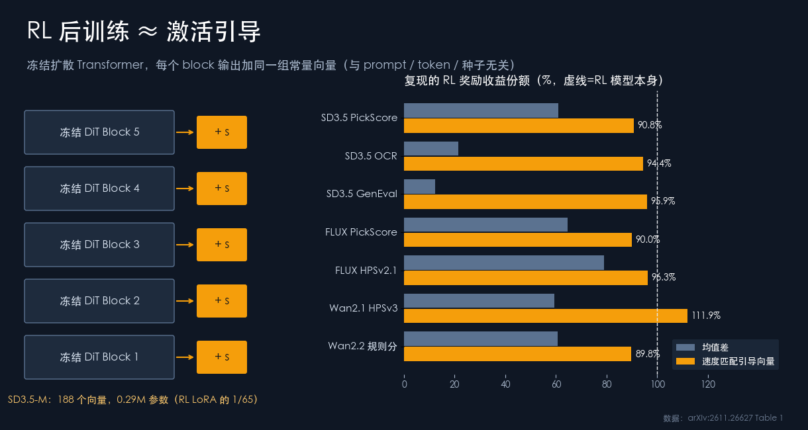

> 本文为 AI 前沿技术系列。事实部分基于论文 **RL Post-Training in Diffusion Transformers Is Activation Steering**（arXiv:2611.26627，2026-11-19 提交；作者 Tuna Han Salih Meral、Kaan Oktay、Alec Helbling、Atakan Kara、Duen Horng Chau、Pinar Yanardag，来自 Virginia Tech、fal、Georgia Tech、IBM Research；Hugging Face Daily Papers 2026-11-20 列表）。论文是预印本，尚未经过同行评审，截至写作时未见公开代码。标注「我的看法」的段落是我个人的分析，与论文结论分开。

## 一、背景：视觉生成的 RL 后训练越来越普遍，但没人说清它改了什么

过去一年多，文生图和文生视频模型的后训练流程基本定型为两步：先做预训练和监督微调，再用强化学习对奖励做优化。代表方法有：

- **Flow-GRPO**：把 GRPO（组相对策略优化）搬到 flow matching 模型上，用 OCR 准确率、GenEval 构图分、PickScore 偏好分做奖励，在 SD3.5-M 上显著改善了文字渲染和多物体构图。
- **DanceGRPO**：对 FLUX.1-dev 做全参数 RL，奖励为 HPSv2.1。
- 视频方向有 GenRL（Wan2.1-1.3B，奖励 HPSv3 + VideoAlign）和 VBVR-Pro 的 RLVR（Wan2.2-5B，基于规则的可验证奖励）。

这些 RL 改动通常以 LoRA 或全参数微调的形式写进权重。权重更新 ΔW 作用在每个 token 的输入 x 上，产生的激活变化 ΔW·x 会随 prompt、token、采样步变化。这很符合直觉：「把海报上写上 GRAND OPENING」和「画三只猫两条狗」需要的改动显然不一样，模型似乎必须学会新的、依赖输入的变换。

论文问的问题很直接：**RL 带来的收益里，有多少其实不需要依赖输入？** 如果只允许加一个对所有输入都一样的常量偏移，能拿回多少？

这个问题在语言模型那边已经有一些线索。此前有工作发现 LLM 的 RL 微调只更新一小块子网络、模型离底座很近、RL 主要提高底座本来就会采样到的答案的概率；也有人用 RL 直接训练 steering vector（引导向量），在数学奖励上接近完整 RL 微调。但扩散模型不同：一次奖励提升对应的是整张图或整段视频按 prompt 的变化，「一个常量能解决问题」在这里更反直觉。

## 二、方法：给冻结底座加一组常量向量

### 2.1 引导向量放在哪

SD3.5-M 是 MMDiT 结构：图像 token 和文本 token 分成两路 stream，在 joint attention 里互相读取对方的 key/value。论文在**每个 block 的输出**上，给该 stream 的每一个 token 加上同一个向量 s：

h'ᵢ = hᵢ + α·s（α 为引导强度，主实验取 1）

向量只按以下维度区分，和 prompt、token、随机种子都无关：

- **block 编号**和 **stream**（图像路 / 文本路）；
- **CFG 的两个 pass**（条件 pass 和无条件 pass 各一套）。原因是 CFG 会把条件速度的变化乘以 w、无条件速度的变化乘以 (1−w)，当 w>1 时两个系数符号相反，共用一个向量无法分别控制；
- **采样步分桶**：只分「前期」「后期」两个桶。早期步决定布局，后期步细化细节。论文统计 RL 模型的平均激活变化，2 个桶就保留了 8 个桶 83%–94% 的能量，1 个桶和 2 个桶的奖励收益也几乎一样。

SD3.5-M 上总共 188 个向量，288,768 个参数，是 Flow-GRPO 训 PickScore 用的 rank-32 LoRA（18.8M）的 1.5%，约 1/65。推理成本是每个 block 输出做一次向量加法，几乎为零。另外由于向量不依赖 token 数，512px 上拟合的向量可以直接用到 768px、1024px，也能迁移到不同采样步数和 CFG 系数。

和 LoRA 的关系值得说一句：一个 rank-1 LoRA 的输出是 u·(vᵀx)，相当于一个固定方向 u 乘上随输入变化的权重。引导向量就是把这个权重也固定掉，是更受限的形式。

### 2.2 怎么拟合：不看奖励，只匹配速度

论文用两种方式得到这组向量。

**基线：均值差（mean-difference）。** 让 RL 模型和底座在同一批带噪状态上前向，取 block 输出之差，在 token、prompt 和该桶内的噪声水平上求平均。这是激活引导领域常用的「对比均值」做法，不需要训练。

**主方法：速度匹配（velocity matching）。** 先用 RL 模型对训练 prompt 采样出最终图像并缓存，再把这些图像重新加噪到随机噪声水平 t，让「底座 + 引导向量」预测的速度去逼近 RL 模型在同一状态下预测的速度，最小化两者的 L2 距离。整个过程两个模型都冻结，只训向量，**损失里没有任何奖励**，训练循环里也不需要奖励模型和在线采样，本质是在缓存样本上做回归。成本是每个图像模型最多 17 个 H100 GPU 小时，视频模型最多 70 个。

这个设计很聪明：它把问题从「常量能不能优化奖励」变成「常量能不能模仿一个已经训好的 RL 模型」，从而能干净地测量 RL 收益里有多少是常量可以解释的。

## 三、核心结果：常量偏移拿回了九成以上的收益

### 3.1 八个公开 RL 模型上的复现率

论文选了 8 个作者公开发布的 RL checkpoint，覆盖 4 个底座、4 种 RL 方法、LoRA 和全参数微调。下表的「份额」指相对于 RL 模型自身收益的百分比（括号为 95% 置信区间，数据摘自论文 Table 1）：

| 底座 | RL 方法 / 更新方式 | 奖励 | RL 收益 | 均值差份额 | 速度匹配份额 |
|---|---|---|---|---|---|
| SD3.5-M | Flow-GRPO / LoRA | PickScore | +1.560 | 61.0% | 90.8% [89.8, 91.7] |
| SD3.5-M | Flow-GRPO 无 KL / LoRA | PickScore | +1.693 | 70.8% | 95.2% |
| SD3.5-M | Flow-GRPO / LoRA | OCR | +0.344 | 21.5% | 94.4% |
| SD3.5-M | Flow-GRPO / LoRA | GenEval | +0.271 | 12.2% | 95.9% |
| FLUX.1-dev | Flow-GRPO / LoRA | PickScore | +1.522 | 64.7% | 90.0% |
| FLUX.1-dev | DanceGRPO / 全参 | HPSv2.1 | +0.054 | 79.0% | 96.3% |
| Wan2.1-1.3B | GenRL GRPO / LoRA | HPSv3 | +1.309 | 59.3% | 111.9% |
| Wan2.2-5B | VBVR-Pro RLVR / 全参 | 规则分 | +0.080 | 60.8% | 89.8% [76.2, 105.6] |

几个值得注意的点：

1. **对「依赖 prompt」最强的任务也成立。** OCR（把 prompt 指定的文字写对）和 GenEval（物体数量、颜色、位置组合）都是典型的 prompt 相关能力，复现率仍有 94.4% 和 95.9%。论文还专门挑了底座在 4 个种子里 3 个都失败的 146 个 GenEval 难题，在留出种子上，引导向量仍拿回 RL 模型 97.7% 的收益。对「底座失败、RL 成功」的 prompt-种子对，引导向量能解出 GenEval 91.4%、OCR 75.3%，和 RL 模型自己换个种子的 93.3%、71.6% 接近。
2. **全参数微调也成立。** DanceGRPO 和 VBVR-Pro 都改了全部权重，复现率依然很高。所以「参数少」并不意味着「RL 更新是低秩的」，作者在局限部分特别强调了这一点。
3. **视频上的迁移。** Wan2.1 的向量在 33 帧片段上拟合，直接用到 81 帧上评测；HPSv3 复现率超过 100%，说明速度匹配只是模仿，剩下的偏差既可能拉低奖励也可能抬高奖励。
4. **最朴素的均值差远远不够。** OCR 上均值差只有 21.5%，GenEval 只有 12.2%。论文分析：PickScore 上均值差方向基本对，但模长太小；OCR 上真正有用的变化不在平均方向上，拟合向量与均值差正交的分量单独保留了 96% 的收益。

### 3.2 常量要放对位置

论文还对比了其他「输入无关」的改法：只拟合一个 prompt token（已有工作 RaTE 的做法）只能拿回 7%–32%；拟合 block 门控缩放、条件偏置、固定 prompt 后缀、调高 CFG，收益都不到引导向量的 30%。可见关键在于「常量 + 放在每个 block 输出 + 按 pass 和步数区分」这个组合。

### 3.3 副作用也一起复现了

如果引导向量只是「刷分」，它不该连 RL 模型的副作用也一并复制。实际结果（PickScore 带 KL 的 SD3.5-M 模型）：

- 在训练目标之外的 HPSv2.1 和 ImageReward 上，收益与 RL 模型相当（+0.0393 vs +0.0407，+0.400 vs +0.388）。
- RL 模型有已知的颜色饱和度下降，色彩能量为底座的 0.550，引导版本为 0.542。
- 多样性下降也同步：空 prompt 多样性 0.850 vs 0.847，同 prompt 多样性 0.517 vs 0.522。
- 作者还试了「是不是 RL 只是调了全局色调」：拟合一个全局颜色和色调变换，只能拿回 8% 的 PickScore 收益。所以收益不是简单的调色。

### 3.4 和同等大小的 LoRA 比，以及与 SFT 的对照

一个自然的质疑是：也许只是因为参数量够了？论文拟合了一个参数量与引导向量相同的 LoRA（依赖输入），用同样的数据和步数。结果在 SD3.5-M、FLUX.1-dev、VBVR-Pro 上两者差异的置信区间都包含 0；在 Wan2.1 上，同等大小 LoRA 只有 69.7%，引导向量是 111.9%。**在模仿 RL 模型这件事上，输入依赖性没带来可测的好处。**

反过来看监督微调（SFT）。用 DreamBooth 教底座画它不会画的人或物体时，引导向量只能拿回 68%–83%（6 个虚构人物身份）和 73%–95%（4 个公开 DreamBooth LoRA），同等大小 LoRA 能拿回更多。这个对照很重要：**常量足够的现象是 RL 特有的，SFT 教新东西时常量不够用。**

### 3.5 直接用 RL 训练向量：超过原 RL 模型

前面都是模仿已有的 RL 模型。作者接着问：如果 RL 一开始就只能训练这组向量，能不能找到同样的收益？他们冻结 SD3.5-M，向量从 0 初始化，用 Flow-GRPO 只训向量，训练过程看得到奖励但看不到 RL 模型。

- OCR：达到 RL 模型收益的 104.6%；
- PickScore：103.6%；
- 用户研究（50 个测试 prompt、25 位评审）：对底座胜率 60%–65%（显著），对 RL 模型胜率 50%–52%（无显著差异）。

这说明速度匹配拿不回的那 5%–10% 是拟合造成的损失，而非常量这个形式的上限。

## 四、机制：同一个常量，怎么变成按 prompt 不同的效果

这是全文最有意思的部分。向量本身不带任何 prompt 信息，那「写对 GRAND OPENING」的能力从哪来？答案是：**prompt 相关的部分由冻结的底座自己完成**，常量只是把底座推向它本来就能算出的方向。论文在 SD3.5-M 上给了两条发现。

**发现一：收益集中在条件 pass、早期步数和文本 stream。**

- 只在条件 pass 上加向量，收益反而比全套还高。原因是两个 pass 的向量方向相近，而 CFG 会减去无条件 pass，去掉无条件向量相当于放大了净变化，效果类似调大 w。
- 早期步数桶贡献远大于后期，与「早期定布局」的经验一致。
- 全套向量中，单独保留文本 stream 的向量就承载了大部分收益。
- 三个选择叠加：只用 35,328 个参数（全套的 12%，rank-32 LoRA 的 0.19%，约 1/531），OCR 上拿回 89.5%，PickScore 上 73.7%。

**发现二：收益通过「图像 token 从文本 token 读到的内容」传进图像。**

文本 stream 的向量只改文本 token，而速度是从图像 stream 投影出来的，所以变化必须穿过 joint attention。作者做了一个干预：让图像 query 读取的文本 key/value 换回未引导底座的版本，其他都不变。结果引导向量只剩 20.5%（OCR）和 10.5%（PickScore）的收益。对 RL 模型做同样的替换，也只剩 26.4% 和 24.5%。反向操作（重置文本 token 从图像 token 读到的内容）则保留至少 84.4%。在 OCR 例子里，这个替换会让两个模型写出的清晰文字都退回底座那种乱码。

**两者走的是同一条通路。** 这比「分数接近」更有说服力：引导向量不只是碰巧达到相同奖励，它和 RL 在模型内部借助同一个路由起作用。

作者还给了一个单注意力头的推导：如果所有文本 key 平移同一个向量、所有文本 value 平移同一个向量，图像 token 对文本的注意力份额和头输出的变化，会依赖该 token 的 query 和各 stream 的加权平均 value。也就是说，常量偏移经过 attention 和归一化后，自然变成了按 token、按 prompt 不同的变化。相比之下，纯 cross-attention 结构里，归一化之后共享的 key 偏移会被 softmax 抵消；Wan2.1 上只在 key 输入加常量确实拿不回任何 HPSv3 收益，和这个预测一致。

## 五、和同类方案的对比

| 方案 | 改什么 | 是否依赖输入 | SD3.5-M 上的参数量级 | 与本文结论的关系 |
|---|---|---|---|---|
| 全参数 RL（DanceGRPO 等） | 全部权重 | 是 | 数十亿 | 被模仿对象，收益大部分可由常量复现 |
| LoRA RL（Flow-GRPO） | 低秩权重增量 | 是 | 18.8M（rank-32） | 同上；同等大小 LoRA 模仿效果不优于常量 |
| Prompt tuning / RaTE | 输入端一个软 token | 否 | 极小 | 位置不对，只拿回 7%–32% |
| BitFit / DiffFit | 偏置、缩放，用任务损失训 | 否（偏置） | 小 | 形式接近，但目标是适配新数据，不是解释 RL |
| 均值差激活引导 | block 输出加平均差 | 否 | 0.29M | 无需训练，但 OCR 只有 21.5% |
| **本文：速度匹配引导向量** | block 输出加常量 | 否 | 0.29M | 复现 90%–96%（图像） |
| **本文：RL 直接训引导向量** | 同上 | 否 | 0.29M | 超过原 RL 模型（103.6%–104.6%） |

LLM 方向的类比：Sinii 等人用 RL 训练 LLM 的 steering vector，在数学推理上接近完整 RL；Venhoff 等人用分类器门控的引导向量逼近推理模型。本文把这一观察推广到扩散 Transformer，并且给出了「通过 joint attention 的文本 KV 路由」这一结构层面的解释。同期还有 First-Order Steering 把权重更新一阶近似为引导向量，思路互补。

## 六、优点、局限与开放问题

**优点（事实层面）**

- 覆盖面广：8 个公开模型、4 个底座、图像和视频、LoRA 与全参、多种奖励，结论不是在单一设置上挑出来的。
- 统计规范：所有收益都在同 prompt、同初始噪声下配对比较，并给出 95% bootstrap 区间。
- 有对照：均值差、同大小 LoRA、SFT（DreamBooth）、其他常量位置，都说明了「常量 + block 输出 + 速度匹配」的必要性。
- 有机制：不只报分数，还用 KV 替换干预找到了收益通路，并证明 RL 模型用的是同一条通路。

**局限（多数作者自己承认）**

- 只证明了**充分性**，没证明必要性。RL 模型内部未必真的「就是」在加常量，只是它的效果可以被常量复现。
- 只测了**策略梯度类** RL（Flow-GRPO、DanceGRPO、GRPO、RLVR）。DPO 类偏好优化和奖励反传（如 ReFL、DRaFT）没测。
- 视频只有两个模型。作者说他们评估的 6 个公开视频 RL 模型中只有这两个在评测奖励上有显著收益，这本身也说明视频 RL 的收益还比较脆弱。
- 机制分析只在 SD3.5-M（MMDiT 结构）上做。FLUX 的单流/双流混合结构、Wan 的 cross-attention 结构里，收益具体怎么传递还需要单独验证。
- 缺少公开代码，复现门槛目前偏高。

**开放问题**：作者留下的问题是「优化这些奖励时，新的输入相关变换到底有没有用，还是当前 RL 方法根本学不出来」。这两种解释对后续工作的指导完全不同。

## 七、我的看法

**1. 这篇论文最大的价值是给「RL 只是在挖掘底座潜力」提供了一个可量化的视觉侧证据。** LLM 社区已经在争论 RLVR 到底是在教新能力还是在提高已有答案的采样概率。本文在扩散模型上给出的答案偏向后者：底座本来就能写对字、摆对物体，只是默认不往那里走；RL 学到的主要是「往哪推」。SFT 对照组进一步支持了这个解释，教新身份时常量就不够了。

**2. 当前视觉奖励本身可能太「单一」。** PickScore、HPS、OCR、GenEval 都是全局性的偏好或正确率信号。一个全局方向能解释九成收益，也可能意味着这些奖励只要求「整体更像好图」，没给模型施加需要复杂条件变换的压力。如果奖励更细（逐区域、逐物体、逐帧物理一致性），常量够不够用就是一个值得做的实验。我认为这比「RL 学不出新变换」更可能是主要原因，但这是推测，需要实验验证。

**3. 对 reward hacking 的启示。** 引导向量连颜色饱和度下降、多样性下降一起复现了。这提示这些副作用很可能也是「沿某个全局方向推过头」的结果。既然方向是显式的向量，就可以直接调 α、只用条件 pass 或早期步，在收益和副作用之间做精细的权衡，这比重新训一个带不同 KL 系数的 LoRA 便宜得多。

**4. 工程上的潜在形态：「奖励插件」。** 0.29M 参数、零推理成本、跨分辨率迁移，非常适合做成可以热插拔、可叠加的模块，例如一个 OCR 向量、一个审美向量、一个品牌风格向量，按请求组合。不过论文里不同奖励的向量能否线性叠加、会不会互相干扰，并没有测试。实际组合前要自己做实验。论文里有一个相关信号：用 OCR 引导底座的文本 KV 时，OCR 模型保留 95.2% 收益，换成 PickScore 引导的文本 KV 只剩 44.0%，说明不同奖励的方向差异很大。

**5. 对评估 RL 改进的启示。** 以后看到一个新的视觉 RL 方法声称大幅提升，可以先问一句：它的收益有多少能被常量引导复现？如果九成以上都能，那么它的贡献更接近「找到了更好的方向」，而不是「学到了新能力」。我建议把「常量引导复现率」当作一个诊断指标，和奖励分数一起报告。

## 八、可落地的建议

1. **做视觉 RL 后训练，先试最便宜的参数化。** 在上 LoRA 或全参 RL 之前，先冻结底座、只用 Flow-GRPO 训 block 输出上的引导向量（按 pass 和 2 个步数桶区分）。论文数据说明在 OCR、PickScore 这类奖励上它可能就够了，而且更不容易破坏底座。
2. **已有 RL 模型，可以「蒸馏」成向量。** 用速度匹配在缓存样本上回归，不需要奖励模型，单个图像模型不超过 17 个 H100 小时。得到的向量部署时几乎零开销，也方便和其他 LoRA 共存。
3. **不要用均值差偷懒。** 均值差在 OCR、GenEval 上只有 12%–22%，必须用速度匹配或直接 RL 训练。
4. **把引导强度 α 当作推理期旋钮。** 用它在奖励收益和饱和度、多样性副作用之间调节，比调 KL 重训便宜。
5. **优先在条件 pass、早期步数、文本 stream 上加向量。** 这三处集中了大部分收益，能把参数压到 3.5 万级别，便于做 A/B 实验。
6. **区分「方向问题」和「能力问题」。** 如果你的目标是让模型学会底座画不出来的东西（新角色、新物体、新风格），依然要用 SFT 或 LoRA；常量引导的适用前提是底座本来就有这个能力。
7. **报告新方法时加一个常量基线。** 这能帮助你和读者判断收益究竟来自哪里。

## 九、结语

这篇论文的结论可以用一句话概括：在当前的扩散 Transformer 上，策略梯度 RL 后训练的大部分收益，相当于给冻结底座的每层输出加一个固定偏移，具体按 prompt 生效的工作由底座自己的 attention 完成。它没有否定 RL 的价值，反而说明 RL 是在高效地挖掘预训练模型已有的能力。对工程团队，它提供了一种更便宜、更可控的后训练形态；对研究者，它提出了一个尖锐问题：我们的视觉奖励和 RL 算法，是否还没有能力逼出真正的新变换。

## 参考

- Meral, T. H. S., Oktay, K., Helbling, A., Kara, A., Chau, D. H., Yanardag, P. *RL Post-Training in Diffusion Transformers Is Activation Steering.* arXiv:2611.26627, 2026. [arxiv.org/abs/2611.26627](https://arxiv.org/abs/2611.26627)
- Hugging Face Daily Papers, 2026-11-20. [huggingface.co/papers/2611.26627](https://huggingface.co/papers/2611.26627)
- Flow-GRPO、DanceGRPO、GenRL、VBVR-Pro 及文中其他引用，见论文参考文献列表。
