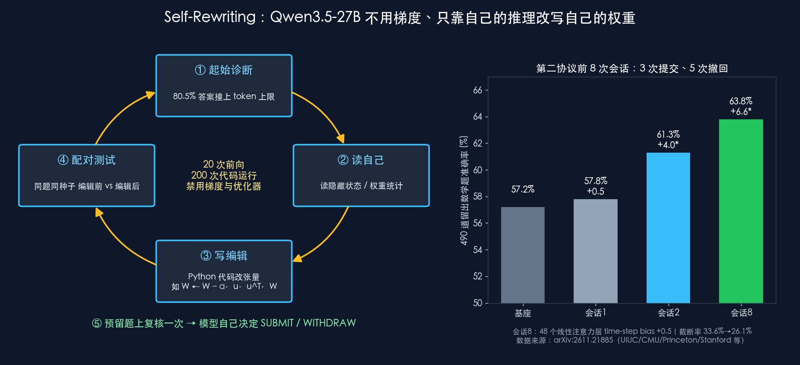

> 本文为 AI 前沿技术系列。事实部分基于论文 **Language Models Can Rewrite Their Own Weights**（arXiv:2611.21885，v1 2026-11-16，v2 2026-11-18；作者 Jiajun Fan、Neil He、Changyi Yang、Andy Mao、Xi Zhu、Chaoran Cheng、Kaiqu Liang、Shuaike Shen、Zetian Li、Ruihan Guo、Ge Liu，单位包括 UIUC、CMU、Rutgers、Princeton、Stanford、Yale；Hugging Face Daily Papers 2026-11-20 列表）。论文是预印本，未经同行评审，截至写作时我没有找到公开代码。标注「我的看法」的段落是个人分析，与论文结论分开。

*题图说明：本次运行环境中没有可调用的 imagegen 图像生成工具，题图用 matplotlib 按论文数据绘制，数据见正文。*

## 一、背景：让模型变好，今天只有三条路

一个大模型训练完就冻结部署。想让它在某类任务上更好，常见做法有三类：

1. **再训练**：SFT、RL、蒸馏。效果写进权重，但需要训练管线、优化器状态和集群，通常只有模型的拥有者能做。
2. **改上下文**：提示词、记忆、Agent 外壳（harness）。谁都能做，但任务一换就没了，而且每次回答都要多付 token。
3. **加推理计算**：多次采样、自我反思、更长的思维链。同样是每次回答都要付费。

论文提出第四条路，叫 **self-rewriting（自我改写）**：把模型自己的权重交给它，让它像工程师调试程序一样读、改、测，最后把改动留在权重里。这里没有梯度，也没有优化器，模型做的每一个数值修改都来自它自己写的代码和推理。

这个想法有直接的前身。Takehi、Teoh、Zhang、Khattab 在 2026 年的博客 *Sparks of Weight-Space Programming* 里，让一个前沿大模型去诊断一个小推理模型的「思维循环」问题，找到一个方向并从两层 MLP 权重里减掉它，不做任何训练。那篇博客把「模型改自己」列为未来工作。这篇论文做的就是这一步：编辑者和被编辑者是同一个模型，过程中没有更强的模型参与。

## 二、实验是怎么搭的

### 2.1 模型与任务

- **模型**：Qwen3.5 的 2B、4B、9B、27B 四个尺寸，层内混合 Gated DeltaNet 线性注意力和全注意力，全部开启 thinking。27B 共 64 层，其中 48 层是线性注意力。
- **练习题**：DeepScaleR 中的 3000 道数学题，去掉了与 MATH-500、AIME 2024/2025、HMMT 2025-02、AMC 2023、OlympiadBench、GPQA-Diamond 重叠的题目。另有 1000 道同源题作为留出集，任何会话都看不到。
- **评分规则**：思维链在 token 预算内没有结束就算错。默认预算 16,384 token；27B 自我编辑的部分会话把预算设为 4,096，以便在时间内跑更多测试。

### 2.2 一次「会话」里模型能做什么

会话开始前，框架先跑一次**起始诊断**：在练习题上作答，报告准确率、撞上 token 上限的比例、重复循环的比例、已完成答案的正确率。之后模型每轮写一段理由和一个动作，动作有三种：

- **Code**：在 CPU 上的持久 Python 会话里读写被编辑权重的张量。框架提供一个辅助函数计算 `W − α·u·uᵀ·W`，即把矩阵 W 往隐藏状态方向 u 上写出的分量削弱比例 α。
- **Generate**：选练习题，用未编辑、已编辑或两者同时作答。两者同时作答时使用相同的题目和随机种子，构成**配对测试**，报告逐题差值的均值和标准误。
- **Read**：在自选文本上读出隐藏状态。

预算：每次会话 20 次前向（Generate/Read）、200 次代码运行，外加时间上限和一个不告诉模型的轮数上限。任务要求是「明显减少因故障丢掉的答案、且不降低准确率；如果做不到就不要提交编辑」。不提交就是撤回。

### 2.3 约束

Python 会话关闭梯度，拒绝任何计算梯度或运行优化器的调用；没有 GPU，不能加载模型、开进程或联网，所以模型只能通过那 20 次计数的前向来运行自己。它不能改输入嵌入、最后一层归一化和输出层，也不能做「整体缩放一个张量」的编辑，因为那相当于改采样温度。

### 2.4 两个协议

- **第一协议**：模型自己决定是否提交。
- **第二协议**（论文主结果）：每次会话都从基座权重开始；一次前向最多能并排测试 4 个候选编辑；Python 会话被封闭在工作目录里；另外预留 300 道练习题，会话既读不到也用不了。模型准备提交前，框架在其中 256 道上（每题 2 个答案，4,096 token）测一次，再由模型选 SUBMIT 或 WITHDRAW。被撤回的编辑不做评估。

### 2.5 「损坏副本」实验

在模型自身权重上，一次编辑没起作用，你无法区分是「模型不会改」还是「这个故障在权重里本来就没有可改的原因」。所以作者另设了一个有确定答案的任务：把 27B 第 30 层 MLP 输出矩阵（`mlp.down_proj`）中连续 8 行（第 3068 到 3075 行）换成方差为 (200σ)² 的高斯噪声，σ = 0.0111 是该矩阵元素的标准差。20σ 和 60σ 的损坏几乎不影响准确率，200σ 让模型在 24 道简单题上从 69.8% 掉到 0。

编辑者是完好的模型，但它读到的权重、跑出的每一次前向都来自损坏副本。它只被告知「副本里有些值坏了，可能是内存或硬件故障」，不知道是哪些值、在哪里、怎么坏的。作者检查了代码记录，模型从没打开过原始权重或损坏记录文件（文件访问没有被硬性封锁）。

## 三、结果：它到底改了什么，改了以后怎样

### 3.1 修复损坏副本：找出那个矩阵，把异常值截断

27B 模型的做法相当像一个经验丰富的工程师。它逐一计算每个 MLP 和线性注意力输出矩阵「最大权重 / 典型权重」的比值，发现第 30 层 MLP 输出矩阵里有一个权重是中位数的 1397 倍，而其他输出矩阵最高也只有 162.3 倍。它据此点名了被损坏的矩阵。

它写的修复规则是：把绝对值超过中位数 15 倍的权重截断到这个阈值，作用于被点名的矩阵和第 0–10 层的另外 19 个输出矩阵，总共只改动了这些矩阵 0.013% 的权重。在被损坏的 8 行里，最大 |w| 原本是 0.071，损坏后是 10.1，修复后是 0.108。也就是说它没有恢复原值（它也读不到原值），只是把异常值压回到正常量级。

| | 基座 | 损坏副本 | 修复后（全部改动） | 只改被点名矩阵 |
|---|---|---|---|---|
| 200 道留出数学题 | 58.5% | 0.0% | 33.0% | 55.0% |

消融显示，修复效果全部来自被点名的那个矩阵；只应用另外 19 个矩阵的改动，副本仍然是坏的。有意思的是，只改被点名矩阵（55.0%）比模型提交的完整修复（33.0%）更好，说明那 19 个矩阵上「顺手」的截断反而有害。

修复是在纯文本数学题上找到的，但迁移到了没见过的图像任务：在 6 个图像基准（每个 100 题）上合计恢复到基座准确率的 83%；ScreenSpot-v2 上从 0% 回到 89%，基座是 93%。作者据此说「它修的是副本，不是某个任务」。

### 3.2 改自己：缓解「想太久想不完」

27B 模型在起始诊断里给自己的诊断原话大意是：80.5% 的答案撞上了 token 上限没写完，但写完的答案 96% 是对的，所以推理本身没问题，问题在于不知道什么时候收尾。之后它的编辑几乎都围绕「减少截断和循环」展开。

**第一协议**下，它在 4,096 token 预算的会话里，从「写完的答案」和「没写完的答案」的隐藏状态差里估出一个方向 u，在第 8 层的两个输出矩阵上做 `W ← W − 0.05·u·uᵀ·W`，即削弱 5%，对矩阵范数的改动分别只有 0.6% 和 0.1%。它在自己的测试题上从 22.4% 提到 29.6%；在事先固定的 490 题 × 8 个答案留出评估上，从 57.2% 到 58.3%（+1.1，置换检验 p = 0.038）。在 16,384 token 的会话里，因为每次测试太慢，它只用一对答案估方向，最后自己撤回了编辑。

**第二协议**是论文的头条结果。前 8 次会话全部报告：

| 会话 | 决定 | 模型写的编辑 | 预留题复核 | 490×8 留出准确率 | 变化 |
|---|---|---|---|---|---|
| 1 | 提交 | 7 个线性注意力层 time-step bias +3.0 | +2.5 | 57.8% | +0.5（不显著） |
| 2 | 提交 | 第 63 层两个输出矩阵减去其在一个实测方向上投影的 5 倍 | +6.6 | 61.3% | +4.0（p<1e-5） |
| 3、4、7 | 撤回 | 自己的测试否决了所有候选 | — | — | — |
| 5 | 撤回 | 第 62 层 log decay rate +0.5 | +0.2 | — | — |
| 6 | 撤回 | 第 40–50 层中 9 层 log decay rate −0.5 | +0.2 | — | — |
| 8 | 提交 | 全部 48 个线性注意力层 time-step bias +0.5 | +2.5 | 63.8% | +6.6（p<1e-5） |

基座在这 490 道题上是 57.2%。会话 8 的编辑让 439 个答案「只有编辑后才对」，182 个「只有编辑前才对」；截断比例从 33.6% 降到 26.1%（会话 2 是 28.8%）。按模型自己的解释，提高 Gated DeltaNet 的 time-step bias 会让线性注意力层衰减更快，长推理不容易卡死在循环里。论文图 1 里有一个例子：同一道题、同一个种子，基座把同一句话重复了 549 次直到预算耗尽，编辑后的模型给出了答案。

### 3.3 规模的作用

同样的任务、工具和规则下：

- **2B**：从没请求过一次前向，几乎所有代码都报错，没有做任何编辑。
- **4B**：跑了很多次自己，但对结果视而不见。配对测试显示每个编辑都把它改坏（编辑后 0%，基座 40–50%），它还在继续叠加编辑，直到会话末尾只剩一次前向时才全部撤回。
- **9B**：读了一次隐藏状态，然后用 `np.random.randn(...) * 0.01` 随机扰动权重，而且只在基座本来就做错的题上测试，这种测试不可能暴露准确率下降。最后提交了一个把自己改坏的编辑（47.5% → 0%）。
- **27B**：先看失败答案再看权重，先读隐藏状态再改，更广的测试不支持时修改方案，靠测试结果决定去留。

作者的结论是「自我改写的能力随规模涌现」。

## 四、与同类方案对比

| 方案 | 改动落在哪 | 谁来决定改什么 | 需要梯度/训练管线 | 每次回答额外成本 |
|---|---|---|---|---|
| SFT / RL / 自训练（STaR、Self-Rewarding 等） | 权重 | 优化器 | 需要 | 无 |
| 提示词/Agent 代码自我优化（OPRO、Gödel Agent 等） | 上下文或外壳 | 模型 | 不需要 | 有 |
| 推理期自我反思（Self-Refine 等） | 无持久改动 | 模型 | 不需要 | 有（更多 token） |
| 模型编辑（ROME/MEMIT）、激活引导、方向消融 | 权重或激活 | 研究者 | 部分需要 | 引导有少量，编辑无 |
| 强模型编辑弱模型（Takehi et al.） | 权重 | 更强的外部模型 | 不需要 | 无 |
| **Self-Rewriting（本文）** | 权重 | 模型自己 | 不需要，只用前向 | 无 |

表中前几列的归纳参考了论文表 3。从技术手段看，27B 模型用到的编辑（方向消融、异常值截断、改偏置）都是可解释性和模型压缩社区里成熟的手法。本文的新意在于**由谁来选这些手法和参数**，而不在编辑手法本身。

## 五、我的看法：哪些地方被高估了，哪些被低估了

**1. 「+6.6 分」更像是在修一个预算相关的缺陷，而不是变聪明了。** 基座在 16,384 token 下有 33.6% 的答案写不完，而写完的答案正确率很高。两次显著的编辑都是在减少截断。会话 8 的改法是给全部 48 个线性注意力层的同一个偏置加 0.5，这是一个全局、统一的标量调整，性质上接近一个推理超参数。作者禁止了整体缩放张量，理由是它等价于调温度；但统一平移所有层的 time-step bias，在效果上也接近一个「推理风格旋钮」。我的判断是：这个结果证明了模型能自己找到并验证一个有效旋钮，这已经有价值；但把它表述为「模型超越了自己」偏乐观。一个直接的对照实验是：人工网格搜索 time-step bias 偏移量能拿到多少？或者在推理端加长度/重复惩罚、提高预算能拿到多少？论文没有报告这些基线。

**2. 搜索空间小、证据门槛低，统计上要保持谨慎。** 每个会话只有 20 次前向，候选编辑是在练习题上筛出来的。第二协议加了预留题复核和事先固定的 490 题检验，这一点做得比很多同类工作扎实，8 次会话也全部报告了。不过留出评估前还有一道「前 200 题上编辑版领先才跑 490 题」的门槛，加上 3 个提交里只有 2 个显著，说明这个过程方差不小。我会把它看作「有一定成功率的自动搜索器」，而不是可以稳定复现的改进方法。

**3. 损坏修复实验设计得好，但难度偏低。** 200σ 的噪声会在权重统计上留下极其明显的离群值（1397 倍中位数），一个「按离群值截断」的规则基本就能修好。这正是作者想要的「有确定解的对照题」，用来证明模型会用证据定位故障，这个目的达到了。但它不能说明模型能处理不留明显统计指纹的故障，比如 20σ、60σ 那种不改变准确率的轻微损坏，或者更隐蔽的知识错误。作者在未来工作里提到「分级损坏」，我认为这是最该先补的实验。

**4. 被低估的一点：可审计的权重改动。** 每次编辑都是一段模型写的短代码，作用于有名字的张量，可以像 git commit 一样阅读、比较和回滚。对比 RL 后训练得到的一大坨不可读的权重差，这种形式对安全审查和线上回滚友好得多。我认为这个性质比「+6.6 分」更值得工程团队关注。

**5. 「规模涌现」的证据还比较单薄。** 每个尺寸在第一协议下基本只有一两次会话，2B/4B/9B 的失败模式（不调用工具、忽略测试结果、只在错题上测）更像是 Agent 能力和长程规划不足，不一定和「理解自身权重」有关。换一个更强的小模型、或者给小模型更好的工具提示，结果可能不同。说它「随规模涌现」需要更多会话和更多模型家族。

**6. 安全含义不能忽略。** 一个能读写自己权重、自己决定是否提交改动的模型，正是对齐研究里讨论「递归自我改进」时担心的形态。这篇论文的设定很保守：只改数学推理、禁用梯度、无网络、有外部复核。但如果把这套流程放到 Agent 产品里持续运行，「谁有权批准一次自我改写」「改写后如何重新做安全评估」这些治理问题会立即出现。论文对此着墨很少。

## 六、应用场景

- **推理模型的故障修补**：过度思考、重复循环、不收尾这类有清晰可测症状的问题，适合用「诊断 → 方向/偏置编辑 → 配对测试」来处理，部署后零额外推理成本。
- **权重损坏检测与修复**：量化、格式转换、硬件位翻转、传输错误后，用离群值统计定位异常矩阵。这类工作不一定需要模型自己来做，一个脚本也能做；论文的启发是可以把诊断流程交给 Agent 自动化。
- **端侧或私有化部署的轻量适配**：没有训练集群，只有一张推理卡时，这种「只要前向」的改进方式门槛很低。论文说最大收益的会话在单 GPU 上几小时内完成。
- **研究工具**：把模型当作一个能自己提出可解释性假设并验证的研究助手。

## 七、优缺点小结

**优点**

- 改进写进权重，不增加每次回答的成本，也不依赖提示词或外壳。
- 只需前向推理，不需要梯度、优化器状态和训练管线。
- 每次改动都是可读的代码，作用范围小（例如只改 0.013% 的权重或一个 rank-1 方向），容易审计和回滚。
- 第二协议有预留题复核、事先固定的留出检验，并完整报告了包括撤回在内的 8 次会话。

**缺点与局限**

- 只在一个模型家族（Qwen3.5）和一类任务（数学，外加图像任务上的修复迁移）上验证。
- 主要收益来自缓解截断，缺少「人工调偏置/调解码参数」这样的直接基线。
- 搜索预算很小，成功率不稳定：8 次会话里只有 2 次带来显著提升。
- 损坏修复实验的故障在统计上非常显眼，难度有限。
- 截至写作时未见公开代码，复现成本未知。

## 八、可落地的建议

1. **先用起始诊断把问题拆清楚。** 论文里 27B 的第一步就是区分「写完了但错」和「没写完」。在你自己的推理模型上，先统计截断率、循环率和已完成答案的正确率。如果大部分错误来自没写完，优先试预算、长度惩罚、重复惩罚这些推理端手段，它们比任何权重编辑都便宜。
2. **想试权重级修补，从 rank-1 方向消融开始。** 收集「正常结束」和「陷入循环」两组答案的某层隐藏状态，取均值差作为方向 u，对该层输出矩阵做 `W − α·u·uᵀ·W`，α 从 0.05 这样的小值起步。这是论文里第一协议的编辑，也是 Takehi 等人博客里的做法。
3. **一定用配对测试。** 同一批题、同一组随机种子，比较编辑前后逐题差值；只在基座做错的题上测试会掩盖准确率下降，9B 模型就是这样把自己改坏的。
4. **留一份完全不参与搜索的复核集，并允许「不提交」。** 第二协议最有价值的设计是撤回机制：8 次里撤回 5 次，在用的模型才能只升不降。自己做自动化改进时，把「不改」当作合法结果。
5. **把权重改动当代码管理。** 记录每次改动的脚本、作用张量、测试结果，便于回滚和审计。
6. **量化或转换模型后，做一次离群值体检。** 逐矩阵计算最大值与中位数的比值，异常高的矩阵值得优先检查。论文的修复实验说明这一简单统计就能定位严重损坏。
7. **对「模型自我改进」类结论，先问三个问题**：收益来自哪种故障？有没有简单的人工基线？在完全没参与选择的数据上是否显著？

## 九、结语

这篇论文证明了一件此前没有被直接展示过的事：一个 27B 开源模型可以在不借助梯度和更强模型的情况下，读自己的权重和隐藏状态，提出编辑，用配对测试检验，并在多数情况下有分寸地选择不改。它修好了一个被注入噪声的副本，也把自己在留出数学题上提高了 6.6 分。我认为它的现实意义主要在「可审计、零推理成本的自动修补」，离论文结尾所说的「训练与推理不再分离」「递归自我改进」还有很长的距离。下一步最值得看的是：更隐蔽的故障、更多模型家族、和简单人工基线的正面对比。

## 参考

- Fan, J., He, N., Yang, C., et al. *Language Models Can Rewrite Their Own Weights.* arXiv:2611.21885, 2026. [arxiv.org/abs/2611.21885](https://arxiv.org/abs/2611.21885)
- Hugging Face Daily Papers, 2026-11-20. [huggingface.co/papers/2611.21885](https://huggingface.co/papers/2611.21885)
- Takehi, R., Teoh, J., Zhang, A., Khattab, O. *Sparks of Weight-Space Programming: LLMs can natively read & write neural network weights.* 2026. [博客](https://rikiyat.github.io/blog/weight-space-programming/)
- Yang, S., Kautz, J., Hatamizadeh, A. *Gated Delta Networks: Improving Mamba2 with Delta Rule.* ICLR 2025.
- Turner, A. M., et al. *Activation Addition: Steering Language Models without Optimization.* arXiv:2308.10248, 2023.
