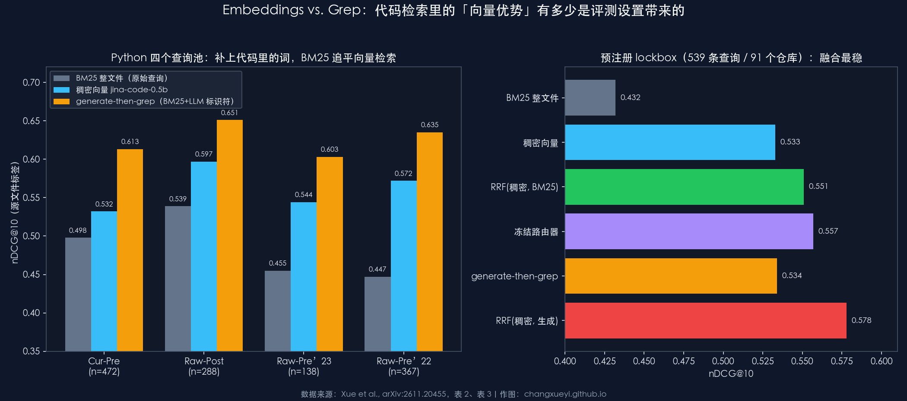

> 本文为 AI 前沿技术系列。事实部分基于论文 **Embeddings vs. Grep: Rethinking the Dense Advantage in Code Search**（arXiv:2611.20455，v1 2026-11-16，cs.SE；作者 Siqiao Xue、Ziyin Zhang、Zihan Liao、Jin Qin、Yixiang Mu、Hang Yu，蚂蚁集团；Hugging Face Daily Papers 列表收录）。数据和代码已公开：[GitHub hq-bench/repo-premium](https://github.com/hq-bench/repo-premium)、[HF 数据集](https://huggingface.co/datasets/hq-bench/repo-premium)。论文是预印本，未经同行评审。标注「我的看法」的段落是个人分析。

*题图说明：本次运行环境中没有可调用的 imagegen 图像生成工具，题图用 matplotlib 按论文表 2、表 3 的数据绘制。左图为源文件标签；右图 lockbox 按预注册方案使用「原样发布」的标签（含被改动的测试文件）。*

## 一、背景：基准说向量赢，Agent 说 grep 够用

做代码 RAG 或代码助手的团队，大多遇到过这个选择：要不要给仓库建一个向量索引？

基准给出的答案很明确。在 CoIR、CodeSearchNet 这类代码检索基准上，专门训练的代码向量模型（jina-code-embeddings、Qwen3-Embedding 等）对 BM25 的领先通常是 0.1 到 0.2 的 nDCG@10。很多团队就是看着这个差距去搭 embedding 管线的。

一线经验却常常相反。Claude Code、Codex CLI、SWE-agent 这类编码 Agent 主要用 `grep`、`rg`、`find` 搜代码，效果并不差。论文引用了一份实践报告：在一个 SWE-bench Agent 上，embedding 根本不是瓶颈。

两边都有道理的话，问题就变成：**基准上测出来的「向量优势」到底测的是什么？** 论文把稠密检索相对 BM25 的 nDCG@10 领先叫作 **dense premium（向量溢价，下文简称「溢价」）**，围绕它问了三个问题：

1. 在统一、公平的协议下，溢价有多大？
2. 溢价集中在哪些查询上？
3. 系统应该逐条查询选检索器（路由），还是固定一个组合方案？

作者认为现有证据回答不了这些问题，原因有四条：

- **查询不像真实场景**。基准多用策展过的、docstring 风格的查询，而 Agent 面对的是原始 issue 和 PR 文字。
- **BM25 被「让分」**。词法基线常常沿用向量模型的切块方式（比如 1000 字符一块），而 BM25 在大块上表现更好。
- **标签规则不一致**。SWE-bench 的 gold patch 不含测试文件，PR 的改动文件列表却包含，后者默认把测试文件也算成「相关」。
- **数据污染**。基准代码早于向量模型的训练截止日期，溢价可能部分来自记忆。

## 二、RepoPremium：怎么搭一个公平的考场

### 2.1 任务定义

任务是**仓库内的文件级检索**：输入一段代码改动的自然语言描述（issue 正文或 PR 标题加正文）和一个固定版本的仓库快照，输出仓库文件的排序。相关文件是这次改动实际编辑过的**非测试源文件**。测试文件仍然参与排序，但算作不相关。

为什么排文件而不是排函数或行？论文的理由是：工程师和 Agent 修改仓库的第一步都是决定打开哪几个文件，Agentless 这类定位管线也是先排文件；文件标签直接来自合入的改动，不需要人工判断相关性。打分仍然是细粒度的：向量模型对 1000 字符的块做嵌入，文件得分取最好那一块。

### 2.2 数据

**RepoPremium-Core**（主结果）：10 个 SWE-bench Verified 的 Python 仓库，共 1,265 条查询、10,200 个文件，每个仓库最多 2,752 个文件。分四个查询池，共享同一套代码快照和标签规则：

| 查询池 | 查询来源 | 时间 | 查询数 |
|---|---|---|---|
| Cur-Pre | SWE-bench Verified 策展问题描述 | 2013-2023 | 472 |
| Raw-Post | 原始 PR 标题+正文 | 2026-01-01 之后 | 288 |
| Raw-Pre'23 | 原始 PR 标题+正文 | 2023 | 138 |
| Raw-Pre'22 | 原始 PR 标题+正文 | 2022 | 367 |

作者特意跳过 2024-2025 年，让每个时间窗都明确地落在向量模型训练截止日期之前或之后，便于检验污染。

**RepoPremium-Ext**（扩展验证）：再加 1,560 条查询，覆盖 JavaScript、TypeScript、Go、Rust、Java，9 个留出的 Python 仓库，88 个 DeepSWE 仓库，以及一组「匹配复现」：同一个改动出现两次，一次是原始 PR 文字，一次是 LLM 改写，只有措辞不同。

**预注册 lockbox**：DeepSWE 加 TypeScript、Go、Rust 的 PR，共 539 条查询、91 个仓库。路由和融合方案在开发集上调好、冻结后，只在这里测一次。这一点在检索论文里少见，值得肯定。

### 2.3 选手和协议

- **词法**：BM25Okapi，以及一个按 IDF 加权的字面 grep 基线。
- **稠密**：6 个家族 13 个 sentence-transformers 检查点（jina-code-embeddings、Qwen3-Embedding、C2LLM、F2LLM、E5、gte-Qwen2），不加指令前缀。默认对照是 jina-code-embeddings-0.5b。另测了 SPLADE 和 ColBERTv2。
- **切块**：通用协议是 1000 字符、10 行重叠，块分取最大值作为文件分。「调好的」BM25 是整文件建索引。
- **预处理**：用正则去掉 PR 模板、checklist、HTML 注释，否则这些样板文字会淹没 BM25。
- **统计**：95% bootstrap 置信区间，跨池比较时按仓库重采样。

论文还定义了一个查询区分度指标 τ：查询和第一个 gold 文件共有的 token 里，最大的 IDF 值。τ 越高，说明查询里含有代码中的稀有词（比如具体函数名）。τ 要用到 gold 文件，只能离线分析；可部署的代理指标 τ̂ 只看查询本身，取最稀有 5 个 token 的平均 IDF。

## 三、发现一：溢价的一大半来自评测设置

### 3.1 切块方式决定正负号

在 django 上，如果向量模型也对整文件嵌入，它反而输给 BM25（Δ = -0.153），因为长文件会被截断。切成 1000 字符块后，结果翻转成 +0.119。BM25 的偏好正好相反，窗口越大越好。

所以「两边用同一个切块」看似公平，实际上是按向量模型的需求定的规则。给 BM25 换成整文件索引后，溢价的变化是：

| 查询池 | 稠密 | BM25（1000 字符块）下的溢价 | BM25（整文件）下的溢价 |
|---|---|---|---|
| Cur-Pre | 0.532 | +0.121 | +0.034 |
| Raw-Post | 0.597 | +0.152 | +0.059 |
| Raw-Pre'23 | 0.544 | +0.128 | +0.089 |
| Raw-Pre'22 | 0.572 | +0.191 | +0.125 |

（nDCG@10，源文件标签；数据来自论文表 2、表 4。）

策展查询上的溢价几乎消失，原始 PR 查询上缩小了三分之一到一半多。在 13 个向量模型里，没有一个在 Cur-Pre 或 Raw-Post 上保持显著溢价，有 7 个在 Cur-Pre 上显著**低于** BM25。论文也提醒，BM25 的设置是在评测查询上挑的，所以这些数字对向量检索来说是下界。

### 3.2 把测试文件算作正确答案，溢价翻倍

向量模型把测试文件排第一的频率远高于 BM25：策展查询上是 59% 对 34%。原因不难理解，测试文件里往往写着和 issue 描述很像的自然语言场景。如果把被改动的测试文件也算进 gold，调好之后的溢价在 Cur-Pre 上从 +0.034 涨到 +0.165，在 Raw-Post 上从 +0.059 涨到 +0.136。

更隐蔽的问题是混用规则。用 SWE-bench gold patch（无测试）评策展查询，同时用 PR 文件列表（有测试）评原始查询，Raw-Post 和 Cur-Pre 之间的差距会从 +0.025 被放大到 +0.102，看起来像「原始查询更需要向量」，其实是标签规则不同造成的。

### 3.3 剩下的优势主要是覆盖面

在整文件 BM25 面前仍然存在的那部分溢价，主要来自 Recall@10（多召回 0.10 到 0.19），而不是把第一个命中排得更靠前：MRR 的显著差异只在 Raw-Pre'22 上出现。Python 之外，TypeScript 和 Rust 上还有不大的溢价，Go 上没有（每种语言只有一个仓库）。

## 四、发现二：把代码里的词补进查询，BM25 就追上来了

如果溢价来自「查询里缺少代码里的稀有词」，那么把这些词补上，BM25 应该比向量模型受益更多。作者用一个控制实验检验：

- 生成器是 qwen35-122B，温度 0，固定一个 prompt。
- 它只读去掉样板的查询，看不到 gold 路径或补丁。
- 它写出可能相关的标识符、文件和模块提示、API、错误信息和一段代码骨架，拼到查询前面，再交给 BM25。

论文把这叫 **generate-then-grep**。结果（整文件 BM25，nDCG@10）：

| 查询池 | 稠密 | BM25 原始查询 | BM25 + 生成锚点 | 扩展后溢价 |
|---|---|---|---|---|
| Cur-Pre | 0.532 | 0.498 | **0.613** | **-0.081**（显著） |
| Raw-Post | 0.597 | 0.539 | 0.651 | -0.054 |
| Raw-Pre'23 | 0.544 | 0.455 | 0.603 | -0.059 |
| Raw-Pre'22 | 0.572 | 0.447 | 0.635 | -0.062 |

生成给 BM25 带来 0.11 到 0.19 的提升，四个池的点估计全部反超向量模型，在策展池上显著领先 0.081。原始查询池的置信区间跨零，所以论文的说法是「追平」，不排除向量仍有小幅领先。即使 BM25 退回 1000 字符块，扩展后溢价也只有 -0.052 到 +0.012。

几组对照让这个结论更扎实：

- **同样的扩展文本，向量模型受益小得多**：+0.03 到 +0.07，BM25 是 +0.12 到 +0.21，差值在每个池都显著。
- **起作用的是标识符**：只留标识符、API 和错误词就能消除溢价；只给自然语言搜索短语则不行。经典的伪相关反馈 RM3 甚至让 BM25 变差。
- **不是记忆**：在生成器发布之后才打开的 PR 上（116 条查询、7 个仓库），generate-then-grep 仍然比向量高 0.094，区间不含零；把锚点里的文件路径全删掉，效果仍在。Raw-Pre'22 的溢价被完全消除，而生成器只在一半查询里点出了 gold 文件名。
- **换更强的向量模型也一样**：Qwen3-Embedding-8B 在两个原始池上溢价更大，但扩展之后同样没有领先。
- **生成器越强效果越大**：在 4B 到 122B 的 5 个生成器上方向一致，但只有最大的那个让策展池溢价变负；gemma-4-31B-it 和 deepseek-v4-flash 能消掉约 80%，Qwen3-8B 消掉一半多。

作者的措辞很克制：生成器可能「认识」这些开源仓库，所以生成标识符可以**替代**溢价，但不能**解释**溢价的来源。

### 4.1 成本账

一次 Qwen3-8B 生成大约 1.5 秒；给 django 建向量索引大约要 4 分钟一次性编码。按这个算，一个仓库被检索少于约 158 次时，「每次查询调一次 LLM」比「建一次向量索引」便宜。生成失败时退回原始查询，这对生成方案是不利的偏差。

## 五、发现三：别路由，直接融合

### 5.1 BM25 赢四分之一的查询，但没人知道是哪四分之一

在 Cur-Pre 上 BM25 严格胜过向量的查询占 24%，Raw-Post 上占 21%。如果有一个完美的逐查询选择器（oracle），比单用向量能多 0.09 nDCG@10。

作者试了结构特征分类器、查询向量上的逻辑回归、两个零样本 LLM 裁判（qwen35-122B 和 gemma-4-31B-it），AUROC 全部在 0.47 到 0.54 之间，置信区间都包含 0.5，也就是和瞎猜没有可分辨的差别。调好的版本最后几乎总选向量；没调的 LLM 裁判则大多选关键词搜索，反而损失 0.1 以上。

### 5.2 预注册路由失败，固定融合通过

作者造了约 30 个路由器，只有一个在开发集上的增益区间不含零。把它冻结后在 lockbox 上测一次：比「总用融合」只多 +0.005，区间跨零，未达到预注册标准；oracle 的空间是 +0.077。

固定方案的成绩（nDCG@10）：

| 方案 | 每次查询的额外开销 | 开发集（604 条） | Lockbox（539 条） |
|---|---|---|---|
| BM25 整文件 | 无 | 0.507 | 0.432 |
| 稠密向量 | 一次查询嵌入 | 0.550 | 0.533 |
| RRF(稠密, BM25) | 一次查询嵌入 | 0.609 | 0.551 |
| 重排器 jina-reranker-v3 | 重排 | 0.574 | 未测 |
| 冻结路由器 | 一次查询嵌入 | — | 0.557 |
| generate-then-grep | 一次 LLM 调用 | 0.625 | 0.534 |
| **RRF(稠密, 生成)** | LLM + 嵌入 | **0.638** | **0.578** |

几点值得注意：

- 最简单的倒数排名融合（RRF）在开发集上比单用向量高 0.060，比 listwise 重排器还好。
- lockbox 上两种固定融合比单用向量高 +0.019 和 +0.045（原样标签），换成源文件标签是 +0.027 和 +0.062；按仓库等权也成立。
- generate-then-grep 单独用在 lockbox 上（非 Python、多语言）只和向量打平，说明「BM25 反超」的结论主要在 Python 上成立；它的价值更多体现在和向量融合。

## 六、发现四：对 Agent 来说，换模型比换搜索工具重要得多

论文最后把检索放回 Agent 里测。用 mini-swe-agent（原始 shell 配置，温度 0，30 步，每题 900 秒），在留出池上看最终 diff 改的文件是否和 gold 一致（exact-match）。注意这里不跑测试，测的是**定位**，不是修复正确性。作者还坦白了一个坑：第一版评测里，合入后的修复可以通过 git 历史看到，结果无效，文中数字全部来自干净环境的重跑。

**固定 LLM（qwen35-122B，开思考），只换搜索工具**，96 题：

| | 原始 shell（grep 等） | BM25 索引 | 向量索引 | τ̂ 路由 |
|---|---|---|---|---|
| exact-match | 0.135 | 0.167 | 0.146 | 0.177 |
| any-hit | 0.573 | 0.604 | 0.615 | 0.625 |

四种工具都在约 0.04 的范围内，配对差异全都不显著，而且 30 题和 96 题样本上的排序还会变。替换工具时，`find`、`grep`、`rg`、`git grep` 在 PATH 上被屏蔽，绕过尝试会被记录。

**固定工具，换模型**，30 题：exact-match 从 0.033（gemma-4-31B-it）到 0.300（kimi-k3），差了近 10 倍。低召回轨迹有一个共同失败模式：Agent 很早认定一个错误文件，然后一直改它。

## 七、我的看法

### 7.1 这篇论文真正有价值的是方法论

「向量好还是 BM25 好」这类争论已经有很多年，信息检索领域早有「弱基线制造虚假进步」的讨论（论文引了 Lin 2018、Yang et al. 2019 等）。这篇论文的贡献不在于发现 BM25 也不错，而在于把溢价拆成了可以定量的几块：切块让分约 0.03-0.09，测试文件标签再加 0.07-0.13，剩下的集中在缺稀有词的查询上。再加上预注册 lockbox 和对自己第一版错误（测试文件标签、git 泄漏）的公开说明，可信度比多数检索论文高。

### 7.2 结论边界要看清

我认为下面几点容易被过度解读：

- **核心结论只在 Python 上最完整**。Core 是 10 个 Python 仓库；跨语言池每种语言只有一个仓库，TypeScript、Rust 上溢价仍在；lockbox 上 generate-then-grep 单独并没有赢向量。
- **BM25 的设置是在评测查询上挑的**，这对 BM25 有利，作者也承认。
- **生成器认识开源仓库**。论文做了发布后 PR 的检验，但对一个模型从没见过的私有代码库，LLM 能否写对标识符是另一回事。我估计效果会打折，尤其是命名风格独特的内部代码。
- **只测文件级**。函数级、行级检索没测，而很多 RAG 系统最终需要的是代码片段。
- **Agent 实验规模小**。96 题、30 步预算，工具差异不显著不等于没有差异；更长的预算、更大的仓库下，检索质量可能更重要。

### 7.3 它和 Agent 的实际行为是一致的

我觉得「generate-then-grep」其实就是在形式化 Agent 已经在做的事：Claude Code 或 Codex 读完 issue 后，会先猜几个函数名、类名、报错字符串，然后 `rg` 它们，再根据结果迭代。论文也提到「自己挑搜索词的 Agent 在做同样的事」。所以在 Agent 场景里，模型本身就是查询扩展器，这解释了为什么换工具影响小、换模型影响大。

反过来，向量检索的不可替代之处在于：查询里完全没有代码词汇的时候，比如产品经理写的需求、用户的模糊描述、只描述行为不提实现的 bug 报告。这时候它多召回的那 10-19 个百分点是真实的。

### 7.4 对行业的启示

很多团队上来就搭 embedding 管线，背后有一个隐含假设：基准上的 0.1-0.2 差距会在自己的系统里兑现。这篇论文说明，这个差距有相当一部分是评测设置造成的。在投入向量数据库、索引更新、嵌入模型升级这一整套运维之前，应该先在自己的数据上和一个调好的 BM25 比一比。

## 八、落地建议

**如果你在做代码 RAG 或代码搜索：**

1. **先建一个公平的词法基线**。BM25 用整文件或大窗口（论文里 c=10,000 和整文件接近），不要直接复用向量的 1000 字符切块；对 PR、issue 文字先去掉模板和 checklist。
2. **明确标签规则**。测试文件算不算相关，写清楚，并对所有查询来源用同一条规则。否则你看到的「向量更适合真实查询」可能只是标签差异。
3. **默认上 RRF 混合检索**。BM25 + 向量做倒数排名融合，实现只要几十行，论文里比单向量高 0.02-0.06，比重排器还好。别花时间做逐查询路由，论文试了 30 个都没赢。
4. **查询里没有代码词时，先让 LLM 写锚点**。一个 prompt：「根据这个描述，列出可能涉及的函数名、类名、模块路径、API 和报错信息，并写一段代码骨架」，把输出拼到查询前。只要标识符，不要自然语言改写。
5. **按检索频率算账**。很少被搜的仓库（论文估算约 158 次以下）用 generate-then-grep 更便宜；高频检索的仓库建向量索引更划算。

**如果你在做编码 Agent：**

1. 预算优先投在模型上，其次才是搜索工具。论文里换模型的差距约 10 倍，换工具在 0.04 以内。
2. 保留 shell 里的 `rg`/`grep`，再按需加一个混合检索工具，而不是用向量检索替换 grep。
3. 针对「过早认定错误文件」这一失败模式，可以在 prompt 或流程里加一个强制步骤：编辑前列出至少两个候选文件并说明取舍。

**如果你在做检索评测：** 报告向量结果时，同时报 Recall@10、整文件 BM25 和「BM25 + 生成锚点」两个基线。这三列放在一起，读者才能判断向量模型的增益有多少是真的。

## 九、小结

这篇论文用 RepoPremium 基准把代码检索里的「向量溢价」拆开看：公平的 BM25 整文件索引和统一的标签规则拿走了大部分溢价，剩下的集中在查询缺少代码稀有词的情况；让 LLM 补上这些词，BM25 在 Python 上追平或反超向量。工程上最稳的做法是 BM25 与向量的固定融合，而对编码 Agent 来说，模型选择比搜索工具重要得多。这些结论主要在 Python、文件级、开源仓库上成立，用到私有代码库前值得先在自己的数据上复现一次。

## 参考

- Siqiao Xue, Ziyin Zhang, Zihan Liao, Jin Qin, Yixiang Mu, Hang Yu. *Embeddings vs. Grep: Rethinking the Dense Advantage in Code Search*. arXiv:2611.20455, 2026. [https://arxiv.org/abs/2611.20455](https://arxiv.org/abs/2611.20455)
- RepoPremium 代码与评测工具：[https://github.com/hq-bench/repo-premium](https://github.com/hq-bench/repo-premium)
- RepoPremium 数据集：[https://huggingface.co/datasets/hq-bench/repo-premium](https://huggingface.co/datasets/hq-bench/repo-premium)
- Jimenez et al. *SWE-bench: Can Language Models Resolve Real-World GitHub Issues?* ICLR 2024.
- Cormack et al. *Reciprocal Rank Fusion Outperforms Condorcet and Individual Rank Learning Methods*. SIGIR 2009.
