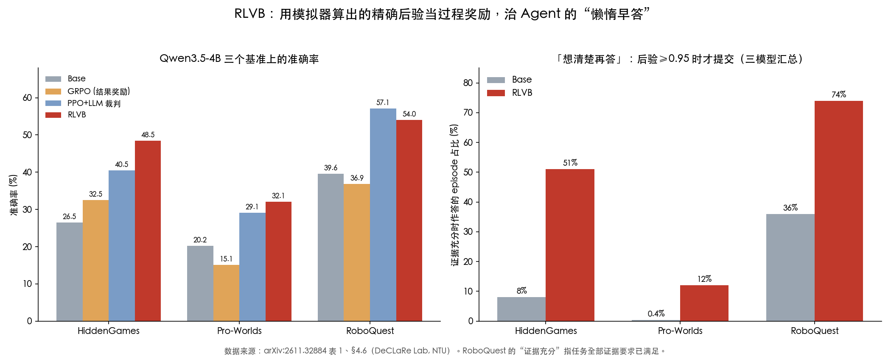

> 本文为 AI 前沿技术系列。事实部分基于论文 **Lazy Agents Answer Against Their Own Beliefs: Reinforcement Learning with Verifiable Beliefs Teaches Them to Act on What They Believe**（arXiv:2611.32884，v1 2026-11-24，cs.AI；作者 Richmond Sin Jing Xuan、Peilin Feng、Wenbin Wang、Soujanya Poria，新加坡南洋理工大学 DeCLaRe Lab；Hugging Face Daily Papers 11-25 列表收录）。代码：[GitHub declare-lab/RLVB](https://github.com/declare-lab/RLVB)。论文是预印本，未经同行评审。文中标注「我的看法」的段落是个人分析，其余数字均来自论文正文与表格。

*题图说明：本次运行环境中没有可调用的 imagegen 图像生成工具，题图用 matplotlib 按论文表 1 和 §4.6 的数据绘制。左图为 Qwen3.5-4B 的准确率；右图为三个模型汇总后“后验 ≥ 0.95 时才作答”的 episode 占比。*

## 一、背景：Agent 嘴上说“还不确定”，手上却提交了

做过 Agent 的人大概都见过这种场景：任务需要先查几步再下结论，模型查了一两步就开始给答案。论文把这叫 **laziness（懒惰）**，也就是证据还不够就提前提交。

论文用一个“猜杯子”的例子说明问题。桌上 4 个倒扣的杯子，要找出藏着红色圆柱的那个。Agent 掀开了 1 号（下面是绿色圆柱）和 3 号（空的），这时红色圆柱在 2 号或 4 号，各 50%。正确的做法是再掀一个；可很多基座模型会直接提交“4 号”。

更值得注意的是作者的一个观察：让模型在每个动作前先写一行信念（belief line），比如 `Possible: cups 2, 4`，模型**写着还有两种可能，下一步照样提交答案**。在证据不足、且模型自己的信念行仍列出多个候选的回合里，基座模型提交答案的比例是 3% 到 68%。论文借用元认知（metacognition）的说法：模型的“监控”（知道自己知道什么）还凑合，问题出在“控制”（按自己知道的去行动）跟监控脱节了。

### 结果奖励为什么治不了这个病

当前训练多轮 Agent 的主流做法是把 RLVR（可验证奖励强化学习）搬过来：episode 结束时检查最终答案，对了给 1，错了给 0，再用 GRPO 或 PPO 更新。问题在于：

1. **蒙对和推对拿到同样的奖励。** 50% 的时候直接猜 4 号也能拿满分，这个“早答”行为会被强化。
2. **认真搜索反而可能被惩罚。** 只要 episode 最后输了，前面每一步有用的探索都会分到负的优势值。
3. **整条轨迹共享一个优势值。** GRPO 把 episode 的优势值分给每一步，没法区分哪一步有用。

论文的实验也印证了这一点：在三个模型、三个基准上，只用结果奖励的 GRPO 平均比基座**低 1.0%**，PPO 平均**低 5.1%**。

另一条路是过程奖励：用过程奖励模型或 LLM 裁判给每一步打分。但裁判通常是对照“真实答案”打分的。在杯子例子里，裁判知道答案是 4 号，就可能奖励“Possible: cup 4”这个蒙出来的信念，惩罚“还剩 2、4 两种可能”这个其实完全正确的信念。此外，PPO 要训练 critic，裁判每一步都要调用，成本都不低。

## 二、核心思路：模拟器能验证的不只是最终答案

RLVB 的出发点很简单：Agent 训练几乎都在沙箱模拟器里进行，**模拟器知道的远比“最终答案对不对”多**。它知道隐藏目标的先验分布，也知道每个动作会揭示什么观测。在观测是确定性的任务里，只要枚举所有可能的隐藏目标，删掉与已有观测矛盾的那些，就得到了隐藏答案的**精确后验**，也就是 POMDP 理论里的信念状态（belief state）。

这个后验只取决于 Agent 已经收集到的证据，与这一局碰巧哪个答案是对的无关。RLVR 在终点验证答案；RLVB 在每一步验证“证据支持的信念”，这就是名字里 Verifiable Beliefs 的来源。

论文对三种框架的对比可以概括成一张表：

| 框架 | 每一步的奖励来自 | 是否依赖本局真实答案 | 额外模型 |
|---|---|---|---|
| GRPO（结果奖励） | 整局最终对错，全轨迹共享 | 是 | 无 |
| PPO + LLM 裁判 | 裁判对照真实状态打分 + critic 回传结果 | 是 | critic + 裁判 |
| RLVB | 动作与“后验教师”的一致程度 | 否，只看已得证据 | 无 |

## 三、技术细节：后验教师、动作项奖励与按历史分组的更新

### 3.1 后验教师（posterior teacher）

有了精确后验，就可以构造一个“教师策略”给每个候选动作估值：

- **提交答案 a**：价值是“答对概率”经时间折扣后取对数。后验里 a 的概率越高，提交越划算。
- **证据动作 e**（掀杯子、移动视窗等）：价值是执行 e 之后、对各种可能观测取期望的后验价值，也就是经典的信息价值（Howard, 1966）思路，带有限深度的前瞻。

教师先用 logistic 函数比较“最优答案”与“最优证据动作”的价值差，决定提交还是继续，再在答案集合或证据动作集合内部用 Boltzmann 分布（温度 τ）分配概率。

有一个细节我认为很实用：答案价值里乘了 **Agent 自己实测的答题准确率**。Agent 看图看得不准，提交的价值就低，教师就会要求它多收集一些证据。也就是说，停止规则是按这个 Agent 的能力量身定的，而不是假设它能完美读懂观测。

### 3.2 过程奖励：动作项是主力，信念项基本没用

每个回合的奖励由两项组成：

- **动作项**：Agent 实际动作在教师策略下的对数概率。证据还允许多个答案时，继续收集证据得分高；证据已经锁定答案时，提交得分高。
- **信念项**（可选，小权重）：把 Agent 写的信念行当成候选集合上的均匀分布，和精确后验比较，由对数评分、“信念行隐含的决策”的恰当评分规则、以及对过宽信念的惩罚组合而成。

两类错误的惩罚很不对称：证据不足时提交，奖励非常低（杯子例子里，无论 4 号下面是不是红色圆柱，提交“4 号”的得分都一样低）；证据够了还多走一步，只损失一步的时间折扣。所以这个奖励的主要作用是**教 Agent 别早答**。

关键设计：**奖励从不读取 Agent 写的信念行**。但更新时提升的是整个回合（信念行 + 动作）的似然，所以信念行也随之被训练。论文报告的主版本 RLVB 只用动作项。

### 3.3 策略更新：在同一段历史上比较多个回合

训练分阶段进行（算法 1）：

1. 固定当前模型副本玩若干局。教师动作以一定概率替换 Agent 动作（初始 0.5，逐阶段衰减，类似 DAgger）；一半训练场景还会额外从随机证据动作开局，覆盖 Agent 自己很少走到的状态。
2. 对每一段历史 h，采样 K 个回合，各自用上面的奖励打分。
3. 用两种方式之一给回合加权：**RLVB** 用“奖励减去组内其他回合均值”的策略梯度（类似 GRPO，但分组单位是同一历史下的 K 个回合，而不是整条轨迹）；**RLVB (EM)** 用期望最大化，按奖励的指数归一化加权。
4. 在加权对数似然上做梯度，直到与上阶段策略的 KL 超过阈值，相当于一步策略镜像下降。

与 GRPO 的根本区别在于信用分配：GRPO 把整局优势值摊给每一步；RLVB 只拿同一证据状态下的不同决策互相比较，而且教师的前瞻已经估计了后续价值，所以每个回合只拿自己的奖励，不需要累加后续回报，也不需要 critic。

## 四、实验：九组设置全部提升

### 4.1 基准与设置

- **HiddenGames**（训练分布内）：7 个任务，包括 MineSweeper、MiniGrid KeyCorridor、FrozenLake、Sokoban，以及 3 个 ManiSkill3 渲染的 Tabletop 任务。测试用 756 局训练中没见过的种子、地图和颜色。
- **Pro-Worlds**（论文新提出，训练未见）：视觉拼图，Agent 只能通过小窗口看一个大世界，移动窗口收集证据，最多 35 步后从 8 个（Jigsaw 为 10 个）候选中选答案。15 个游戏各玩 20 次。后验教师平均 14.7 步解出每一局。
- **RoboQuest**（训练未见，且**没有精确后验**）：10 个模拟厨房里的移动操作任务，比如靠称重找出异常包裹。每个任务 50 局。

模型为 Qwen3-VL-4B-Thinking、Qwen3-VL-8B-Thinking、Qwen3.5-4B，所有方法都训练 LoRA，最多 50 次更新，每回合都能看到完整的动作-观测历史。最强基线 PPO (belief + action) 用 DeepSeek V4.1 Flash 做裁判，按真实隐藏状态给信念打分。

### 4.2 主结果（表 1 节选，准确率 %）

| 方法 | Qwen3.5-4B HG | PW | RQ | Qwen3-VL-8B HG | PW | RQ |
|---|---|---|---|---|---|---|
| 后验教师 | 97.5 | 100.0 | – | 97.5 | 100.0 | – |
| Base | 26.5 | 20.2 | 39.6 | 22.9 | 14.8 | 36.2 |
| Base（写信念行） | 38.1 | 23.9 | 41.3 | 23.9 | 20.5 | 39.8 |
| SFT | 26.9 | 13.6 | 38.3 | 27.0 | 19.3 | 42.5 |
| GRPO（结果奖励） | 32.5 | 15.1 | 36.9 | 23.1 | 14.9 | 34.7 |
| PPO + LLM 裁判 | 40.5 | 29.1 | **57.1** | 26.4 | 16.9 | 51.4 |
| RLVB (EM) | 42.9 | 28.1 | 47.3 | 29.0 | **32.4** | 47.2 |
| RLVB | **48.5** | **32.1** | 54.0 | **31.1** | 29.9 | **62.7** |

（HG = HiddenGames，PW = Pro-Worlds，RQ = RoboQuest。Qwen3-VL-4B 上 RLVB 为 36.2 / 28.7 / 61.2，Base 为 24.6 / 17.2 / 28.4。）

要点：

- RLVB 相对 Base 九组全部提升，平均 **+17.1%**；RLVB (EM) 平均 +10.4%。
- 同一个学习器下，后验过程奖励比结果奖励（GRPO）平均高 **18.1%**，九组全胜。这说明收益主要来自奖励信号本身。
- 比 PPO + LLM 裁判平均高 9.3%，九组中赢八组，唯一输的是 Qwen3.5-4B 的 RoboQuest（54.0 vs 57.1）。
- 在训练未见的 RoboQuest 上提升最大可达 +32.8%（Qwen3-VL-4B，28.4 → 61.2）。RoboQuest 没有精确后验，说明学到的“先查够再答”习惯能迁移到规则未知的环境。
- 只是让模型写信念行，不做训练，八组都有小幅提升，平均 +3.8%。
- 运行方差：作者说明在 Qwen3.5-4B 上改动少量设置重复训练三次，准确率波动最多约 4%。

### 4.3 成本

在 A100 上训练 Qwen3.5-4B：PPO + 裁判 120.1 GPU 时，外加约 1.26 万次裁判调用（约 9.8 美元）；RLVB 74.2 GPU 时；RLVB (EM) 29.7 GPU 时。RLVB (EM) 达到其精度只需 RLVB 32%–44% 的算力，但精度更低（平均 36.0% vs 42.7%）。

### 4.4 消融：真正起作用的是动作项

在 Qwen3-VL-4B 上（表 3）：

- 采样集从 1200 段历史缩到 300 段，分布内几乎不变（36.2 → 35.3），但两个分布外基准下降（28.7 → 23.9，61.2 → 55.5）。
- 再加上信念项，准确率没有上升，RoboQuest 反而从 55.5 掉到 45.8。
- 只保留信念项、去掉动作项，结果与不训练相当甚至更差（RoboQuest 19.7 vs 34.0）。

结论很清楚：**奖励“信念写得对”教不会 Agent 何时停止；奖励“动作对”才行。**

## 五、收益到底从哪来：答得更晚，而不是看得更准

这是我觉得论文最有价值的部分。作者没有停在“准确率涨了”，而是用精确后验回放每一局，检验三种可能的解释：

1. **RQ1：Agent 读证据读得更准了？** 不是。全部回合里，RLVB 的信念行并不总比基座更准确：HiddenGames 上 Qwen3.5-4B 变准（47.8% → 60.3%），两个 Qwen3-VL 模型反而变差；Pro-Worlds 上三个模型都变差 4.9–7.8 个百分点。
2. **RQ2：每一步收集的证据更多了？** 也不是。RLVB 每一步带来的证据增量与基座差不多。Pro-Worlds 上后验教师每步把后验提高 5.9%，所有方法每步只有 0.7%–1.3%。
3. **RQ3：Agent 开始按自己的信念行事了？** 是。证据不足且信念行仍列出多个候选时，RLVB 只在 0.1%–2.2% 的回合提交，基座是 3.2%–67.9%，九组设置的 95% 置信区间都不重叠。在 Tabletop 任务上，RLVB 会多走 2.6–3.1 步，接近后验教师的 2.5 步，基座只走 0.1–0.8 步。

作者把准确率按“作答时的证据水平”分解成两部分：在高证据水平作答的比例，乘以该水平下的答对率。所有方法在证据充分（后验 ≥ 0.95）时作答，正确率都在 66%–92%；在最低证据水平作答，正确率只有 0%–13%。RLVB 在证据充分时作答的 episode 比例是 51% / 12% / 74%（三个基准），基座是 8% / 0.4% / 36%，PPO + 裁判是 20% / 3% / 57%。

所以，**准确率提升几乎全部来自“在证据更充分时才作答”**；在同样的证据水平下，RLVB 的答案并不比基座更准。HiddenGames 上这一项甚至为负，因为训练后的 Agent 在 Tabletop 任务里更常误读已经足够的证据。

### 一个被低估的对照：harness 里加检查行不行

很多工程团队的第一反应是：在 harness 里拒绝第一次提交，逼模型再想想。论文测了这个（附录 K.4）。对基座模型，这招在 RoboQuest 上有用（Qwen3.5-4B 从 39.6% 到 50.9%），在 HiddenGames 和 Pro-Worlds 上几乎没用（最多 +1.9%）。原因是 harness 看不懂观测，不知道证据够不够；被拒之后基座模型多走的步数大多没有信息量（Pro-Worlds 上“有用步”只占 4%–7%）。RLVB 加上这个检查，在 RoboQuest 上还能再涨 1.9–7.7 个百分点，两者可以叠加。

## 六、局限：作者自己承认的和我额外担心的

论文明确写出的局限：

- **需要已知规则的任务。** 只有知道隐藏答案的先验和每种观测的似然，才能算精确后验。谜题、游戏、模拟家居任务满足；开放式任务需要估计后验。
- **前瞻代价随动作数和观测数增长。** 大动作空间只能用浅层或采样前瞻。
- **信念行只能表达候选集合。** 只有候选等概率时，集合才等价于后验，表达不了更细的置信度。
- **证据充分时答错的比例上升。** 从 2%–4% 升到 10%–15%，主要出现在 Tabletop 任务：Agent 误读了已经能决定答案的观测，然后照着错误的信念行作答。
- **离教师还很远。** Pro-Worlds 上最好的 Agent 32.4%，后验教师 100%。

**我的看法**，以下几点值得读者额外留意：

1. **“懒惰”和“不会看”是两个问题，RLVB 只解决了前一个。** 它让 Agent 学会“没把握就继续”，但没有让 Agent 更会选信息量大的动作、更会读图。对于感知能力本身就是瓶颈的任务（比如复杂 GUI、真实机器人视觉），收益会受限。
2. **绝对准确率仍然偏低。** HiddenGames 上最好成绩 48.5%，Pro-Worlds 32.1%。这是一篇诊断清楚、方向正确的方法论文，还不是“问题已解决”。
3. **“证据充分”的阈值（0.95）和 RoboQuest 的“要求满足”判定都是作者定义的。** 在 RoboQuest 上，信念行是否准确靠语言模型阅读器判断，这部分分析的可信度低于有精确后验的两个基准。
4. **代价在别处：需要能算后验的环境。** 训练不需要裁判和 critic，但需要投入去写能枚举隐藏状态的模拟器。这对游戏、表格 QA、结构化检索很现实，对开放 Web 任务很难。
5. **多走几步本身有成本。** RLVB 的步数明显更多（RoboQuest 上 Qwen3-VL-8B 从 4.7 步到 10.1 步）。在调用一次工具要花钱或花时间的生产环境，需要把步数成本显式写进奖励里，论文的时间折扣只是一个很弱的版本。

## 七、与同类方案的对比

| 方案 | 奖励来源 | 优点 | 缺点 |
|---|---|---|---|
| RLVR / GRPO 结果奖励 | 最终答案对错 | 简单、无需额外模型 | 奖励蒙对；长程信用分配差；本文中平均掉分 |
| 过程奖励模型 / LLM 裁判（如 PPO + 裁判、Agent-BRACE） | 学到的或裁判给出的步级分数 | 适用于规则未知的任务 | 对照真实答案打分，会奖励“蒙对的信念”；贵 |
| 信息增益奖励（CURIO、ECHO 等） | 每轮信念改进量 | 鼓励探索 | 不直接管“何时停止” |
| 测试时贝叶斯实验设计（BED-LLM） | 推理时选最高信息增益的问题 | 无需训练 | 推理开销大，不改变模型本身 |
| **RLVB** | 后验教师对动作打分 | 只依赖证据、不奖励蒙对；无裁判无 critic；更便宜 | 需要可算后验的环境；不提升感知和选步质量 |

我的看法：RLVB 与 GiGPO 这类“按共享状态分组做信用分配”的工作是一个方向上的两步。GiGPO 解决“和谁比”，RLVB 进一步解决“用什么尺子量”。两者结合（用后验做尺子，在共享状态上比较）正是 RLVB 已经做的事，这也解释了它为何比 GRPO 强那么多。

## 八、可落地的收获

**如果你在训练 Agent：**

- 先检查你的环境能不能算后验，哪怕是近似的。很多内部任务（表格问答、配置排查、结构化检索、带规则的游戏）其实能枚举候选答案，并能判断每次观测排除了哪些候选。只要能做到这一步，就能得到不依赖最终对错的步级奖励。
- 不要只看最终准确率。像论文那样按“作答时的证据水平”拆解准确率，能区分模型是“学会了谨慎”还是“学会了蒙”。这套诊断方法本身就值得复用，即使你不用 RLVB。
- 结果奖励的 GRPO 在长程证据收集任务上可能是负收益。如果你观察到 RL 后模型越来越“果断”而准确率不涨，很可能就是在强化蒙对的答案。
- 信用分配单位改成“同一历史下的多个候选回合”，而不是整条轨迹。

**如果你在做 Agent 产品或 harness：**

- 让模型在每次行动前显式写出“当前还有哪些可能”。论文中这一招不训练也能平均带来 +3.8%，几乎零成本。
- 在 harness 里加一条规则：信念行列出多个候选时禁止提交。论文证明模型会说不会做，那就在系统层面把“说”和“做”对齐。这比单纯拒绝第一次提交更有针对性，因为它利用了模型自己读到的信息。（这是我基于论文结论的推论，论文测试的是更粗的“拒绝首次提交”检查。）
- 对用户可见的答案，记录作答时的证据状态。论文对“可靠”的定义是“答案正确且有充分证据支撑”，因为用户通常无法检查 Agent 是怎么得出结论的。

**上手建议：** 仓库 [declare-lab/RLVB](https://github.com/declare-lab/RLVB) 已公开。最小复现可以从 HiddenGames 里的 FrozenLake 或 MineSweeper 开始，这类任务后验好算，用 4B 级 VLM 加 LoRA，单卡 H200 约 14–31 GPU 时（论文表 4 中 Qwen3-VL-4B 的 RLVB (EM) 与 RLVB）。

## 九、总结

RLVB 把 RLVR 的“可验证”从终点延伸到了过程中：模拟器既然知道规则，就能在每一步算出证据支持的精确信念，用它给动作打分，不再奖励运气。实验给出的诊断比数字更有价值：训练后的 Agent 没有变得更会看、更会探索，它只是学会了**按自己写下的判断行事**，没把握时继续查。这个结果提醒我们，当前 Agent 的很多失败不是能力问题，而是决策与自我监控脱节。在能算后验的场景里，RLVB 提供了一个便宜、干净的修复方法；在开放环境中，如何近似这个后验，是下一步要解决的问题。

## 参考

- Richmond Sin Jing Xuan, Peilin Feng, Wenbin Wang, Soujanya Poria. *Lazy Agents Answer Against Their Own Beliefs: Reinforcement Learning with Verifiable Beliefs Teaches Them to Act on What They Believe*. arXiv:2611.32884, 2026. [论文](https://arxiv.org/abs/2611.32884) · [HTML 版](https://arxiv.org/html/2611.32884) · [代码](https://github.com/declare-lab/RLVB)
- [Hugging Face Daily Papers 2026-11-25](https://huggingface.co/papers?date=2026-11-25)
