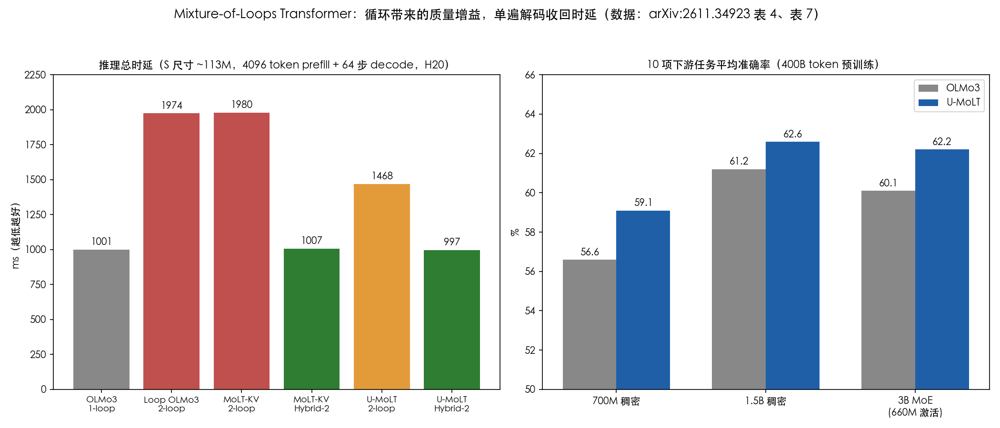

> 本文为 AI 前沿技术系列。事实部分基于论文 **Mixture-of-Loops Transformer**（arXiv:2611.34923，v1 2026-11-25，cs.LG；作者 Lianghui Zhu、Shijie Wang（项目负责人）、Xinggang Wang（通讯）、Jinze Bai、Bo Wang、Xiang Bai；华中科技大学、字节跳动 Seed、多伦多大学；Hugging Face Daily Papers 11-26 列表收录，写作时约 63 赞）。代码仓库：[GitHub hustvl/MoLT](https://github.com/hustvl/MoLT)（论文称将发布完整实现）。论文为预印本，未经同行评审。文中标注「我的看法」的段落是个人分析，其余数字均来自论文正文与表格。

*题图说明：本次运行环境中没有可调用的 imagegen 内置图像生成工具（其 CLI 备用路径需要 OPENAI_API_KEY，环境中未配置），题图用 matplotlib 按论文表 4、表 7 的数据绘制。左图：4096 token prompt + 64 步解码的总时延，单张 H20、batch size 1；右图：400B token 预训练后 10 项下游任务平均准确率。*

## 一、背景：循环模型为什么又火了，又卡在哪里

“循环 Transformer”（looped Transformer）的想法不新：Universal Transformer 和 ALBERT 早就让多层共享同一组参数。思路是参数不变，把同一个层栈多跑几遍，相当于加深计算深度。近一两年它重新回到架构讨论的中心，原因大致有三个：

1. **参数效率。** 同样的参数量跑两轮，计算深度翻倍，显存里的权重不变。对端侧和带宽受限的部署有吸引力。
2. **“多想几步”的叙事。** 推理模型让大家相信测试时计算有价值。循环是在隐空间里多算几步，不需要输出思维链 token。
3. **规模化工作陆续出现。** 论文相关工作部分列了在稠密和 MoE 上放大循环模型、自适应循环深度、稳定深层展开、把预训练模型改造成循环骨干等多条路线。

循环模型一直有一个躲不开的效率问题。标准做法叫 **loop residual（循环残差）**：第 r 轮的输出直接作为第 r+1 轮的输入。论文认为这带来两个瓶颈：

- **表达上，信息被反复压进一条残差流。** 每一轮只把最终状态交给下一轮，中间层算出的东西后面的轮次读不到。论文称之为跨层、跨轮的“信息稀释”。
- **效率上，同一个 token 依赖自己上一轮的输出。** 解码每个新 token 都要按顺序跑完 N 轮，2 轮循环的解码时延大约翻倍。论文表 7 中，2 轮的 Loop OLMo3 在 4096 token 场景下总时延 1974.3 ms，非循环 OLMo3 为 1000.6 ms。

MoLT 的切入点是一个具体问题：**Transformer 循环时，相邻两轮之间应该传什么？** 作者的回答是：除了（或者代替）残差流，传已经算好的 key 和 value（KV），把它们当作可被选择性读取的记忆。

## 二、核心机制：MoLA，一次 softmax 同时读“序列”和“深度”

MoLT 的基础组件叫 **Mixture-of-Loops Attention（MoLA）**。它沿用 Mixture-of-Depths Attention（MoDA）的联合归一化做法，在一个注意力分布里同时读两类 KV：

- **序列 KV**：沿 token 方向的上下文，也就是普通注意力读的内容。
- **深度 KV**：同一个 token 位置上，其他层（某些变体里还包括上一轮各层）产生的局部 KV。

两类 KV 拼在一起，用同一个 query 做一次 softmax。各来源的权重完全由 query 决定，没有额外的跨轮门控参数。因为两类 KV 在同一个 softmax 里竞争，logit 尺度必须可比，所以论文对每个 query/key 头做独立的仿射 RMS 归一化（QK norm）后再加 RoPE。

在这个组件之上有三种变体。理解它们的区别，看两件事：每一轮从哪里开始，上一轮的信息怎么进来。

### 2.1 MoLT-R：保留残差流，再加跨轮直读

MoLT-R（R 指 residual）保留循环残差，第 r 轮从第 r-1 轮的输出开始。区别是每层 MoLA 还能直接读：

- 当前轮、当前 token 上更早层的局部 KV；
- 上一轮所有层在当前 token 上的局部 KV（上一轮已经算完，所以比当前层更深的层也能读）。

这样不增加参数，只多一点注意力计算。代价是它仍依赖同一 token 的上一轮状态，推理时还得串行跑 N 轮，还要存 N 份序列 KV cache。论文把它定位为“表达能力优先”。

### 2.2 MoLT-KV：每轮从嵌入重启，只读上一轮的“前缀记忆”

MoLT-KV 是这篇论文最有新意的部分。它做了两件有点反直觉的事：

1. **嵌入重启（embedding restart）。** 每一轮都从 token 嵌入 e(x_t) 重新开始，不接上一轮的残差状态。
2. **严格前缀记忆（strict-prefix memory KV）。** 上一轮的归一化输出 z^{r-1} 经每层独立投影变成“记忆 KV”，但位置 t 只能读 j < t 的记忆，**读不到自己位置上一轮的结果**。

当前 token 的信息来自本轮的深度 KV，包括本层自己的 KV（论文叫 own KV）。所以每一层读的是“前面 token 在上一轮的结果 + 当前 token 在本轮各层的中间结果”。

两条规则合起来，消除了“同一位置的跨轮依赖”：token t 在第 r 轮的计算只依赖更早 token 在第 r-1 轮的结果。轮与轮之间变成沿 token 方向的严格三角递推。论文附录证明，位置 0 到第 2 轮就稳定，之后每个位置比它的前缀晚一轮稳定；展开深度 r ≥ t+2 时，所有展开都收敛到同一个解，不需要压缩映射之类的假设。

### 2.3 Loop forcing 和 MoL 解码：把“串行跑 N 轮”变成“每个 token 走一遍”

这个三角递推结构直接带来两件好事。

**训练端：loop forcing。** 类比 teacher forcing，每一轮都监督下一 token 预测，第 r 轮用第 r-1 轮在所有位置上并行算出的前缀记忆，而不是按 token 顺序递推。于是训练从 T 步串行变成 N 次并行前向。总损失是各轮交叉熵的加权和，默认 1:1。表 3 显示，把权重调到 1:4 可以让第 2 轮 CE 从 3.279 降到 3.272，第 1 轮 CE 从 3.306 升到 3.322。

**推理端：Mixture-of-Loops（MoL）解码。** 解码新 token t 时，它前面所有 token 的记忆 KV 已经在缓存里。t 只需从嵌入出发走一遍共享层栈，读缓存的前缀记忆和本轮局部 KV，然后把自己的输出投影成记忆 KV 追加进缓存，供后面的 token 用。每步解码从 N 次遍历降到 1 次，持久 KV 也只剩 1 份。

一个容易误解的地方：单遍解码不等于退化成单轮模型。前缀记忆本身是递归累积的，token t 读到的是 t-1 算完之后的结果，而 t-1 又读了 t-2 的结果。论文给出的计算是：即便编码器和解码器各占一半层（LE = LD = L/2），U-MoLT 对更早 token 的因果路径深度至少是 3L/2 个 block，非循环 L 层模型最多是 L。论文还称这让模型能“超出训练时的循环轮数”运行。

纯 MoL 解码也有问题：prompt 必须逐 token 处理，失去并行 prefill。表 7 里 4096 token prompt 下，MoLT-KV 纯 MoL 解码总时延 73.8 秒，几乎不可用。所以实际用的是 **MoL-Hybrid**：prompt 部分用 1 轮或 2 轮并行 prefill（Hybrid-1 / Hybrid-2）生成记忆，之后的生成用单遍 MoL 更新。代价是它不再与“空缓存逐 token 递推”严格等价，论文用实验说明质量差异很小（见第四节）。

### 2.4 U-MoLT：把“造记忆”和“做预测”拆开

纯 MoLT-KV 还有一个结构上的别扭：最后一层的归一化输出 z^r 既要喂给词表投影做预测，又要投影成记忆 KV 给下一轮和后续 token。论文在讨论部分解释了这个冲突：靠近输出头的隐藏状态要逐渐“塌缩”成下一 token 分布，会丢掉当前 token 的细节；而记忆需要保留干净的历史上下文。

**U-MoLT** 借鉴 YOCO、Universal YOCO 和 DeepSeek CED 的思路，把网络分成两段：

- **MoLT Encoder**：用 loop KV 方式循环，负责构造记忆。
- **MoLT Decoder**：不循环、只做交叉注意力（cross-only），每层用**独立的 KV 投影**读编码器的归一化输出 z^r，负责预测。解码器的状态从不回流给编码器，也不给后续 token 提供 KV。

这样分工带来的推理好处是：中间轮次和 prompt 中非最后位置的解码器计算可以直接跳过，不影响预测结果。论文附录的成本分析是，等分 U-MoLT 在 MoL-Hybrid-2 下与非循环 L 层模型在四项主要推理成本上持平：全 prompt prefill 的 block 深度、prefill 的二次注意力、每步解码遍历数、持久 KV 存储。剩下的额外开销是 LE 个记忆 KV 投影和很小的深度注意力。

论文的结论是：U-MoLT 是纯注意力 LLM 的默认选择；MoLT-KV 适合生成为主、希望少引入归纳偏置的场景；MoLT-R 适合能接受 N 倍解码成本、追求表达能力的场景。

## 三、实验设置

- **消融（S 尺寸，约 113M）**：OLMo3 风格 pre-norm 骨干，宽 768，GQA、QK norm、SwiGLU；12 层纯栈或 6 层循环编码器 + 6 层解码器；GPT-2 分词，1024 上下文，FineWeb 3B token，BF16 + Muon，固定种子。
- **规模实验**：700M、1.5B 稠密和 3B MoE（660M 激活），各 400B token，沿用 OLMo3 工程管线和 OLMo-mix-0625 数据，4096 上下文。
- **继续预训练**：从 Qwen3.5-0.8B-Base 出发，原架构与两种 U-MoLT 改造各训 100B token，同一数据流和超参。
- **评测**：10 项下游任务（PIQA、HellaSwag、WinoGrande、OpenBookQA、BoolQ、SciQ、ARC-E、ARC-C、COPA、MMLU）和 10 个领域的验证困惑度；时延在单张 H20、batch size 1 上测。

## 四、关键结果

### 4.1 消融：哪些设计真的有用（表 2，S 尺寸，验证 CE 越低越好）

| 配置 | CE | 每步更新时间 |
|---|---|---|
| OLMo3 单轮（12 层） | 3.318 | 494 ms |
| 2 轮循环残差（同参数） | 3.299 | 942 ms |
| MoLT-R，跨轮深度 KV，稠密放置 | 3.284 | 1029 ms |
| MoLT-KV，无深度 KV，稠密 | 3.322 | 968 ms |
| MoLT-KV，跨轮深度 KV，隔层放置 | 3.286 | 1018 ms |
| U-MoLT，跨层深度 KV，隔层，独立解码器投影 | 3.279 | 965 ms |
| U-MoLT，跨轮深度 KV，稠密，独立解码器投影 | **3.273** | 1001 ms |

从这张表能读出几条结论：

- **单纯循环 2 轮有收益但不大**：CE 降 0.019，训练 FLOPs 翻倍，更新时间从 494 涨到 942 ms。
- **深度 KV 是 MoLT-KV 能成立的前提。** 去掉深度 KV 后，loop KV 变体比 2 轮残差基线还差，稠密版甚至不如单轮基线（3.322 对 3.318）。嵌入重启丢掉了当前 token 的跨轮信息，必须由本轮深度 KV 补回来。
- **放置方式和反馈形式要一起选。** MoLT-R 稠密放置最好；MoLT-KV 隔层放置在 4 种来源条件下都比稠密 CE 更低、更快，低 0.011-0.012。
- **U-MoLT 的独立解码器 KV 投影收益最稳定。** 6 组配对里，独立投影都优于共享投影和解码器自注意力，比自注意力低 0.014-0.021。
- **最好的配置不支持单遍解码。** 跨轮（X loop）变体读上一轮同位置局部 KV，又引入了同位置依赖。能用 MoL 解码的是“本轮”深度来源，例如 3.279 的那一行。

### 4.2 规模实验：400B token 对比 OLMo3

| 规模 | 方法 | 10 任务平均准确率 | 10 领域平均 PPL |
|---|---|---|---|
| 700M 稠密 | OLMo3 | 56.6 | 15.64 |
| 700M 稠密 | MoLT-R | 59.2 | 14.84 |
| 700M 稠密 | U-MoLT | 59.1 | 14.86 |
| 1.5B 稠密 | OLMo3 | 61.2 | 13.86 |
| 1.5B 稠密 | U-MoLT | 62.6 | 13.15 |
| 3B MoE（660M 激活） | OLMo3 | 60.1 | 13.99 |
| 3B MoE（660M 激活） | U-MoLT | 62.2 | 13.24 |

三种规模下 10 个领域的困惑度全部下降。3B MoE 上 10 项任务全部提升，ARC-C 从 36.7 到 41.8，MMLU 从 36.7 到 38.2。在另一组 700M 配对运行里，U-MoLT 在 232.8B token 时就追平 OLMo3 在 400B token 时的平均验证 CE，即论文说的 1.7 倍 token 效率。

### 4.3 解码：质量几乎不变，时延回到单轮水平

表 6 用 8 个窗口（128 token prompt + 896 个续写目标）比较同一权重在四种调度下的表现：

- MoLT-KV：固定 2 轮 CE 3.320、总时间 31.5 秒；MoL-Hybrid-1 CE 3.322、16.8 秒（-46.7%）；Hybrid-2 CE 3.321、16.9 秒。
- U-MoLT：固定 2 轮 CE 3.280、23.4 秒；Hybrid-1 和 Hybrid-2 CE 都是 3.280，时间降 31.5% 和 28.0%。

表 7 是题图左半部分的数据：4096 token prompt + 64 步解码，U-MoLT MoL-Hybrid-2 总时延 996.6 ms，非循环 OLMo3 为 1000.6 ms，2 轮 Loop OLMo3 为 1974.3 ms。

### 4.4 改造已有模型：Qwen3.5-0.8B-Base 继续预训练

Qwen3.5-0.8B 是混合架构，24 层中 18 层 Gated DeltaNet（GDN）线性注意力、6 层全注意力。改造方式是切成 12+12 层：编码器里的 3 个全注意力层充当 MoLA 反馈层，GDN 层的状态每轮重置。参数只多 3.15M（+0.42%）。100B token 后，U-MoLT-CT1 在 11 个领域的 CE 全部低于同预算继续训练的原架构，平均 2.496 → 2.480；按训练轨迹插值，相当于 1.28-1.51 倍、平均 1.4 倍的 token 效率。

这里有个工程细节值得注意：Qwen3.5 的 GDN 层对 query 有长度 4 的因果卷积，所以改造后的解码器不是严格的 cross-only，做不到 prefill 时只算最后一个位置。也就是说，混合架构上的推理收益没有纯注意力版本那么干净。

## 五、与同类方案对比

| 方案 | 两轮之间传什么 | 每步解码遍历 | 主要取舍 |
|---|---|---|---|
| 标准循环残差（Universal Transformer 一系） | 残差状态 | N | 简单；解码 N 倍、信息稀释 |
| LPT（Looped Prediction Transformer） | 残差 + 首轮 KV 与滑窗 | N | 省 KV，仍串行跑满所有轮 |
| PLT（Parallel Loop Transformer） | 错位的残差状态 | N（跨 token 重叠） | 用流水线掩盖时延，计算量不减 |
| Universal YOCO | 自解码器循环构造共享 KV | N 次编码 + 1 次解码 | 解码仍需多轮编码 |
| DeepSeek CED | 编码器输出 + 每层投影 | 1 + 1（不循环） | 非循环，分离记忆与读取 |
| **MoLT-R** | 残差 + 跨层/跨轮局部 KV | N | 表达最强，无新增参数 |
| **MoLT-KV / U-MoLT** | 严格前缀记忆 KV（嵌入重启） | 1（MoL 解码） | 单遍解码；需 loop forcing 训练，prefill 用 Hybrid |

和 MoDA、Attention Residuals、DenseFormer 这类“跨深度注意力”的关系：它们在单次前向里让层读取更早层的表示；MoLA 把这种同 token 深度注意力和跨轮 KV 复用统一到一个 softmax 里。和 Feedback Transformer、Recurrent Transformer、LCKV 这类“高层表示回流给后续 token”的方法也有亲缘关系，MoLT-KV 可以看成把这类前缀反馈套进循环框架，再加上每轮监督，使它能并行训练。

## 六、我的看法

**1. 这篇论文最有价值的是 MoLT-KV 的依赖结构设计，规模数字反而要打折看。** 嵌入重启 + 严格前缀，把“同位置跨轮依赖”换成“跨位置递推”。这个改动让循环模型第一次能以接近普通模型的成本解码，而且训练仍然可并行。这个思路可以迁移到其他想做隐空间迭代的架构上。

**2. 和 OLMo3 的对比基本是“同参数、同 token”，不是“同算力”。** 论文在 S 尺寸消融里写明，2 轮循环让逻辑训练 FLOPs 翻倍；U-MoLT 只循环一半层，但每轮都要跑解码器算损失，训练算力同样明显高于单轮基线。可 400B 规模实验只列了单轮 OLMo3，没有同 FLOPs 的更大非循环模型，也没有 2 轮 Loop OLMo3。所以“1.7 倍 token 效率”应读作“数据效率”，不能读作“算力效率”。在 S 尺寸上，U-MoLT 最好成绩 3.273 对 2 轮残差循环的 3.299，这个 0.026 的 CE 差才是“同算力下比普通循环好多少”的更公平参照，但只有 3B token、单种子。论文自己也在讨论部分承认，“把额外计算花在更大的模型还是更多轮次上”还是开放问题。

**3. 推理时延的证据规模偏小。** 时延表全部是约 113M 的 S 尺寸模型、batch size 1、单张 H20。小模型 batch 1 的解码受访存和 kernel 启动主导，和大模型高并发服务的瓶颈不同。持久 KV 与非循环模型持平这一点，在长上下文大批量服务里可能比时延更重要，但论文没有给出大模型的吞吐或显存测量。我会等开源代码和更大规模的服务端评测。

**4. “超出训练循环轮数”的说法需要谨慎理解。** 它的含义是前缀记忆沿 token 递归累积，因果路径变深；单个 token 的计算仍是一次遍历。这和“推理时多跑几轮来多思考”不是一回事，后者在这套设计下怎么扩展，论文没有展示。

**5. 下游任务的绝对水平还很低。** 700M-3B 规模的 MMLU 在 34-38% 区间，接近随机水平的 25% 之上不多。提升是真的，但离“新一代基础模型架构”的定位还有距离，需要 7B 以上和长训练预算来验证。

**6. U-MoLT 的“编码器-解码器”分工可能比循环本身更值得关注。** 表 2 里，从全栈 MoLT-KV 换到 6+6 的 U-MoLT，再换成独立解码器投影，带来的 CE 改进和循环本身的收益是同一量级。作者对此的解释是“预测”与“记忆”两种角色互相冲突，这和 YOCO、DeepSeek CED 的方向一致。论文初步实验里“非循环编码器 + 循环中段 + 解码器”的三段式“长颈鹿”结构效果最好，也指向同一个结论：哪一段负责什么，可能比循环几轮更关键。

## 七、可落地的收获

**做模型架构研究的：**

- 设计任何迭代/循环结构时，先画出“token t 第 r 轮依赖谁”的依赖图。只要依赖是严格跨位置的三角形，就有机会做并行训练和单遍解码。
- 把共享 softmax 用于多源 KV（序列 + 深度）时，QK 归一化是必需的，否则不同来源的 logit 尺度会互相压制。
- 做循环模型对比时，至少补一个同 FLOPs 的非循环基线和一个同参数的普通循环基线，否则收益里混着“多花的算力”。

**做推理与部署的：**

- 如果评估循环类模型，关注三个数：每步解码遍历数、持久 KV 份数、prefill 是否能并行。MoLT-KV/U-MoLT 的价值在于把前两个降回 1，第三个用 Hybrid 方案保住。
- 纯 MoL 解码不适合长 prompt（4096 token 时 47-74 秒），实际部署应使用 MoL-Hybrid。
- 对 GDN、Mamba 这类混合骨干，cross-only 解码器的 prefill 省算会受卷积窗口等细节影响，需要逐层核对哪些计算真的能跳过。

**想上手的：**

- 关注 [hustvl/MoLT](https://github.com/hustvl/MoLT) 的代码发布，先在 100M 级别复现表 2 的 2 轮残差 vs U-MoLT 对比，同时记录训练 FLOPs，自己算一遍“同算力”下的收益。
- 想改造已有小模型，可参考论文的 Qwen3.5-0.8B 方案：对半切层，全注意力层改成 MoLA 反馈层，只新增约 0.4% 参数，再用 loop forcing 做继续预训练。

## 八、小结

MoLT 回答了循环 Transformer 的一个核心设计问题：两轮之间传 KV 记忆，并且让每轮从嵌入重启、只读严格前缀。这样换来了可并行的 loop forcing 训练和每 token 单遍的 MoL 解码，U-MoLT 在 113M 规模上把 2 轮循环模型的解码时延拉回到和非循环 OLMo3 持平。质量方面，700M 到 3B MoE 的同参数、同 token 对比全面领先。尚待验证的是同算力对比、更大规模、高并发服务下的表现。对架构研究者来说，它提供了一个可复用的设计原则：先设计依赖结构，再谈循环轮数。

**参考来源**

- 论文：Lianghui Zhu et al., *Mixture-of-Loops Transformer*, arXiv:2611.34923, 2026-11-25. <https://arxiv.org/abs/2611.34923>
- 代码：<https://github.com/hustvl/MoLT>
- Hugging Face Daily Papers（2026-11-26 列表）：<https://huggingface.co/papers/2611.34923>
