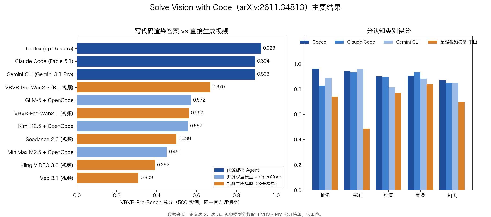

> 本文为 AI 前沿技术系列。事实部分基于论文 **Solve Vision with Code: Coding Agents Are Stronger Visual Reasoners Than Video Models**（arXiv:2611.34813，v1 2026-11-25，cs.CV，CC BY 4.0；作者 Dezhi Luo、Fengyuan Yu、Haotian Zhang 等，通讯作者 Dezhi Luo（UCL）与 Hokin Deng（CMU），合作单位包括 NTU、USC、UCSD、JHU、港中文、UC Berkeley；Hugging Face Daily Papers 11-27 列表收录，写作时约 59 赞）。项目页：[solve-vision-with-code.com](https://solve-vision-with-code.com/)。论文为预印本，未经同行评审。文中标注「我的看法」的段落是个人分析，其余数字均来自论文正文与表格；“ID/OOD 分半平均分”是我根据论文附录表 5 的逐任务分数自行计算的。

*题图说明：本次运行环境中没有可调用的 imagegen 内置图像生成工具（其 CLI 备用路径需要 OPENAI_API_KEY，环境中未配置），题图用 matplotlib 按论文表 2、表 3 的数据绘制。左图选取了部分代表性系统；视频模型分数取自 VBVR-Pro 公开榜单，论文没有重跑。*

## 一、背景：视频模型被当成“视觉推理器”，但没人认真比过对照组

过去一年，视频生成模型的画面质量进步很快，研究者开始问一个更难的问题：它们能不能**推理**？典型的评测方式是：给模型一张第一帧图片和一句自然语言指令，例如“把这些物体按大小排序”“从起点沿最短路径走到终点”“选出序列里的下一个图形”，看它生成的视频里是不是真的把任务做对了。

这条路线有一个很有吸引力的叙事：推理“原生地”发生在视觉介质里，在像素帧中展开，不需要先翻译成语言或代码。“视频模型即世界模型”“视频是通用视觉推理接口”这类说法都建立在这个叙事上。

VBVR-Pro（Xu et al., 2026）是这类评测里比较严格的一个：任务由程序生成，有符号化的标准答案，用基于规则的经典计算机视觉和 OCR 自动打分。VBVR-Pro-Bench 有 100 个任务族、每族 5 个实例，共 500 个实例，覆盖五个认知类别：抽象（Abstraction）、感知（Perception）、空间（Spatiality）、变换（Transformation）、知识（Knowledge）。输入是 1024×1024 的第一帧加一句指令。

本文作者注意到一个被忽略的事实：**VBVR-Pro 里大多数任务的正确输出，是第一帧和指令的确定性函数**。既然如此，“原生视觉推理”到底是不是更可靠的路线，就需要一个对照组：同样的输入、同样的输出规格、同样的评测器，只把“答题介质”从去噪像素换成写程序。此前没有人在相同条件下做过这个对照。

## 二、实验设计：只换介质，其他全部不变

论文的核心贡献是一个控制得比较干净的评测协议。

**任务说明。** 每个实例在一个全新的容器里运行，容器里只有输入文件和一份由评测框架自动生成的任务说明。说明对所有 Agent、所有实例结构相同，只有输出格式（帧尺寸、帧率、帧数、时长）随实例变化。它给出三条约束：

1. 不得调用任何图像或视频生成模型；
2. 只改动指令要求改动的内容；
3. 动作必须在整段视频中展开，不能只在最后一帧出现答案。

**沙箱。** 纯 CPU 的 Python 环境，预装常用图像与科学计算库和若干字体；Agent 以非特权用户运行，有固定资源上限和 **30 分钟墙钟预算**；网络只开放给模型 API 调用和装包。作者审计了每一条事件日志和保留下来的程序，确认没有人偷偷调用生成模型。

**一次机会。** 每个实例只跑一次，不重试。容器退出时没有视频就记 0 分，和视频模型生成失败的处理方式一致。

**打分。** 所有视频都交给 VBVR-Pro-Bench 官方评测工具打分，**评测器不做任何修改**，模式与公开榜单相同。Agent 看不到标准答案、任务生成器和任务元数据。

**参评系统。**

| 类别 | 系统 | 说明 |
|---|---|---|
| 闭源编码 Agent | Codex CLI 0.154.0 + gpt-6-astra | 官方非交互模式，跳过审批，默认设置 |
| 闭源编码 Agent | Claude Code 2.1.268 + Claude Fable 5.1（Amazon Bedrock） | 同上，不加系统提示词、skill 或任何改造 |
| 闭源编码 Agent | Gemini CLI 0.59.0 + gemini-3.1-pro-preview | 同上 |
| 开源权重模型 | 24 个模型经 OpenCode 驱动（GLM、Kimi、MiniMax、DeepSeek、Qwen、gpt-oss、Nemotron、Mistral、Llama、Gemma 等） | DeepSeek R1 在 Bedrock 上不支持工具调用，剔除后 23 个计分 |
| 视频生成模型 | VBVR-Pro 公开榜单 14 个中的前 11 个 | 分数直接引用，未重跑 |

这里的关键设计是“输出仍然是视频”。Agent 不能只回答“选 C”，它必须写一个程序，读入第一帧，在 CPU 上把答案过程渲染成一段符合规格的 mp4，再交给原评测器。这样视频模型和编码 Agent 才是在同一张卷子上答题。

## 三、主要结果：闭源 Agent 包揽前三，开源模型输在“交不了卷”

### 3.1 总分

| 排名（共 37 个系统） | 系统 | 总分 | 交付视频数 / 500 |
|---|---|---|---|
| 1 | Codex（gpt-6-astra） | **0.923** | 500 |
| 2 | Claude Code（Fable 5.1） | 0.894 | 500 |
| 3 | Gemini CLI（Gemini 3.1 Pro） | 0.893 | 500 |
| 4 | VBVR-Pro-Wan2.2-I2V-A14B（RL，视频模型） | 0.670 | — |
| 5 | GLM-5 + OpenCode | 0.572 | 495 |
| 6 | VBVR-Pro-Wan2.1-I2V-14B（视频模型） | 0.562 | — |
| 7 | Kimi K2.5 + OpenCode | 0.557 | 498 |
| 9 | Seedance 2.0（视频模型） | 0.499 | — |
| 11 | MiniMax M2.5 + OpenCode | 0.451 | 488 |
| 13 | Kling VIDEO 3.0（视频模型） | 0.392 | — |
| 14 | DeepSeek V3.2 + OpenCode | 0.378 | 475 |
| 17 | Veo 3.1（视频模型） | 0.309 | — |
| 19 | Qwen3-Coder-Next + OpenCode | 0.264 | 498 |
| 34–37 | Gemma 3 27B / Gemma 3 12B / Magistral Small / Llama 3.3 70B | 0.000 | 0（从不调用工具） |

几个值得注意的点：

- **最强视频模型是“主场作战”。** VBVR-Pro-Wan2.2-I2V-A14B 在基准的域内任务族上做过强化学习，奖励就是这套评测器。即便如此，它比 Codex 低 0.253 分。下一个视频模型又低了 0.108。
- **商用视频模型分数不高。** Seedance 2.0 为 0.499，Kling VIDEO 3.0 为 0.392，Veo 3.1 为 0.309。画面质量好不等于能完成结构化任务。
- **开源模型两极分化。** GLM-5 和 Kimi K2.5 排第 5 和第 7，超过除 RL 视频模型外的所有视频模型；往下分数急剧下滑，有 4 个模型 500 次里一次工具都没调用。

### 3.2 分类别得分

| 系统 | 抽象 (25) | 感知 (39) | 空间 (17) | 变换 (19) | 知识 (20) | 总分 |
|---|---|---|---|---|---|---|
| Codex | **0.964** | 0.942 | **0.903** | 0.908 | **0.872** | **0.923** |
| Claude Code | 0.828 | 0.934 | 0.901 | **0.933** | 0.851 | 0.894 |
| Gemini CLI | 0.887 | **0.960** | 0.816 | 0.884 | 0.850 | 0.893 |
| GLM-5 | 0.477 | 0.723 | 0.482 | 0.546 | 0.492 | 0.572 |
| Kimi K2.5 | 0.413 | 0.697 | 0.528 | 0.543 | 0.488 | 0.557 |
| 最强视频模型（RL） | 0.741 | 0.488 | 0.771 | 0.840 | 0.699 | 0.670 |

括号里是带该标签的任务族数量；16 个任务族有多个标签，按 1/k 权重计入各类别。

三个闭源 Agent 在每个类别都在 0.8 以上，也都超过最强视频模型。差距最大在**感知**（视频模型只有 0.488），最小在**变换**（视频模型 0.840，Gemini CLI 0.884）。

作者自己对这两个极端给了谨慎的解释：

- 感知任务大多是“在图里找到并测量物体”，连通域分析、颜色过滤这类操作用规则代码可以**精确**执行，这会放大编码 Agent 的优势。
- 变换任务要求物体随时间变形、移动，这可能是视频模型从视频数据里学得更自然的能力，所以差距最小。

开源模型的画像不同：它们最强的也是感知，和闭源 Agent 差距最小；差距最大的是**抽象**。也就是说，“读懂第一帧”开源模型已经能做到七成，“推断规则”才是它们掉队最多的地方。

### 3.3 一个论文没有单独强调的数字：域外任务反而更高

VBVR-Pro-Bench 的 100 个任务族分两半：50 个**域内**（ID，VBVR-Pro 有对应训练数据，RL 视频模型就在这些任务族上训练过）和 50 个**域外**（OOD，所有训练都没见过）。我用附录表 5 的逐任务分数算了分半平均：

| Agent | 域内 50 族 | 域外 50 族 |
|---|---|---|
| Codex | 0.879 | 0.967 |
| Claude Code | 0.830 | 0.958 |
| Gemini CLI | 0.826 | 0.960 |

**我的看法：** 编码 Agent 没有在任何一半上训练过，所以“域内/域外”对它们没有训练意义上的区别。分数差异主要反映两半任务的难度和类别构成不同（论文附录说明：域内多知识和抽象类，域外 21 个是感知类）。这提醒我们，比较“RL 视频模型 vs 零样本 Agent”时，视频模型在域内的主场优势并没有帮它追上 Agent；而 Agent 在偏感知的域外任务上几乎满分，恰好对应上一节作者说的“感知任务对代码天然友好”。

### 3.4 失败从哪来：交付失败 vs 内容失败

作者把失败拆成两种：

- **交付失败**：容器退出时没有视频；
- **内容失败**：交了视频但分数低。

在开源模型中，总分和交付视频数的 Spearman 相关系数 ρ = 0.93（n = 23）。低分主要来自交不了卷，作者归纳了三种模式：

1. **从不调用工具。** Gemma 3 27B、Gemma 3 12B、Llama 3.3 70B、Magistral Small 500 次全部用文字作答；有的把工具调用当成普通文本输出，附上占位代码，什么也没执行。
2. **过早结束。** Qwen3-32B 和 Llama 4 Maverick 平均每个实例不到 3 次工具调用，分别只交付 25 和 7 个视频。Qwen3-32B 常常写好代码骨架就退出，没有运行；Llama 4 Maverick 会把任务委派给一个不存在的子 Agent 类型，然后停下。
3. **超时。** Qwen3-Coder-Next 有 93 个实例撞上 1800 秒上限，比其他所有模型加起来还多；但它几乎每次都在超时前写出了视频，最终交付 498 个。它 0.264 的低分来自内容质量，不是交付问题。

## 四、效率：分数接近，成本差了近一个数量级

论文附录表 4 给出了每个实例的平均成本（运行时间为中位数）：

| Agent | 总分 | 平均工具调用 | 运行时间中位数 (s) | 输入 token (k) | 输出 token (k) | 超时数 |
|---|---|---|---|---|---|---|
| Codex | 0.923 | 3.2 | 22 | 57 | 1.2 | 0 |
| Claude Code | 0.894 | 9.2 | 105 | 233 | 7.3 | 0 |
| Gemini CLI | 0.893 | 25.3 | 218 | 659 | 7.5 | 0 |
| GLM-5 | 0.572 | 48.0 | 378 | 1569 | 16.3 | 12 |
| Kimi K2.5 | 0.557 | 41.9 | 336 | 1213 | 19.2 | 0 |
| MiniMax M2.5 | 0.451 | 45.7 | 420 | 1295 | 19.8 | 0 |
| DeepSeek V3.2 | 0.378 | 32.9 | 277 | 636 | 13.6 | 0 |

要点：

- **三个闭源 Agent 分数相差 0.030，成本差很多。** 相对 Codex，Claude Code 约 3 倍工具调用、4 倍输入 token；Gemini CLI 约 8 倍调用、12 倍输入 token。作者提醒，不同厂商的分词器和缓存策略不同，跨 Agent 的 token 数只能作参考。
- **工具调用多不等于更好。** 在开源模型里，调用次数和分数正相关（ρ = 0.88），但这只是因为最低分的模型根本没开始干活。最强的两个开源模型每实例调用 40–50 次、输入 token 是 Codex 的二十多倍，分数仍低 0.3 以上。
- **调用次数是难度信号。** 在同一个 Agent 内，把 500 个实例按调用次数分成四档，调用最多的一档分数最低：Claude Code 为 0.843，Gemini CLI 为 0.819。Agent 在难题上会更多地试探、验证和修改，所以调用次数更像“这题难”的标记，而不是“想得更周全”的证明。

三个闭源 Agent 的行为“指纹”也很不一样（附录 D.1、D.2）：

- **Codex** 主要依赖模型自身的多模态能力直接看图，做少量像素探测后就开始写代码；首次写 `solve.py` 之前的工具调用中位数是 3；只在 13.8% 的任务上检查自己渲染出的结果。
- **Claude Code** 更“按部就班”：平均每任务看图 2.8 次、像素探测 3.3 次，94.0% 的任务会回看自己的输出；首次写代码前调用中位数 7。
- **Gemini CLI** 几乎不直接打开图片（不到 2.0% 的任务），而是用脚本大量读取像素值来重建场景，平均每任务 17.1 次像素探测；需要读文字时会调 OCR；所有 53 次装包事件都来自它；首次写代码前调用中位数 19。

**我的看法：** 这组数据对 Agent 工程很有参考价值。三种完全不同的工作方式最后分数几乎一样，说明在这类任务上，“先用多模态模型看懂，再写确定性代码执行”这一步才是关键，后续的反复验证带来的边际收益很小。Codex 只用约 1/4 的输入 token 就拿到最高分，说明强基座模型的“第一眼判断”质量本身就是最大的效率来源。

## 五、最有意思的部分：描绘式程序 vs 命题式程序

分数只告诉你答对没有，不告诉你程序是**怎么**得到答案的。作者对三个闭源 Agent 写出的 1385 个“解对了本实例”的程序做了分类，借用了认知科学里“心理意象之争”（Kosslyn 的描绘式表征 vs Pylyshyn 的命题式表征）的术语：

- **描绘式（depictive）程序**：运行时在第一帧的像素数组里“导航”，过滤颜色、测量区域、定位物体，从图里算出答案。它的流程绑定在任务族上，换一个同族实例也能算对。
- **命题式（propositional）程序**：只包含 Agent 事先在会话里确定好的常量，比如坐标、颜色值、格子编号，程序只负责把答案画出来。换一个实例，它会画出同样的、但已经错误的答案。

分类方法是**行为式**的：把程序拿到同任务族的另一个实例上重新执行。答案跟着新输入变（分数和之前一样好，或者在测量新帧时出错），就算描绘式；能跑但画出同样的错误答案（按最终帧改动区域在两个实例上的重叠度判断），就算命题式；介于两者之间的归为灰色地带。

论文图 4 用 G-131（“选出递增大小序列的下一个图形”）的一个实例展示了两者区别。第一帧里一行有三个逐渐变大的橙色圆，第四个位置空着，下方有四个候选答案。

- **Claude Code 的程序是描绘式的**：提取彩色区域，测出三个圆的宽度 21、39、57 像素，算出公差 18 像素，预测下一个应为 75 像素，再用颜色、形状、尺寸约束逐一检验候选项。
- **Codex 的程序是命题式的**：它在会话里就确定了答案，程序里只有固定的像素坐标和绘图操作，用来画出解释并高亮所选选项。

两者选了同一个正确选项，得分相同。**分数相同，程序的通用性完全不同。**

按类别看，描绘式程序占感知类的 67%、变换类的 45%，在抽象类降到 33%、知识类降到 27%；命题式程序在抽象类和知识类占 26% 和 28%，在变换类只有 6%。按 Agent 看，Claude Code 61% 的程序是描绘式，Codex 只有 35%；Gemini CLI 只在 10 个实例上打开过图片，但它仍有 17% 的程序是命题式，常量来自会话中的探索脚本。

作者强调：**两种模式都不预测分数**。Codex 在抽象类只有 24% 的程序是描绘式，却是该类别得分最高的 Agent。

**我的看法：** 这个区分对实际工程比对认知科学更有用。如果你的目标是“一次性答对这道题”，命题式完全够用，而且更省；如果你的目标是“产出一个以后可以复用的视觉处理工具”，比如生成一个能批量处理同类截图、图表、工业检测图的脚本，那么你需要的是描绘式程序，而单看本实例的分数根本分辨不出来。把“换一个实例重跑”加进评测，是一个低成本、可直接借用的做法。

## 六、与同类方案对比

“用代码做视觉推理”并不是新想法，论文把它放在程序合成这条线上：

| 路线 | 代表工作 | 做法 | 与本文的关系 |
|---|---|---|---|
| 程序辅助推理 | PAL（Gao et al., 2023）、Program of Thoughts（Chen et al., 2023） | 让语言模型写代码完成数值计算，把计算交给解释器 | 思想源头：把“推理”和“计算”分开 |
| 视觉程序 | VisProg（Gupta & Kembhavi, 2023）、ViperGPT（Surís et al., 2023） | 让 LLM 组合视觉 API（检测、分割、VQA）回答图像问题 | 本文不提供视觉 API，只给通用 Python 图像库 |
| 视觉草稿本 | Visual Sketchpad（Hu et al., 2024） | 多模态模型画辅助线等作为“视觉思维链” | 中间步骤可视化，但最终仍以文字作答 |
| 视频模型即推理器 | VBVR-Pro、RULER-Bench 等 | 生成视频本身就是答案 | 本文的比较对象 |
| 本文 | Solve Vision with Code | 现成的编码 Agent CLI，写程序渲染答案视频，交给原评测器 | 第一次在视频模型自己的基准、同一评测器下做对照 |

本文相对前几类工作的新意不在方法，而在**评测设定**：它不为 Agent 设计任何专用工具或提示词，直接用厂商默认的 CLI；输出也不是文字答案，而是和视频模型完全一样的视频文件。这使得“视频模型 vs 编码 Agent”第一次可以放在一张榜单上比较。

## 七、优点与局限

### 优点

- **控制变量干净。** 输入、输出规格、评测器、一次机会、失败记零，全部与视频模型对齐，评测器不改一行代码。
- **覆盖面广。** 3 个闭源 Agent + 23 个开源模型，全部 500 个实例，给出类别分、逐任务分和完整成本账。
- **失败分析有用。** 把交付失败和内容失败分开，直接指出开源模型的主要短板在“能不能把工具用起来、把活干完”，而不是看不懂图。
- **描绘式/命题式的区分可操作。** 用“换实例重跑”做行为分类，不依赖人工读代码。

### 局限（作者承认的）

- **基准天然偏向代码。** VBVR-Pro 的任务本身就是程序生成和渲染的：纯色、精确几何、确定性评测。Agent 用颜色掩码、连通域、网格切分，等于把渲染时的符号描述“逆向”出来，再改几处像素。真实世界里物体有纹理、遮挡、光照变化，没有符号真值，很多答案也不可能只靠编辑第一帧的几个区域画出来。
- **比较不对称。** Agent 可以用工具、沙箱和最多 30 分钟迭代；视频模型只采样一次。Agent 之间成本也差一个数量级以上。
- **视频模型分数没有重跑。** 直接引用公开榜单。

### 局限（我补充的）

- **没有按算力或成本对齐。** 视频模型一次生成的 GPU 成本和 Agent 一次会话的 API 成本没有放在同一坐标系里。在这个基准上 Agent 显然更划算，但“同等预算下谁更好”这个问题论文没有回答。
- **闭源模型版本特殊。** gpt-6-astra、Fable 5.1、Gemini 3.1 Pro 都是写作时最新的前沿模型；视频模型一侧最强的只是 14B 级开源模型的 RL 版本，商用视频模型没有针对该基准训练。这种“前沿 LLM vs 中等规模视频模型”的组合会放大差距。
- **“推理”和“渲染”被混在一个分数里。** Agent 写的程序可以逐像素精确地画出答案；视频模型哪怕“想对了”，也可能因为画得不够准而被规则评测器扣分。论文没有拆出“视频模型推理对但渲染错”的比例，所以 0.25 的差距里有多少是推理差距、多少是渲染精度差距，目前不清楚。

## 八、我的观点：这篇论文到底说明了什么

**1. 它说明的是“当前这类任务的最优解法”，不是“视频模型不能推理”。** 作者自己也写得很克制：结果描述的是现状，不构成原则性上限。对“答案能从第一帧和指令算出来”的任务，把规则写成代码、让解释器去渲染，比在去噪过程里隐式学会这个函数要可靠得多。这和 PAL 当年的结论一样：能显式计算的东西，就不要指望模型在隐空间里算准。

**2. 视频模型做“视觉推理”的叙事需要更好的基准。** 如果一个基准能被一个不调用任何生成模型、只用 PIL 和 NumPy 的程序拿到 0.92，那它主要测的是符号推理和像素级执行，而不是视频模型真正擅长的东西：物理动态、外观连续性、开放场景。本文最小的差距出现在“变换”类，这其实是在提示：视频模型的优势领域在那里。下一代视频推理基准应该更多覆盖“无法用几行代码精确画出来”的任务。

**3. 混合系统是最自然的下一步。** 作者在讨论里也提到“编码 Agent + 生成式渲染器”。我认为这是工程上最有前景的方向：Agent 负责理解场景、推断规则、规划每一帧该发生什么（结构化的布局、轨迹、关键帧），视频模型负责在真实感外观上把它渲染出来。这和现在“LLM 规划 + 扩散模型执行”的图像编辑流水线是同一个思路，只是时间维度更长。

**4. 开源模型的差距首先在 Agent 能力，不在视觉能力。** 4 个模型从不调用工具、2 个模型写完代码不运行，这些失败和视觉推理毫无关系。GLM-5、Kimi K2.5 能交付几乎全部视频，分数就进入第一梯队边缘。对开源社区来说，提升工具调用稳定性和“把任务做完”的习惯，可能比提升视觉编码器更划算。

**5. 评测器可以直接当奖励。** 作者提出下一步用 GRPO 训练写代码的策略，评测器作为可验证奖励，镜像 VBVR-Pro 对视频模型做的 RL。考虑到开源模型在“交付”和“抽象规则推断”上的短板都很具体，这类 RL 的提升空间应该很大。

## 九、读者可以带走什么

### 给做多模态应用的工程师

- **能写成规则的视觉任务，先试“多模态模型看 + 代码执行”。** 图表读数、表单/截图定位、工业检测里的尺寸测量、网格类游戏状态识别，这些任务和 VBVR-Pro 的感知、空间类很像。让模型先描述场景，再生成 OpenCV/NumPy 代码做精确测量，往往比让模型直接输出数值稳定。
- **想要可复用的脚本，就要求描绘式程序。** 在提示里明确“不得硬编码坐标和颜色，必须从图像中计算”，并用另一张同类图片重跑验收。这正是论文的行为分类方法，可以直接变成你的单元测试。
- **生成式模型留给真正需要“真实感”的部分。** 结构、布局、轨迹交给代码；纹理、光照、自然运动交给生成模型。

### 给做 Agent 的工程师

- **先保证“能交卷”。** 本文开源模型的低分几乎全部来自没调用工具、写完不运行、委派给不存在的子 Agent。上线前至少测三件事：模型是否真正发出结构化工具调用；是否执行了自己写的代码；输出文件是否存在、格式是否合规。最后一项可以在 harness 里强制检查。
- **别用工具调用次数衡量“认真程度”。** 同分数下成本可以差 8–12 倍；在同一 Agent 内，调用越多往往意味着题越难。把调用次数当作难度和成本信号来监控，而不是质量信号。
- **自检有用，但不是越多越好。** Claude Code 94% 的任务会回看输出，Codex 只有 13.8%，分数反而是 Codex 更高。自检的价值取决于第一稿的质量，在强模型上应该做成“按需触发”，比如在渲染结果和预期规格不一致时才回看。

### 给做评测和研究的人

- **任何“X 模型能推理”的基准，都应该配一个程序合成对照组。** 如果一段不调用生成模型的脚本就能拿高分，这个基准测的可能不是你以为的能力。
- **评测要加“换实例重跑”。** 只看单实例分数，分不出“理解了规则”和“记住了答案”。
- **报告成本。** 同分数下成本差一个数量级，是部署决策里比 0.03 分更重要的信息。

## 十、小结

Solve Vision with Code 做了一件看起来简单、但此前没人认真做过的事：在一个为视频模型设计的视觉推理基准上，保持输入、输出格式和评测器完全不变，只把答题方式换成“编码 Agent 写程序渲染答案”。结果是三个闭源 Agent 拿到 0.893–0.923，比在该基准上 RL 训练过的最强视频模型（0.670）高 0.22 以上；最好的开源模型 GLM-5（0.572）也超过了其余所有视频模型。开源模型掉队的主要原因是交不出视频，而不是看不懂图。

论文的结论有明确边界：任务是程序生成的纯色几何场景，比较在迭代次数和成本上并不对称。它最有价值的地方是提醒大家，“原生视觉推理”目前在结构化任务上还打不过“看懂后写代码”；描绘式/命题式的区分则给了一个低成本的方法，用来检查 Agent 写出的程序是真的学会了规则，还是只记住了这一题的答案。

## 参考资料

- Luo, D. et al. *Solve Vision with Code: Coding Agents Are Stronger Visual Reasoners Than Video Models.* arXiv:2611.34813, 2026. [arXiv](https://arxiv.org/abs/2611.34813) · [项目页](https://solve-vision-with-code.com/)
- Xu et al. *VBVR-Pro*（论文引用的视频推理基准与公开榜单），2026.
- Gao, L. et al. *PAL: Program-aided Language Models.* ICML 2023.
- Chen, W. et al. *Program of Thoughts Prompting.* TMLR 2023.
- Gupta, T. & Kembhavi, A. *Visual Programming: Compositional Visual Reasoning without Training.* CVPR 2023.
- Surís, D. et al. *ViperGPT: Visual Inference via Python Execution for Reasoning.* ICCV 2023.
- Hu, Y. et al. *Visual Sketchpad: Sketching as a Visual Chain of Thought for Multimodal Language Models.* NeurIPS 2024.
- Kosslyn, S. M. *Image and Mind.* 1980；Pylyshyn, Z. W. *The imagery debate: Analogue media versus tacit knowledge.* 1981.
